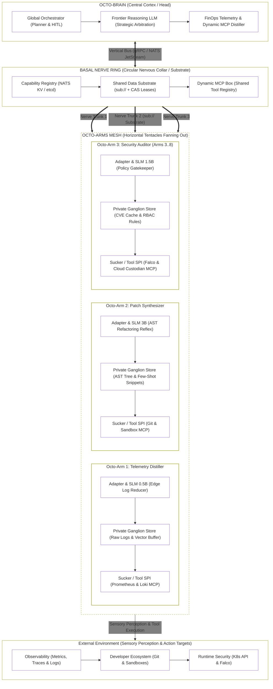
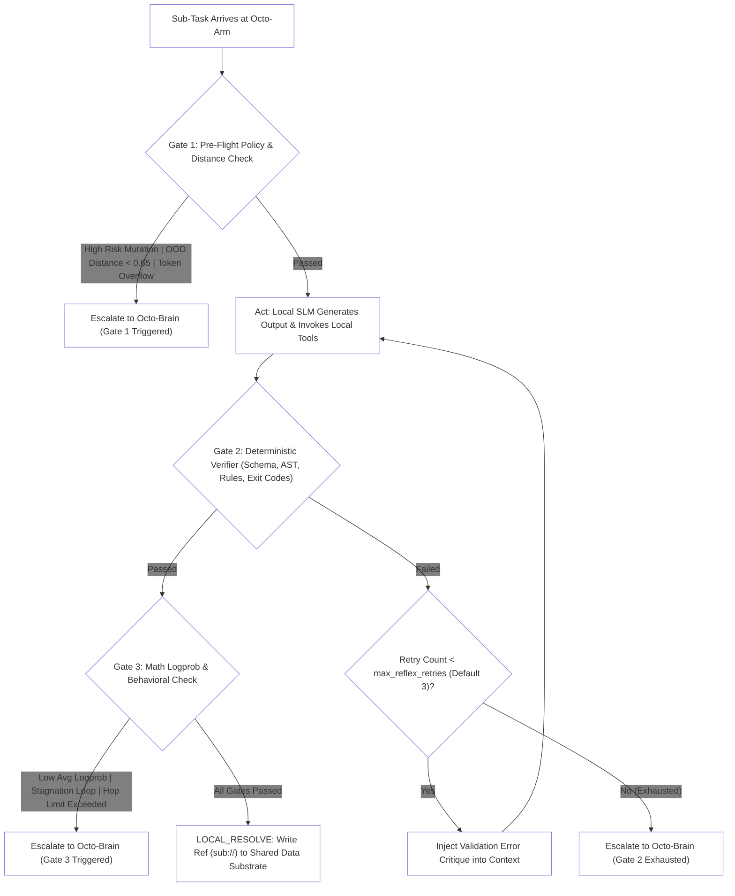
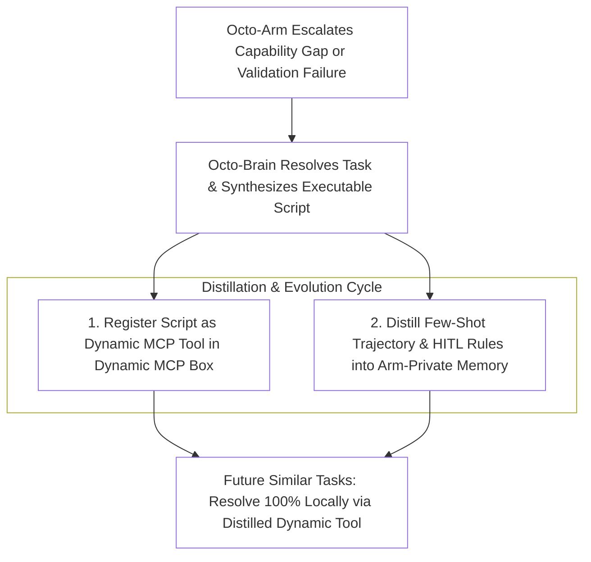

# Octpex

<p align="center">
  <strong>Biomimetic Distributed Cognitive Topology & Self-Evolving Edge-Cloud Agent Fabric</strong>
</p>

<p align="center">
  <a href="LICENSE"></a>
  <a href="README_CN.md"></a>
  <a href="docs/PRD.md"></a>
  <a href="docs/ARCHITECTURE.md"></a>
  <a href="docs/k8s_multi_agent_guide.md"></a>
</p>

---

## Table of Contents

1. [Vision & Strategic Overview](#vision--strategic-overview)
2. [Why Biomimetic Architecture? (Octopus Topology)](#why-biomimetic-architecture-octopus-topology)
3. [Core Pain Points & Solutions](#core-pain-points--solutions)
4. [System Architecture & Topology](#system-architecture--topology)
5. [Objective Escalation Funnel (Zero-Trust in SLM Self-Assessment)](#objective-escalation-funnel-zero-trust-in-slm-self-assessment)
6. [Cross-Tier Self-Evolution: Brain-to-Arm & Dynamic MCP](#cross-tier-self-evolution-brain-to-arm--dynamic-mcp)
7. [Collaboration Patterns & Ecosystem Interoperability](#collaboration-patterns--ecosystem-interoperability)
8. [Core SPI Contracts](#core-spi-contracts)
9. [Security Governance & Edge Resilience](#security-governance--edge-resilience)
10. [Deployment Profiles & Core Feature Architecture](#deployment-profiles--core-feature-architecture)
11. [Documentation Index](#documentation-index)

---

## Vision & Strategic Overview

**Octpex** is designed to make production-grade multi-agent systems economically sustainable, ultra-responsive, and continuously self-evolving.

* **What Octpex IS:** A domain-agnostic **Distributed Cognitive Fabric & Scheduling Runtime** that coordinates autonomous edge workers (**Octo-Arms** running local Small Language Models) through a shared coordination substrate (**Basal Nerve Ring**) under the strategic oversight of a central reasoning model (**Octo-Brain**).
* **What Octpex IS NOT:** Octpex is **not** another single-process agent orchestration SDK (such as LangGraph, Google ADK, or CrewAI), nor is it an operating system/container isolation sandbox (such as AbloEx). Instead, Octpex serves as the **distributed nervous system** that wraps existing single-node agents, routes collaborative workloads across heterogeneous runtimes, offloads 70%–85% of routine inference, and delegates privileged actions to pluggable sandboxes.

---

## Why Biomimetic Architecture? (Octopus Topology)

In nature, cephalopods (octopuses) exhibit remarkable decentralized intelligence:
* **Two-thirds of an octopus's neurons reside in its arms**, enabling autonomous sensory perception, pattern recognition, and localized motor reflexes without brain intervention;
* **The central brain focuses on high-level strategy and cross-arm coordination**, remaining unburdened by routine suction-cup movements.

Octpex strictly mirrors this biomimetic principle:
* **Octo-Brain (Central Cortex):** Powered by frontier cloud LLMs, focused exclusively on global intent decomposition, cross-domain conflict arbitration, deep reasoning, and dynamic tool synthesis.
* **Basal Nerve Ring (Shared Coordination Substrate):** A distributed control and working memory ring managing dynamic capability discovery, pass-by-reference Shared Data Substrate state, and peer-to-peer lateral signaling.
* **Octo-Arms (Edge Ganglia):** Distributed worker nodes equipped with an **Arm-Private Data Store**, local Small Language Models (SLMs, 0.5B–3B), and embedded vector memory, resolving routine tasks through localized `Act -> Inspect -> Retry` reflex loops.

---

## Core Pain Points & Solutions

| Core Pain Point | Root Cause in Monolithic Architectures | How Octpex Solves It |
| :--- | :--- | :--- |
| **Token Inference Cost Explosion** | Routine steps (log deduplication, JSON formatting, API parameter retries) invoke expensive cloud LLMs, wasting up to 80% of token budgets. | **Edge Offloading & Distillation:** Local 0.5B–3B SLMs inside Octo-Arms resolve 70%–85% of high-frequency tasks locally at near-zero marginal cost. |
| **Excessive End-to-End Latency** | Multi-hop public API reasoning loops accumulate 5–30 seconds of latency per workflow, violating real-time production SLAs. | **Intra-Arm Reflex & Lateral Bus:** Sub-second ($<800\text{ ms}$) local reflex cycles and direct peer-to-peer lateral handoffs ($<15\text{ ms}$) eliminate central round-trips. |
| **Context Window Bloat & Hallucination** | Dumping raw multi-page logs or database tables into LLMs impairs reasoning, while SLMs fail silently when asked to assess their own certainty. | **Two-Tier Storage & Hard Gates:** Raw sensitive data stays in Arm-private storage; cross-node collaboration uses lightweight `sub://` references over the Shared Data Substrate. |
| **Static Tooling & Framework Silos** | Heterogeneous agent frameworks (Go, ADK, LangGraph) operate in silos, unable to share discovered tools or learn from past escalations. | **Basal Nerve Ring & Dynamic MCP:** Central resolutions are synthesized into standardized dynamic MCP tools and broadcast for local reuse. |

---

## System Architecture & Topology



---

## Objective Escalation Funnel (Zero-Trust in SLM Self-Assessment)

> **Engineering Principle:** Never trust an edge SLM (0.5B–3B) to evaluate its own certainty. All escalation boundaries are strictly enforced by host runtime code through objective gates.



---

## Cross-Tier Self-Evolution: Brain-to-Arm & Dynamic MCP



* **Closed-Loop Distillation:** When Brain resolves an escalation, it synthesizes an executable script and publishes it as a standard tool in the **Dynamic MCP Box**;
* **Autonomous Scaling:** Over time, the Local Offload Rate climbs naturally from 75% to 85%–90%+, continuously driving down cloud LLM token expenses.

---

## Collaboration Patterns & Ecosystem Interoperability

### Canonical Collaboration Patterns
1. **Coordinator Pattern:** `Octo-Brain` decomposes high-level requests into parallel sub-tasks fanned out by capability tags, synthesizing final results.
2. **Sequential Pattern:** `Octo-Arms` execute pipelined handoffs over the Lateral Bus (`Arm A -> Arm B -> Arm C`) via lightweight Shared Data Substrate URIs (`sub://`) without central round-trips.
3. **Iterative Refinement Pattern:** Supports intra-arm reflex loops (`Generator SLM -> Deterministic Critic -> Retry`) and inter-arm peer critiques.
4. **Human-in-the-Loop (HITL):** Suspends execution on high-risk actions, emitting structured review requests and persisting human feedback as permanent local constraints.

### Multi-Framework Ecosystem Integration

| Framework / Protocol | Layer | Integration Role & Architecture Value |
| :--- | :--- | :--- |
| **LangGraph** | Macro Orchestration / Arm Runtime | Drives cyclic state graphs with native `interrupt()` at Brain level, or encapsulates complex subgraphs within single Arms. |
| **Google ADK** | Arm Runtime | Seamlessly wraps Go/Python ADK agents as distributed Octo-Arms via `ArmRuntimeAdapterSPI`. |
| **Microsoft AutoGen / Semantic Kernel** | Arm Runtime | Mounts multi-agent debate groups or enterprise semantic connectors onto the capability bus. |
| **CrewAI** | Arm Runtime | Wraps role-playing teams as domain-specific edge workers exchanging intermediate state through the Shared Data Substrate. |
| **Temporal** | Macro Durability | Provides event-sourced persistence for mission-critical, long-running enterprise workflows. |
| **Model Context Protocol (MCP)** | Protocol & Tooling | Native first-class support for standard static and dynamically synthesized tools. |
| **AbloEx** | Security & Sandboxing | Sister sandbox project providing hardware-grade MicroVM/container isolation for privileged tools. |

---

## Core SPI Contracts

### Pluggable Core SPIs
* **`GlobalOrchestratorSPI`**: Macro task decomposition, Coordinator fan-out, and HITL suspension.
* **`ArmRuntimeAdapterSPI`**: Non-invasive adapter wrapping ADK, LangGraph, AutoGen, CrewAI, or native Go/Python FSMs.
* **`SLMInferenceSPI`**: Unified local SLM execution (Ollama, llama.cpp, vLLM) with critical token logprob extraction.
* **`DataSubstrateSPI`**: CAS-versioned pass-by-reference working memory with distributed TTL leases.
* **`ToolInvocationSPI`**: Standardized invocation layer for static/dynamic MCP tools and security sandboxes.

---

## Security Governance & Edge Resilience

* **Dynamic Tool AST Scanning & Micro-Sandboxing:** Synthesized scripts undergo AST security scanning before entering Dynamic MCP Box and execute inside CPU/memory-capped micro-sandboxes.
* **Zero-Trust Scoping & Token Attenuation:** Shared Data Substrate leases are scoped to session IDs; permission sets monotonically attenuate with each lateral hop.
* **Air-Gapped & Offline Edge Resilience:** Edge arms switch to autonomous degradation if central connectivity is lost. Escalation-bound tasks are durably queued locally or routed to on-site human operators, never executed unverified.

---

## Deployment Profiles & Core Feature Architecture

### Supported Profiles
* **Standalone / Developer (`profile: local`):** Runs on a single workstation without cluster services using local SLMs (Ollama) and in-memory Data Substrate/Registry.
* **Distributed / Enterprise (`profile: cluster`):** Employs NATS JetStream and Redis/Valkey to scale horizontally across Kubernetes and edge servers.

### CLI Quick Commands
```bash
octpex run       # Boot the nervous daemon (default, -profile=local|cluster, -port=8080)
octpex eval      # Execute automated kernel self-diagnostics & verification
octpex bench     # Run high-throughput performance & latency stress benchmarks (>2M ops/s)
octpex finops    # Display FinOps cost reduction & token ROI audit report
octpex version   # Display version and architecture information
```

### Core Capabilities & Production Features
1. **Single-Node Biomimetic Kernel (`profile: local`):**
   * Zero-external-dependency execution loop with In-Memory Substrate (CAS versioning) and Local Nervous Bus.
   * Full spectrum Arm adapters: Level 0 (Deterministic Go FSM, 0 tokens, <2ms) and Level 1 (Edge SLM Ganglion via Ollama).
   * Tri-Gate Objective Escalation Funnel (Pre-flight Gate 1, Schema/AST Gate 2, Math Logprob/Loop Detection Gate 3).
   * Octo-Brain central cortex with Frontier LLM provider integration, DAG task planning, and FinOps telemetry logger.
2. **Enterprise Distributed Cluster (`profile: cluster`):**
   * NATS JetStream dual-plane bus (`vertical.dispatch.*` and `lateral.handoff.*`) with queue group load balancing.
   * Redis/Valkey atomic Compare-And-Swap (CAS) Shared Data Substrate (`sub://`) with distributed TTL leases.
   * etcd Basal Nerve Ring registry with 5-second lease heartbeats and automatic fault eviction.
   * Multi-region cross-cluster federation router (`pkg/ring/federation.go`) with inter-cluster hop attenuation.
3. **Multi-Framework Ecosystem & Python SDK (`octpex-sdk`):**
   * Native production wrappers for **Google ADK**, **LangGraph**, **Microsoft AutoGen**, and **CrewAI**.
   * `OctoArmDaemon` for running Python Arm workers as standalone services communicating via REST APIs.
   * Runnable 4-tier heterogeneous multi-agent mesh example (`examples/python_heterogeneous_mesh/`).
   * 5-arm collaborative blog research, drafting, multi-round critique & publishing mesh (`examples/blog_publish_mesh/`).
4. **Self-Evolution & Dynamic MCP Tool Box:**
   * "Brain teaches Arm" capability distillation loop: automatic tool synthesis upon central escalation.
   * Standard Model Context Protocol (MCP 2024-11-05) client over `stdio` and streaming HTTP/SSE.
   * AbloEx pre-admission static AST security scanning and resource-quota micro-sandboxing.
5. **Real-Time Visual Dashboard & FinOps Auditing:**
   * Embedded asynchronous HTTP dashboard with live Server-Sent Events (SSE: `/api/v1/events`) pulse stream.
   * REST APIs for topology discovery, task dispatching, and FinOps token ROI audit reporting.
   * Proven throughput: **9.6M+ CAS ops/s**, **8.1M+ bus msgs/s**, and **1.6M+ gate verifications/s**.
6. **Cloud-Native Deployment & Enterprise Helm Packaging:**
   * 25MB production multi-stage Docker image, full Docker Compose stack, and raw Kubernetes manifests.
   * Production Helm v3 Chart (`deploy/helm/octpex`) with Horizontal Pod Autoscaling (HPA) and health probes.

---

## Documentation Index

### Core Architecture & Specifications
* [System Architecture Specification](docs/ARCHITECTURE.md)
* [Product Requirements Document (PRD)](docs/PRD.md)

### Developer & Operational Guides
* [Comprehensive Developer & Integration Guide](docs/developer_guide.md)
* [Comprehensive Deployment & Operations Guide](docs/deployment_guide.md)
* [Kubernetes Multi-Agent Zero-to-One Deployment Guide](docs/k8s_multi_agent_guide.md)

### Multi-Language Documentation
* For Chinese documentation and architecture specifications, please refer to [README_CN.md](README_CN.md).

---

## License

This project is licensed under the [Apache License 2.0](LICENSE).
