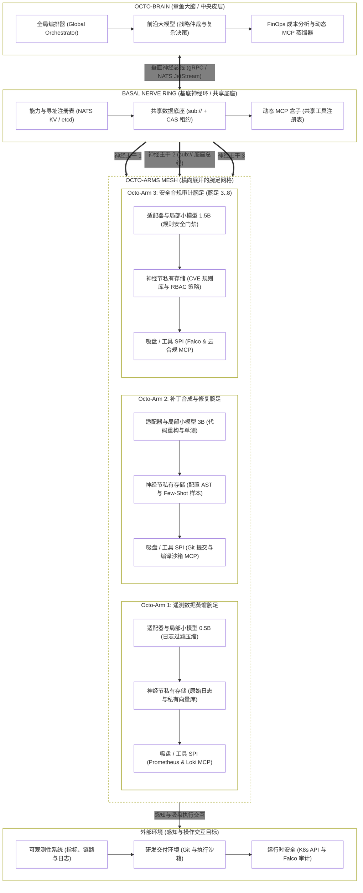
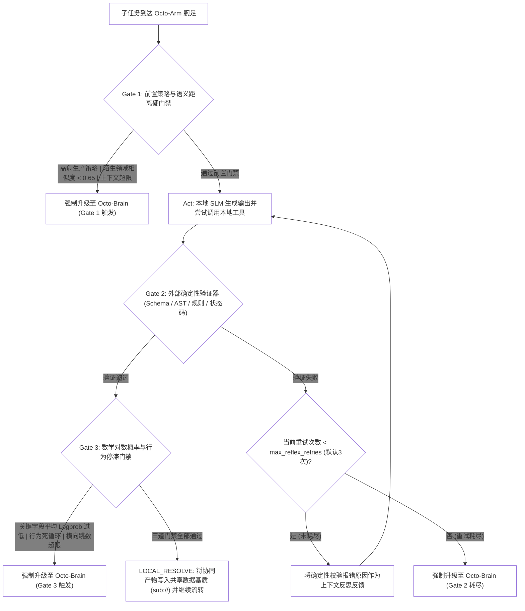
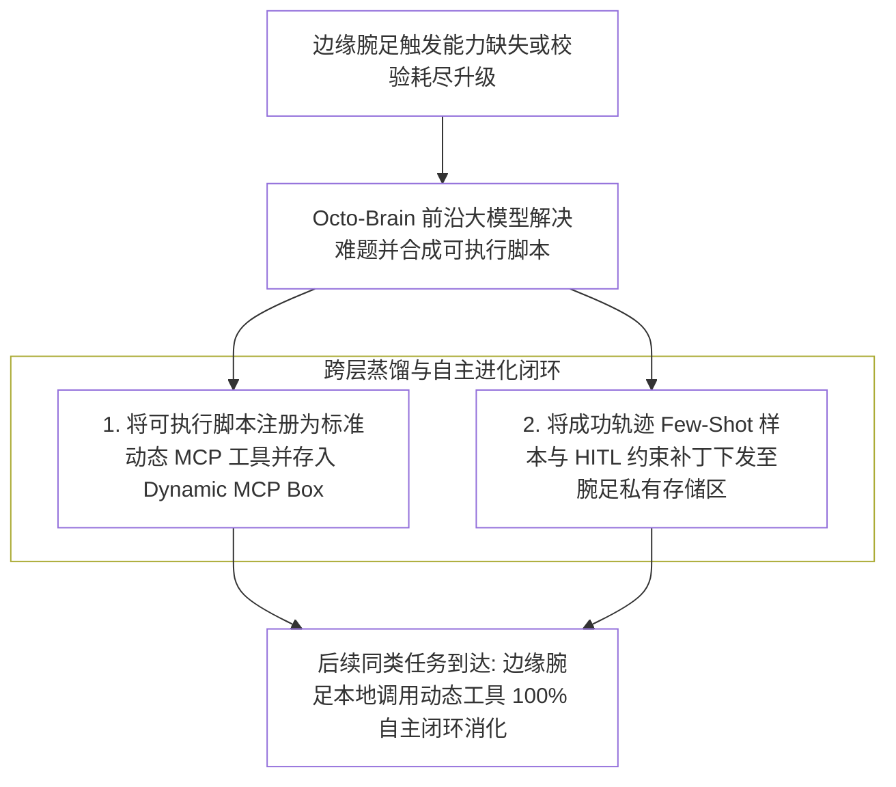

# Octpex

<p align="center">
  <strong>仿生分布式认知拓扑与自我进化的端云协同智能体底座</strong><br>
  <em>Biomimetic Distributed Cognitive Topology & Self-Evolving Edge-Cloud Agent Fabric</em>
</p>

<p align="center">
  <a href="LICENSE"></a>
  <a href="README.md"></a>
  <a href="docs/PRD_CN.md"></a>
  <a href="docs/PRD.md"></a>
  <a href="docs/ARCHITECTURE_CN.md"></a>
  <a href="docs/ARCHITECTURE.md"></a>
</p>

---

## 目录

1. [项目愿景与背景](#项目愿景与背景)
2. [为什么是仿生架构？（章鱼拓扑启发）](#为什么是仿生架构章鱼拓扑启发)
3. [核心痛点与破局之道](#核心痛点与破局之道)
4. [系统整体拓扑架构](#系统整体拓扑架构)
5. [三道门禁客观升级漏斗（零信任小模型自评）](#三道门禁客观升级漏斗零信任小模型自评)
6. [跨层自进化：“大脑教腕足”与 Dynamic MCP](#跨层自进化大脑教腕足与-dynamic-mcp)
7. [多智能体协作范式与多框架生态](#多智能体协作范式与多框架生态)
8. [核心 SPI 契约规范](#核心-spi-契约规范)
9. [安全治理与离线韧性](#安全治理与离线韧性)
10. [双模部署支持与核心特性架构](#双模部署支持与核心特性架构)
11. [文档索引](#文档索引)

---

## 项目愿景与背景

**Octpex** 旨在让企业级多智能体系统（Multi-Agent Systems）在经济成本上可持续、在响应速度上达到亚秒级、在能力上具备持续自我进化特性。

* **Octpex 是什么：** 一个领域无关的**分布式认知调度底座与运行时（Distributed Cognitive Fabric & Scheduling Runtime）**。它通过共享协调神经环（**Basal Nerve Ring**），在顶层中枢推理模型（**Octo-Brain**）的统筹下，调度海量搭载本地小模型（SLM, 0.5B–3B）的自主边缘执行节点（**Octo-Arms**）。
* **Octpex 不是什么：** Octpex **不是**单机/单进程 Agent 编排 SDK（如 LangGraph、Google ADK 或 CrewAI），也**不是**底层容器隔离沙盒（如 AbloEx）。它充当连接异构智能体的**“分布式神经系统”**，跨节点路由协同任务，就地消化 70%–85% 的常规低阶推理，并将高危工具执行委托给可插拔安全沙盒。

---

## 为什么是仿生架构？（章鱼拓扑启发）

自然界中，头足类生物（章鱼）拥有极高智慧，但其神经结构与哺乳动物迥然不同：
* **三分之二的神经元分布在八条腕足中**，每条腕足都具备独立的触觉感知、模式识别与反射运动能力；
* **中枢大脑专注于高层战略意图与多腕足协调**，绝不事无巨细地指挥腕足的每一个触手动作。

Octpex 严格仿生这一自然进化奇迹：
* **Octo-Brain（中枢大脑）：** 采用前沿云端大模型，专注全局意图分解、跨领域冲突仲裁、疑难任务攻坚与动态代码合成。
* **Basal Nerve Ring（腕足根部神经环）：** 轻量级分布式控制与协同记忆层，负责动态能力发现、引用传递式共享数据基质（Shared Data Substrate）与节点间横向通信。
* **Octo-Arms（边缘腕足）：** 边缘工作节点，配备**腕足私有数据区**与本地小模型（0.5B–3B），通过 `Act -> Inspect -> Retry` 局部自愈微循环就地消化常规任务。

---

## 核心痛点与破局之道

| 核心痛点 | 传统中心化 Agent 架构根源 | Octpex 仿生破局之道 |
| :--- | :--- | :--- |
| **Token 推理成本爆炸** | 日志去噪、格式转换、API 重试等琐碎步骤全调云端大模型，80% 预算被低价值调用浪费。 | **边缘分流与数据蒸馏：** 腕足内置 0.5B–3B SLM，零边际成本就地消化 70%–85% 高频任务。 |
| **端到端响应延迟过高** | 多轮公网 API 思考循环累积 5–30 秒延迟，无法满足实时生产 SLA。 | **局部反思微循环与横向总线：** $<800\text{ ms}$ 本地自愈闭环，腕足间点对点总线交接 $<15\text{ ms}$。 |
| **上下文污染与小模型盲目自信** | 原始日志或数据库多表直接塞入大模型引发幻觉；小模型对陌生问题极易盲目自信。 | **两级数据存储与客观门禁：** 腕足私有区隔离高频敏感原始数据；跨节点协作通过共享数据基质传输轻量指针（`sub://`）。 |
| **工具静态僵化与框架孤岛** | 跨团队 Agent（Go/ADK/LangGraph）技术栈割裂，历史经验与新工具无法沉淀共享。 | **根部神经环与动态 MCP 蒸馏：** 大脑解决的难题自动合成动态 MCP 工具广播全网复用。 |

---

## 系统整体拓扑架构



---

## 三道门禁客观升级漏斗（零信任小模型自评）

> **工程原则：** 永远不要相信本地小模型（0.5B–3B）对自己输出置信度的主观打分。所有升级决策由宿主运行时代码通过确定性客观硬门禁强制裁决。



---

## 跨层自进化：“大脑教腕足”与 Dynamic MCP



* **闭环沉淀：** 大脑解决问题不仅返回答案，还合成标准化 MCP 脚本存入 **Dynamic MCP Box**；
* **复用递增：** 随着系统运行时间增加，本地消化率（Local Offload Rate）从最初的 75% 逐步自然攀升至 85%–90% 以上。

---

## 多智能体协作范式与多框架生态

### 四大原生支持的协作范式
1. **协调器模式（Coordinator Pattern）：** `Octo-Brain` 宏观分解任务，按能力标签并发扇出给多条 `Octo-Arm`，并汇总终局结果。
2. **顺序流水线（Sequential Pattern）：** 腕足间在横向总线上进行点对点接力（`Arm A -> Arm B -> Arm C`），仅传递共享数据基质引用指针（`sub://`），不绕行中枢。
3. **迭代优化模式（Iterative Refinement Pattern）：** 支持腕足内部“生成 $\rightarrow$ 校验器批评 $\rightarrow$ 重试”微循环，以及跨腕足“生成节点 $\leftrightarrow$ 评判节点”对抗闭环。
4. **人机协同模式（Human-in-the-Loop, HITL）：** 高危操作触发拦截后状态机安全挂起，人类审批反馈永久沉淀为腕足的局部硬规则。

### 多框架生态兼容矩阵

| 框架 / 协议 | 对应层级 | 集成角色与价值 |
| :--- | :--- | :--- |
| **LangGraph** | 全局编排层 / 腕足运行时 | 作为全局带环状态机驱动 Brain，或封装为复杂的单腕足子图。 |
| **Google ADK** | 腕足运行时 | 快速将 Go/Python ADK 智能体包装为分布式 Octo-Arm 执行单元。 |
| **AutoGen / Semantic Kernel** | 腕足运行时 | 挂载多智能体讨论辩论组或企业级语义插件节点。 |
| **CrewAI** | 腕足运行时 | 封装角色扮演团队，通过共享数据基质交换产物。 |
| **Temporal** | 宏观编排持久化 | 为跨天级企业复杂工作流提供事件溯源与状态容灾。 |
| **Model Context Protocol (MCP)** | 工具与协议交互层 | 原生一等公民支持外部工具与动态生成工具的标准化调用。 |
| **AbloEx** | 安全与沙盒隔离层 | 承接高危指令与动态合成代码的微沙盒硬件级隔离执行。 |

---

## 核心 SPI 契约规范

### 五大核心服务提供者接口 (SPI)
* **`GlobalOrchestratorSPI`**：全局规划、协调器扇出与 HITL 挂起。
* **`ArmRuntimeAdapterSPI`**：非侵入式包装 ADK、LangGraph、原生 FSM 的腕足运行环境。
* **`SLMInferenceSPI`**：统一本地推理后端（Ollama / llama.cpp / vLLM）并提供关键字段 Logprob 提取。
* **`DataSubstrateSPI`**：支持 CAS 乐观锁版本控制与分布式租约的引用传递共享数据基质。
* **`ToolInvocationSPI`**：统一静态与动态 MCP 工具调用及安全沙盒隔离接口。

---

## 安全治理与离线韧性

* **动态工具静态 AST 扫描与微沙盒：** 动态代码执行前必经语法树安全审查，运行在受限微容器/Wasm 沙盒中，强限内存与 CPU 配额。
* **零信任与权限逐跳衰减：** 共享数据基质访问按 `session_id` 鉴权；横向总线多跳接力时权限随 `hop_count` 递增而单调收敛。
* **断网自治与离线降级：** 纵向总线失联时边缘腕足切入断网模式，凡命中 Gate 1/Gate 2 升级请求严格挂起存入本地 WAL 队列或转就地人工排队，绝不盲目放行。

---

## 双模部署支持与核心特性架构

### 双模部署支持
* **单机开发模式（`profile: local`）：** 零集群依赖，单机工作站运行本地小模型运行时（Ollama），配合内存共享数据基质与进程内注册表，适合敏捷开发与原型验证。
* **企业集群模式（`profile: cluster`）：** 基于 NATS JetStream 双平面总线与 Redis/Valkey 分布式共享数据基质，跨 Kubernetes 与边缘服务器弹性调度海量异构腕足。

### 命令行快速指令 (CLI)
```bash
octpex run       # 启动神经底座守护进程 (默认, 支持 -profile=local|cluster, -port=8080)
octpex eval      # 执行全内核自检与子系统连通性核验
octpex bench     # 执行超高吞吐性能与微秒级延迟基准压测 (>200万 ops/s)
octpex finops    # 输出 FinOps 财务降本与 Token ROI 审计分析报表
octpex version   # 查看当前内核版本与运行架构信息
```

### 核心系统特性与生产级能力矩阵
1. **单机极速仿生内核（`profile: local`）：**
   * 零外部集群依赖，提供纯内存原子 CAS 数据基质与本地双平面神经总线。
   * 完整支持全谱系智能适配：Level 0（Go 原生确定性 FSM，0 Token，< 2ms）与 Level 1（基于 Ollama 的边缘小模型本地反思闭环）。
   * 三道客观升级漏斗（前置策略 Gate 1、确定性 Schema/AST Gate 2、数学对数概率与防死循环 Gate 3）。
   * 中心大脑（Octo-Brain）对接前沿 LLM 服务，提供确定性 DAG 任务规划与 FinOps 财务遥测引擎。
2. **企业分布式集群中枢（`profile: cluster`）：**
   * 基于 NATS JetStream 构建双平面总线（纵向派发 `vertical.dispatch.*` 与横向接力 `lateral.handoff.*`），带消费组弹性负载均衡。
   * 基于 Redis/Valkey Lua 脚本实现原子 CAS 版本控制的分布式共享数据基质（`sub://`），带分布式 TTL 租约。
   * etcd 基底神经环注册表，5 秒租约心跳，节点故障秒级感知并自动踢出。
   * 跨地域多集群联邦路由中枢（`pkg/ring/federation.go`），支持跨数据中心信封流转与权限单调衰减。
3. **异构多框架生态与 Python SDK（`octpex-sdk`）：**
   * 原生提供 **Google ADK**、**LangGraph**、**Microsoft AutoGen** 与 **CrewAI** 官方生产级适配包装器。
   * 提供 `OctoArmDaemon`，支持将 Python 智能体作为常驻独立进程运行，通过 REST 接口与 Go 内核握手。
   * 包含开箱即用的四层异构多智能体同级接力实战示例（`examples/python_heterogeneous_mesh/`）。
4. **跨层级自进化与动态 MCP 工具箱：**
   * “大脑教腕足”能力蒸馏闭环：腕足遇到难题升级后，中枢大脑动态合成代码工具并注入基底神经环。
   * 完整支持标准模型上下文协议（MCP 2024-11-05），支持 `stdio` 与流式 HTTP/SSE 客户端。
   * AbloEx 静态 AST 语法树安全扫描审查，结合配额微沙盒实施硬安全隔离。
5. **实时动态看板与微秒级极速压测：**
   * 嵌入式 HTTP 服务内置实时 Server-Sent Events（SSE: `/api/v1/events`）脉冲流，单页 Web 动态看板免刷新呈现集群脉冲。
   * 完备的 REST API：拓扑感知、任务直接派发与 FinOps 审计报表输出。
   * 经实测验证的微秒级吞吐：**基质 CAS > 960 万 ops/s**、**总线信封 > 810 万 msgs/s**、**门禁核验 > 160 万 ops/s**。
6. **云原生敏捷交付与企业级 Helm 生产包：**
   * 25MB 极简生产级多阶段 Dockerfile、一键拉起全集群依赖的 Docker Compose 配置与 K8s 清单。
   * 企业级 Helm v3 Chart 生产包（`deploy/helm/octpex`），内置水平弹性伸缩（HPA）与存活/就绪健康探针。

---

## 文档索引

### 核心架构与产品规范
* [系统架构规范 (中文版)](docs/ARCHITECTURE_CN.md)
* [System Architecture Specification (English)](docs/ARCHITECTURE.md)
* [产品需求文档 (中文版)](docs/PRD_CN.md)
* [Product Requirements Document (English)](docs/PRD.md)

### 开发者实战与集群运维指南
* [开发者与生态集成综合指南 (中文版)](docs/developer_guide_cn.md)
* [Comprehensive Developer & Integration Guide (English)](docs/developer_guide.md)
* [部署运维与业务实战指南 (中文版)](docs/deployment_guide_cn.md)
* [Comprehensive Deployment & Operations Guide (English)](docs/deployment_guide.md)
* [English README (README.md)](README.md)

---

## 开源许可证

本项目基于 [Apache License 2.0](LICENSE) 协议开源。
