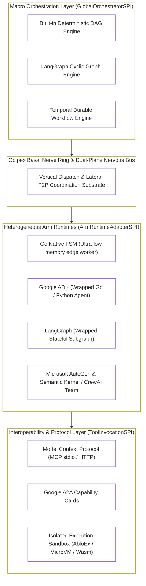
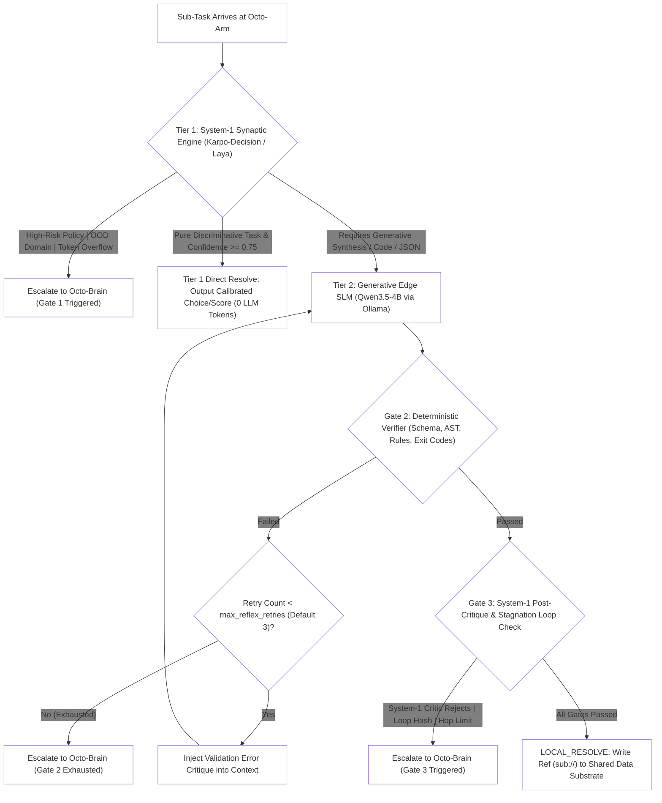
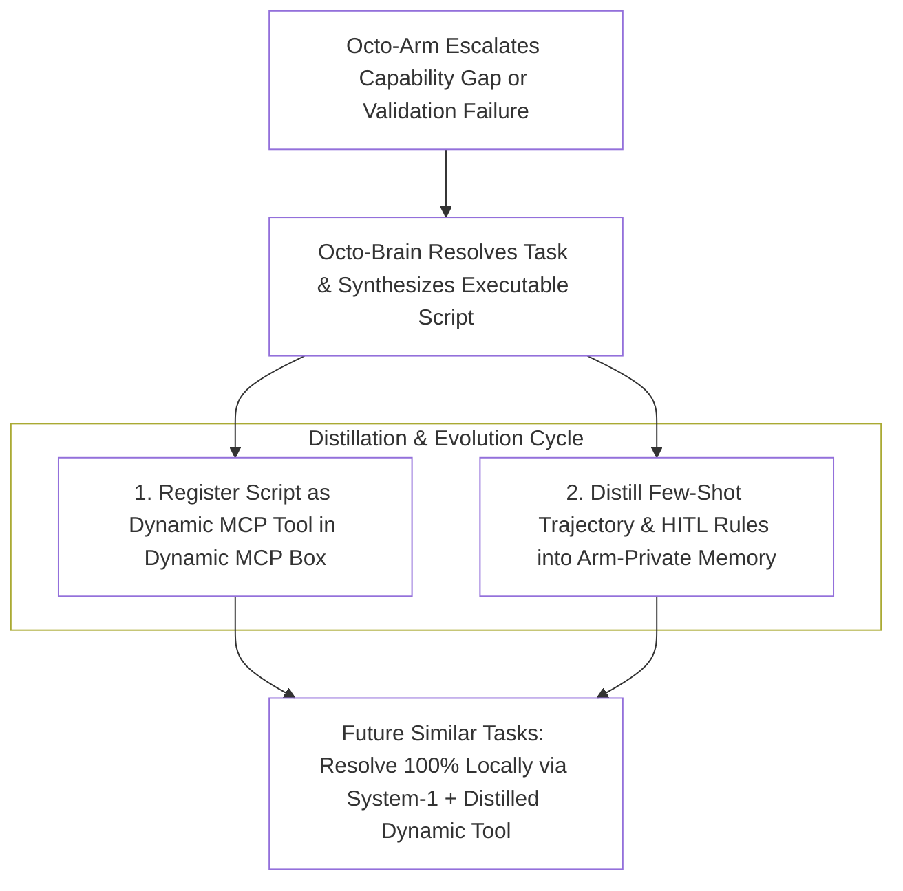

# System Architecture & Engineering Specification: Octpex

**Document Version:** 2.2.0  
**Scope:** Biomimetic Topology, Multi-Framework Ecosystem Integration, Three-Tier Cognitive Escalation Ladder, Hardware-Aware System-1 Decision Engine, Data Contracts, SPI Specifications, and Security Governance  

---

## 1. Biomimetic System Topology

Octpex organizes distributed intelligence into three structural tiers modeled after cephalopod neurobiology: **Octo-Brain (Central Cortex)**, **Basal Nerve Ring (Shared Coordination Substrate)**, and **Octo-Arms (Edge Ganglia)**. Each Octo-Arm integrates a **System-1 Non-Autoregressive Decision Engine** (`Karpo-Decision` / `Laya`) alongside a **System-2 Generative SLM** (`Qwen3.5-4B` / `1.5B`).

```mermaid
%%{init: {
  "themeVariables": {
    "background": "transparent",
    "mainBkg": "transparent",
    "subGraphBkg": "transparent",
    "clusterBkg": "transparent",
    "edgeLabelBackground": "transparent"
  },
  "themeCSS": ".edgeLabel, .edgeLabel span, .edgeLabel div { background-color: transparent !important; } .edgeLabel rect { fill: transparent !important; opacity: 0 !important; }"
}}%%
flowchart TD
    classDef default fill:none;

    %% 1. OCTO-BRAIN (THE HEAD: WIDE & HORIZONTAL)
    subgraph BRAIN["OCTO-BRAIN (Central Cortex / Head)"]
        direction LR
        B_ORCH["Global Orchestrator (Planner & HITL)"] --> B_CORE["Frontier Reasoning LLM (Strategic Arbitration)"] --> B_FINOPS["FinOps Telemetry & Dynamic MCP Distiller"]
    end

    %% 2. BASAL NERVE RING (THE COLLAR SUBSTRATE: WIDE & HORIZONTAL)
    subgraph RING["BASAL NERVE RING (Circular Nervous Collar / Substrate)"]
        direction LR
        RING_REG["Capability Registry (NATS KV / etcd)"] --> RING_SUB["Shared Data Substrate (sub:// + CAS Leases)"] --> RING_BOX["Dynamic MCP Box (Shared Tool Registry)"]
    end

    %% Central Vertical Nervous Bus connects Head to Collar
    BRAIN <==>|"Vertical Bus (gRPC / NATS JetStream)"| RING

    %% 3. OCTO-ARMS (HORIZONTAL TENTACLES: 3 DISTINCT SPECIALIZED ARMS IN SOLID BOXES)
    subgraph ARMS_LAYER["OCTO-ARMS MESH (Horizontal Tentacles Fanning Out)"]
        direction LR

        %% Left Arm: Telemetry & Log Distiller
        subgraph ARM1["Octo-Arm 1: Telemetry Distiller"]
            direction TB
            A1_SYS1["System-1 Synaptic Engine (Laya / Karpo-2B)"]
            A1_CORE["System-2 Generative SLM (Qwen3.5-4B Reducer)"]
            A1_PRIV["Private Ganglion Store (Raw Logs & Vector Buffer)"]
            A1_TOOL["Sucker / Tool SPI (Prometheus & Loki MCP)"]
            A1_SYS1 --> A1_CORE --> A1_PRIV --> A1_TOOL
        end

        %% Middle Arm: Code & Patch Synthesizer
        subgraph ARM2["Octo-Arm 2: Patch Synthesizer"]
            direction TB
            A2_SYS1["System-1 Synaptic Engine (Karpo-2B / Laya)"]
            A2_CORE["System-2 Generative SLM (Qwen3.5-4B AST Reflex)"]
            A2_PRIV["Private Ganglion Store (AST Tree & Few-Shot Snippets)"]
            A2_TOOL["Sucker / Tool SPI (Git & Sandbox MCP)"]
            A2_SYS1 --> A2_CORE --> A2_PRIV --> A2_TOOL
        end

        %% Right Arm: Security & Policy Auditor (Representative of Arms 3..8)
        subgraph ARM3["Octo-Arm 3: Security Auditor (Arms 3..8)"]
            direction TB
            A3_SYS1["System-1 Direct Executor (Karpo-2B Readout)"]
            A3_CORE["System-2 Generative SLM (Optional Explanation)"]
            A3_PRIV["Private Ganglion Store (CVE Cache & RBAC Rules)"]
            A3_TOOL["Sucker / Tool SPI (Falco & Cloud Custodian MCP)"]
            A3_SYS1 --> A3_CORE --> A3_PRIV --> A3_TOOL
        end
    end

    %% 3 Dedicated Nerve Trunks down to the Arms Mesh (Trunk 1, Trunk 2, Trunk 3)
    RING ==>|"Nerve Trunk 1"| ARMS_LAYER
    RING ==>|"Nerve Trunk 2 (sub:// Substrate)"| ARMS_LAYER
    RING ==>|"Nerve Trunk 3"| ARMS_LAYER

    %% 4. EXTERNAL ENVIRONMENT & SUCKERS INTERACTION (BOTTOM TARGETS)
    subgraph ENV["External Environment (Sensory Perception & Action Targets)"]
        direction LR
        ENV_OBS["Observability (Metrics, Traces & Logs)"] --> ENV_DEV["Developer Ecosystem (Git & Sandboxes)"] --> ENV_SEC["Runtime Security (K8s API & Falco)"]
    end

    %% Arms Mesh connects cleanly to Environment container
    ARMS_LAYER -->|"Sensory Perception & Tool Execution"| ENV

    style BRAIN fill:none;
    style RING fill:none;
    style ARMS_LAYER fill:none,stroke-dasharray: 4 4;
    style ARM1 fill:none,stroke-width:1.5px;
    style ARM2 fill:none,stroke-width:1.5px;
    style ARM3 fill:none,stroke-width:1.5px;
    style ENV fill:none;
```



---

## 2. Multi-Framework Ecosystem Integration

Octpex is designed as an **unopinionated distributed agent fabric** rather than a monolithic single-process SDK. Through three standardized extension layers, existing agent frameworks embed cleanly into Octpex without rewriting domain logic:



### Integration Mapping Table

| Ecosystem Framework | Integration Layer | Integration Mechanism & Architectural Value |
| :--- | :--- | :--- |
| **LangGraph** | `GlobalOrchestratorSPI` or `ArmRuntimeAdapterSPI` | Mounts complex cyclic state machines with native `interrupt()` HITL checkpoints at the Brain level, or wraps existing LangGraph subgraphs as specialized edge Arms. |
| **Google ADK (Go / Python)** | `ArmRuntimeAdapterSPI` | Wraps lightweight ADK agents inside Octo-Arms, pairing ADK's tool/session abstractions with Octpex's local System-1/System-2 reflex loop and Basal Nerve Ring discovery. |
| **Microsoft AutoGen / Semantic Kernel / Agent Framework** | `ArmRuntimeAdapterSPI` | Encapsulates multi-turn debate/critic groups or enterprise .NET/Python semantic plugins as a single capability-registered Octo-Arm on the bus. |
| **CrewAI** | `ArmRuntimeAdapterSPI` | Mounts role-playing task crews as domain-specific edge ganglia while offloading cross-crew routing and state sharing to the Shared Data Substrate. |
| **Temporal** | `GlobalOrchestratorSPI` | Backs `Octo-Brain` with durable event-sourced execution for long-running, mission-critical financial or supply-chain workflows. |
| **MCP & Google A2A** | `ToolInvocationSPI` & `CapabilityRegistry` | Standardizes external tool access via MCP (`stdio` / `HTTP+SSE`) and aligns `ArmManifest` discovery with A2A-compatible peer capability cards. |

---

## 3. Core Subsystems & Distributed Mechanics

### 3.1 Basal Nerve Ring Mechanics

#### A. Capability & Peer Registry
* **Registration Lifecycle:** On boot, each `Octo-Arm` registers an ephemeral lease record in the Registry (`etcd`, `Consul`, `NATS KV`, or in-memory registry for `local` profile) and renews heartbeats every `5s`.
* **Routing Resolution:** Both `Octo-Brain` and peer `Octo-Arms` resolve target workers by querying `capability_tags` or cosine similarity against `role_embedding`, filtering by health status and lowest `active_queue_depth`.

#### B. Shared Data Substrate & Arm-Private Data Partitioning
Octpex implements a two-tier data architecture—**Arm-Private Storage** paired with the **Shared Data Substrate**—to eliminate bulk network copying overhead while ensuring zero exposure of unverified or sensitive raw telemetry:
* **Arm-Private Data Store (Ganglion Private Storage):** Located on each edge worker, holding raw un-sanitized logs, high-frequency sensor streams, embedded vector indices (LanceDB/SQLite-vss), scratchpad drafts, and private few-shot rules. This area is physically and logically isolated from peer nodes and the central brain.
* **Shared Data Substrate:** A shared coordination substrate on the Basal Nerve Ring, specifically engineered for low-overhead, zero-copy inter-agent sharing.
* **Pass-by-Reference Pattern:** Collaborative intermediate artifacts written to the substrate are referenced over the nervous buses via lightweight URI pointers (`sub://{session_id}/{artifact_id}`, `< 1KB`), drastically cutting network serialization overhead and preventing large-payload broadcast leaks.
* **Concurrency Control & Distributed Leases:** Artifacts are held in `Redis/Valkey` (hot state `< 1MB`) or `Object Store/SQLite` (blobs). Writes require session-scoped authorization, monotonic CAS (Compare-And-Swap / `ETag`) version validation, and short-lived distributed write leases (`TTL = 30s`).

#### C. Dual-Plane Nervous Bus & Workflow Patterns
* **Vertical Bus (`Brain <-> Arm`):** Uses `gRPC` or `NATS JetStream` subjects (`octpex.vertical.dispatch.{capability}`, `octpex.vertical.escalate`) for **Coordinator Pattern** fan-out/fan-in and backpressure signals (`PAUSE` / `RESUME`).
* **Lateral Bus (`Arm <-> Arm`):** Uses `NATS` queue groups (`octpex.lateral.handoff.{capability}`) or peer `gRPC` for **Sequential Pattern** pipelines, peer critic loops, and work stealing. Every lateral message increments `hop_count`.

#### D. Protocol Matrix

| Communication Path | Transport / Protocol | Payload / Responsibility |
| :--- | :--- | :--- |
| `Octo-Brain <-> Octo-Arm` | gRPC / NATS JetStream | Protobuf or JSON envelopes for dispatch, backpressure, and escalation |
| `Octo-Arm <-> Octo-Arm` | NATS pub-sub / peer gRPC | Lightweight handoff events and Shared Data Substrate pointers (`sub://`) |
| `Octo-Arm <-> Data Substrate` | Redis protocol / object-store API / SQLite | Collaborative artifact storage with CAS versioning and leases |
| `Octo-Arm -> External Tools` | MCP (`stdio` / Streamable HTTP), REST/gRPC | JSON-RPC or HTTP tool requests |
| `Octo-Arm -> System-1 Decision` | HTTP (`POST /v1/systemone`) / In-Process ONNX | Non-autoregressive single-pass readout (`choice` / `noul` / `score`) |

#### E. Task Durability

In the `cluster` profile, accepted tasks must use durable delivery. A worker acknowledges a task only after its completion state and Shared Data Substrate references are committed; if the worker fails before acknowledgment, the task can be retried or reassigned. Since redelivery can repeat work, handlers must be idempotent or deduplicate by task/envelope ID. The `local` profile does not promise recovery across process or machine loss.

---

### 3.2 Three-Tier Cognitive Escalation Ladder & Objective Escalation Funnel

> **Core Design Principle:** *Never trust an autoregressive generative SLM to self-report its own confidence. Routing, discriminative edge execution, and post-generation quality gating are enforced deterministically by combining a non-autoregressive System-1 Decision Engine (`Karpo-Decision` / `Laya`), deterministic verifiers (Schema/AST/Exit Codes), and behavioral loop detectors.*



#### Hardware-Aware Adaptive Decision Engine & VRAM Guard (`DecisionEngineSPI`)
Because generative models (e.g., `Qwen3.5-4B` via Ollama) cannot run specialized non-autoregressive readout heads directly inside Ollama, Octpex decouples **System-1 Synaptic Decision Inference (`DecisionEngineSPI`)** from **System-2 Generative Inference (`SLMInferenceSPI`)**. On startup, each Octo-Arm runs a **Hardware Probe** to enforce a strict **VRAM Budget Guard**—preventing OOM crashes on CPU laptops and legacy 8GB GPUs (such as NVIDIA GTX 1080 without native FP16 Tensor Cores):

| Hardware Tier | Detected Hardware Profile | System-2 Generative SLM (`SLMInferenceSPI`) | System-1 Decision Engine (`DecisionEngineSPI`) | OOM & Latency Safeguard |
| :--- | :--- | :--- | :--- | :--- |
| **Tier 0 (CPU Edge)** | No discrete GPU, RAM $< 16\text{GB}$ | `qwen3.5:0.8b` / `1.5b` (Q4) | `Laya` (ONNX INT8 on CPU) | Keeps total RAM $< 2.5\text{GB}$; decision latency $< 15\text{ms}$. |
| **Tier 1 (Legacy / 8GB VRAM)** | 8GB VRAM (e.g., GTX 1080) | `qwen3.5:4b` (Q4_K_M, 8K ctx) | `Laya` (CPU ONNX) primary; `karpo-decision-2B` (4-bit) secondary | Pins `Laya` to system RAM (0 VRAM) to prevent competing with `Qwen3.5-4B` for the 8GB VRAM ceiling. |
| **Tier 2 (Mid-Range / Apple Silicon)** | 12–16GB VRAM or Unified Memory | `qwen3.5:4b` (Q4/Q8, 16K ctx) | `karpo-decision-2B` / `4B` | Enables 32K decision context and multimodal screenshot inspection. |
| **Tier 3 (Enterprise GPU)** | $\ge 24\text{GB}$ VRAM | `qwen3.5:9b` (Q8/FP8) | `karpo-decision-4B` / `31B` | Full multi-branch parallel gating with highest Decision Index calibration. |

#### Dynamic Task-Aware Routing Between `Laya` and `Karpo-Decision`
1. **Multimodal or Long Context (`tokens > 1024` or image input):** Routes to `Karpo-Decision` (supports up to 32K context and visual UI/screenshot inputs).
2. **High-Cardinality Routing or Tool Selection (`options > 20` / `When2Call`):** Routes to `Karpo-Decision` (supports up to 255 choices with superior OOD generalization).
3. **High-Frequency Short-Text Screening (`tokens <= 1024`):** Routes to `Laya` (in-process ONNX/MLX execution in $< 15\text{ms}$ with zero network or VRAM overhead).
4. **Reverse-Option Calibration Check (FlexDM Pattern):** If the top option probability falls within the uncertainty band (`0.50 <= p_max < 0.65`), the runtime performs a second forward pass with reversed option ordering and averages the distributions; divergence immediately triggers `ESCALATE_TO_BRAIN`.

---

### 3.3 Self-Evolution & Cross-Tier Distillation Pipeline

Octpex implements a closed-loop evolutionary cycle where central frontier reasoning is progressively crystallized into deterministic edge capabilities:



---

## 4. Canonical Data Contracts

### 4.1 Arm Capability Manifest (`ArmManifest`)
```json
{
  "arm_id": "arm-log-triage-01",
  "runtime_adapter": "go-native-fsm",
  "role_name": "telemetry-distiller",
  "capability_tags": ["log-parsing", "stacktrace-dedup", "k8s-diagnostics"],
  "endpoint": "nats://octpex.arm.telemetry-distiller",
  "hardware_tier": "TIER_1_LEGACY_8GB",
  "decision_engine_profile": {
    "primary_engine": "laya-onnx-int8",
    "secondary_engine": "karpo-decision-2b-4bit",
    "endpoint": "http://127.0.0.1:8091/v1/systemone",
    "safe_decision_context": 32768
  },
  "slm_profile": {
    "provider": "ollama",
    "model": "qwen3.5:4b",
    "safe_context_limit": 8192
  },
  "escalation_gates": {
    "min_capability_similarity": 0.65,
    "min_system1_confidence": 0.75,
    "uncertainty_band_low": 0.50,
    "max_reflex_retries": 3,
    "max_lateral_hops": 3
  },
  "telemetry": {
    "active_queue_depth": 1,
    "status": "HEALTHY",
    "last_heartbeat_unix": 1794690000
  }
}
```

### 4.2 Nervous Bus Envelope (`NervousEnvelope`)
```json
{
  "envelope_id": "env-9f8e7d6c",
  "trace_id": "tr-20261117-001",
  "session_id": "sess-8841",
  "plane": "LATERAL",
  "orchestration_pattern": "SEQUENTIAL",
  "message_type": "HANDOFF_REQUEST",
  "source_node": "arm-log-triage-01",
  "target_capability": "patch-synthesizer",
  "hop_count": 1,
  "substrate_refs": [
    {
      "uri": "sub://sess-8841/distilled-error-summary",
      "version": 2,
      "content_type": "application/json",
      "byte_size": 640
    }
  ],
  "directive": "Synthesize remediation configuration for the distilled OOM error.",
  "timestamp_unix": 1794690005
}
```

### 4.3 Escalation Bundle (`EscalationPayload`)
```json
{
  "escalation_id": "esc-4412",
  "trace_id": "tr-20261117-001",
  "source_arm": "arm-patch-synthesizer-02",
  "triggered_gate": "GATE_2_REFLEX_EXHAUSTED",
  "objective_metrics": {
    "attempts_made": 3,
    "system1_engine": "karpo-decision-2b-4bit",
    "system1_confidence": 0.58,
    "reverse_option_consistent": false
  },
  "last_validation_error": "Schema violation: target replica count exceeds policy limit.",
  "distilled_context_refs": ["sub://sess-8841/distilled-error-summary"],
  "proposed_action_summary": "Scale deployment payment-worker from 4 to 16 replicas."
}
```

### 4.4 Evolved Skill & Dynamic MCP Record (`EvolvedSkillRecord`)
```json
{
  "skill_id": "skill-waybill-csv-normalizer",
  "origin_escalation_id": "esc-4412",
  "target_capability": "manifest-parsing",
  "evolution_type": "DYNAMIC_MCP_TOOL",
  "mcp_server_uri": "mcp://basal-ring/dynamic-tools/waybill-normalizer",
  "context_patch": {
    "few_shot_examples": [
      {
        "input_pattern": "Unstructured carrier manifest with multi-line SKU blocks",
        "tool_invocation": "normalize_waybill_v1(strict_schema=true)"
      }
    ],
    "hitl_constraints": [
      "Always flag shipments exceeding 500kg for manual customs verification."
    ]
  },
  "metrics": {
    "times_reused_locally": 42,
    "estimated_tokens_saved": 185000
  }
}
```

---

## 5. Service Provider Interfaces (SPI) & Repository Layout

### 5.1 Pluggable Core Interfaces

#### 1. Global Orchestrator Interface (`GlobalOrchestratorSPI`)
```go
type GlobalOrchestratorSPI interface {
    // Plans global task DAG or cyclic state machine
    Plan(ctx context.Context, goal string, contextData map[string]any) (*PlanDAG, error)
    // Arbitrates escalation payloads from edge arms
    Arbitrate(ctx context.Context, escalation *EscalationPayload) (*ArbitrationDecision, error)
    // Suspends workflow for human-in-the-loop approval
    SuspendForHITL(ctx context.Context, sessionID string, approvalReq *HITLRequest) error
}
```

#### 2. Arm Execution Adapter Interface (`ArmRuntimeAdapterSPI`)
```go
type ArmRuntimeAdapterSPI interface {
    // Initializes the internal agent runtime (ADK, LangGraph, or Native FSM)
    Init(ctx context.Context, manifest *ArmManifest) error
    // Executes a sub-task delivered via the nervous bus
    ExecuteStep(ctx context.Context, envelope *NervousEnvelope) (*StepResult, error)
    // Returns live health and active queue depth telemetry
    Telemetry(ctx context.Context) (*ArmTelemetry, error)
}
```

#### 3. Synaptic System-1 Decision Engine Interface (`DecisionEngineSPI`)
```go
type DecisionQuestion struct {
    QID     string   `json:"qid"`
    QType   string   `json:"qtype"`   // "choice" | "noul" | "score"
    Prompt  string   `json:"prompt"`
    Options []string `json:"options"` // Up to 255 candidate options for "choice"
}

type DecisionResult struct {
    QID           string             `json:"qid"`
    Probabilities map[string]float64 `json:"probabilities"`
    TopOption     string             `json:"top_option"`
    Confidence    float64            `json:"confidence"`
    EngineUsed    string             `json:"engine_used"` // e.g., "laya-onnx-int8" or "karpo-decision-2b"
    LatencyMs     int64              `json:"latency_ms"`
}

type DecisionEngineSPI interface {
    // Evaluates typed questions in a single non-autoregressive forward pass (Question-List-First layout)
    Decide(ctx context.Context, stateText string, questions []DecisionQuestion, images [][]byte) ([]DecisionResult, error)
    // Reports detected hardware tier and active backing engine
    ActiveProfile() string
}
```

#### 4. Local Generative SLM Inference Interface (`SLMInferenceSPI`)
```go
type SLMInferenceSPI interface {
    // Generates text/JSON/code response via local generative runtime (e.g., Ollama Qwen3.5-4B)
    Generate(ctx context.Context, req *InferenceRequest) (*InferenceResponse, error)
    // Returns maximum safe context token capacity
    ContextCapacity() int
}
```

#### 5. Shared Data Substrate Interface (`DataSubstrateSPI`)
```go
type DataSubstrateSPI interface {
    // Puts an artifact with CAS version validation
    PutArtifact(ctx context.Context, uri string, expectedVersion int64, data []byte, ttl time.Duration) (newVersion int64, err error)
    // Retrieves an artifact and its current version
    GetArtifact(ctx context.Context, uri string) (data []byte, version int64, err error)
    // Acquires or renews a distributed write lease
    AcquireLease(ctx context.Context, uri string, ttl time.Duration) (leaseToken string, err error)
}
```

#### 6. Tool & Sandbox Invocation Interface (`ToolInvocationSPI`)
```go
type ToolInvocationSPI interface {
    // Invokes static or dynamic MCP tools / external APIs
    InvokeTool(ctx context.Context, toolURI string, params map[string]any) (*ToolResult, error)
    // Inspects tool health and parameter schemas
    InspectTool(ctx context.Context, toolURI string) (*ToolSchema, error)
}
```

### 5.2 Recommended Directory Structure
```text
octpex/
├── README.md                        # Project overview and quickstart (English default)
├── README_CN.md                     # Project overview and quickstart (Chinese)
├── LICENSE                          # Apache License 2.0
├── docs/
│   ├── PRD.md                       # Product Requirements Document (English)
│   ├── PRD_CN.md                    # Product Requirements Document (Chinese)
│   ├── ARCHITECTURE.md              # System Architecture & Spec (English)
│   └── ARCHITECTURE_CN.md           # System Architecture & Spec (Chinese)
├── proto/
│   └── octpex/v1/nervous_bus.proto  # gRPC & message envelope definitions
├── pkg/ (or octpex/)
│   ├── core/
│   │   ├── spi.go (or spi.py)       # Core SPI contracts (Orchestrator, Arm, Decision, SLM, Substrate, Tool)
│   │   ├── envelope.go              # NervousEnvelope, EscalationPayload & EvolvedSkillRecord
│   │   └── telemetry.go             # FinOps metrics (Offload Rate, System-1 Rate, Token Savings)
│   ├── brain/
│   │   ├── cortex.go                # Octo-Brain planner, arbiter & HITL hook
│   │   ├── distiller.go             # Dynamic MCP tool & skill synthesizer
│   │   └── llm_adapter.go           # Frontier LLM client adapter
│   ├── ring/
│   │   ├── registry.go              # Capability & Peer Registry (In-Memory / etcd / NATS KV)
│   │   ├── substrate.go             # CAS-versioned Shared Data Substrate Working Memory
│   │   ├── mcp_box.go               # Shared Dynamic MCP Tool registry
│   │   └── bus.go                   # Vertical & Lateral Nervous Bus routers
│   ├── arm/
│   │   ├── ganglion.go              # Octo-Arm worker lifecycle & heartbeat loop
│   │   ├── hardware_probe.go        # GPU/VRAM detection & adaptive model tiering guard
│   │   ├── reflex.go                # Act -> Inspect -> Retry engine
│   │   ├── escalation_gate.go       # Three-Tier Cognitive Ladder & Objective Escalation Funnel
│   │   └── local_storage.go         # Arm-private vector, scratchpad, few-shot & KV store
│   └── adapters/
│       ├── decision_karpo.go        # Karpo-Decision (/v1/systemone) HTTP client adapter
│       ├── decision_laya.go         # Laya (ModernBERT ONNX INT8) in-process CPU adapter
│       ├── slm_ollama.go            # Local generative SLM runtime adapter (Qwen3.5-4B / 1.5B)
│       ├── tool_mcp.go              # MCP protocol client adapter
│       └── framework_bridge.go      # Wrappers for Google ADK, LangGraph, AutoGen & CrewAI
└── examples/
    ├── local_quickstart/            # Zero-dependency single-machine demo
    ├── aiops_triage_mesh/           # Multi-arm log distillation + lateral handoff demo
    └── self_evolving_parser/        # Brain-to-Arm dynamic MCP synthesis demo
```

---

## 6. System Core Capabilities & Production Feature Architecture

Octpex delivers a complete, production-grade distributed biomimetic nervous architecture structured across six integrated capability tiers:

### 6.1 Single-Node Biomimetic Kernel (`profile: local`)
* **Canonical Envelope Protocol (`pkg/protocol`)**: Standardizes `NervousEnvelope`, `ArmManifest`, `SubstrateRef`, and `SecurityContext` with immutable CAS version tags and token attenuation bounds.
* **Dual-Plane In-Memory Bus (`pkg/bus`)**: Sub-microsecond local channel multiplexer separating vertical task dispatching from peer-to-peer lateral handoffs.
* **Zero-Copy Shared Data Substrate (`pkg/substrate`)**: In-memory Compare-And-Swap (CAS) data layer resolving state via `sub://{session_id}/{artifact}` references without redundant payload duplication.
* **Three-Tier Cognitive Escalation Ladder (`pkg/gates`)**: Combines System-1 synaptic readouts (`Karpo-Decision` / `Laya`), System-2 local generative SLMs (`Qwen3.5-4B` via Ollama), and deterministic verifiers with Hardware VRAM Guards.

### 6.2 Basal Nerve Ring & Distributed Cluster (`profile: cluster`)
* **NATS JetStream Dual-Plane Transport**: Horizontally scalable distributed messaging bus with queue group consumer rebalancing and backpressure control.
* **Distributed Redis/Valkey CAS Substrate**: Distributed working memory operating with Lua-driven atomic CAS validation and distributed lease TTLs.
* **Fault-Tolerant Capability Registry (`pkg/ring`)**: etcd cluster integration maintaining 5-second lease heartbeats with automated node failure eviction.
* **Multi-Region Cross-Cluster Federation (`pkg/ring/federation.go`)**: Cross-datacenter peer routing with inter-cluster hop attenuation and active latency probe telemetry.

### 6.3 Multi-Framework Ecosystem & Heterogeneous Python Mesh (`bridge/python`)
* **Unified Intelligence Spectrum**: Supports Level 0 (Deterministic Go FSMs), Level 1 (System-1 Non-Autoregressive Decision Readouts via Karpo/Laya), Level 2 (Local Generative SLM Ganglia via Ollama), and Level 3 (Wrapped Multi-Agent Crews).
* **Heterogeneous Framework Adapters**: Native production wrappers for **Google ADK**, **LangGraph**, **Microsoft AutoGen**, and **CrewAI**.
* **Autonomous Arm Runner (`OctoArmDaemon`)**: Python worker runner capable of executing local reflex loops and communicating with the Octpex Go kernel via REST APIs.

### 6.4 Self-Evolution & Dynamic MCP Tool Box (`pkg/tool`, `pkg/mcp`)
* **Brain-to-Arm Capability Distillation**: Central Octo-Brain synthesizes targeted automation tools when escalations occur, compiling knowledge into reusable artifacts.
* **Full MCP 2024-11-05 Specification Support**: Standardized MCP client communicating over `stdio` subprocesses and streaming HTTP/SSE.
* **AbloEx Zero-Trust Security Sandbox (`pkg/sandbox`)**: Pre-admission static AST safety scanning (blocking system wipers, malicious network sockets) and hardware/memory-quota isolation.

### 6.5 Real-Time Observability & FinOps Governance (`pkg/server`, `pkg/telemetry`)
* **Asynchronous Web Visual Dashboard**: Single-page interactive HTML5 dashboard dynamically powered by Server-Sent Events (SSE: `/api/v1/events`).
* **FinOps Cost & Token ROI Engine**: Continuous tracking of cloud tokens, edge SLM tokens, System-1 zero-token resolutions, latency savings, and financial dollar savings against frontier commercial baselines.
* **Extreme Performance Benchmarks**: Validated kernel throughput exceeding **9.6M+ CAS ops/s**, **8.1M+ bus msgs/s**, and **1.6M+ gate verifications/s**.

### 6.6 Cloud-Native Deployment & Enterprise Helm Packaging (`deploy/`)
* **Production Docker Stack**: 25MB multi-stage Alpine container and full-stack `docker-compose.yaml` (Kernel, NATS, Redis, etcd, Ollama).
* **Enterprise Helm v3 Chart (`deploy/helm/octpex`)**: Production-ready deployment manifests supporting Horizontal Pod Autoscaling (HPA), ConfigMaps, and health probes.

---

## 7. Security Governance & Edge Resilience

### 7.1 Dynamic Tool Guardrails & Sandbox Isolation
Executable scripts synthesized dynamically by the central LLM during "Brain-to-Arm" evolution must pass three security gates before admission into the **Dynamic MCP Box**:
1. **Static AST Whitelist Scanning:** Scans abstract syntax trees to reject unsafe system calls, unauthorized outbound network socket imports, or file-system wiper commands.
2. **Micro-Sandbox Hard Isolation:** Dynamically synthesized tools run inside locked-down micro-sandboxes (e.g., Wasm runtime or read-only isolated container environments) with strict CPU, memory (e.g., max 256MB), and execution timeout (e.g., max 5s) quotas.
3. **Dual-Signoff for Privileged Actions:** Any synthesized tool attempting database mutation, configuration tampering, or billed API calls requires explicit human approval (HITL) before activation.

### 7.2 Zero-Trust Scoping & Token Attenuation
* **Data Substrate Access Authorization & Lease Scoping:** Edge arms acquire Shared Data Substrate read/write leases restricted strictly to the caller's active `session_id`, preventing cross-tenant or cross-session leakage.
* **Monotonic Privilege Attenuation:** Across lateral handoffs (`Sequential Pattern`), each increment of `hop_count` monotonically attenuates the permission scope carried by the `NervousEnvelope`, preventing privilege escalation across serial hops.

### 7.3 Air-Gapped & Offline Edge Resilience
* **Autonomous Degradation Mode:** If the vertical bus to `Octo-Brain` is severed or times out, edge arms automatically shift into autonomous degradation mode.
* **Offline Gate Enforcement:** Tasks triggering Gate 1 or Gate 2 escalation are never executed unverified; instead, they are durably enqueued into local WAL (Write-Ahead Log) queues or directed to local on-site operator consoles until central cloud connectivity and telemetry sync are restored.