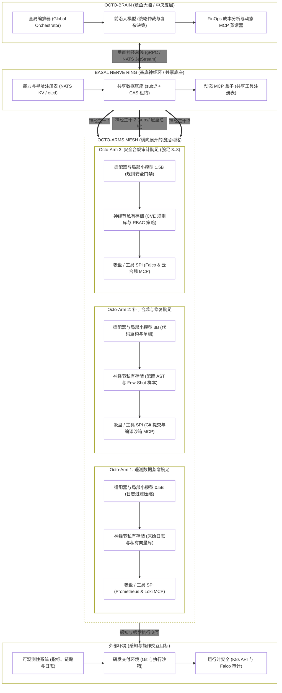
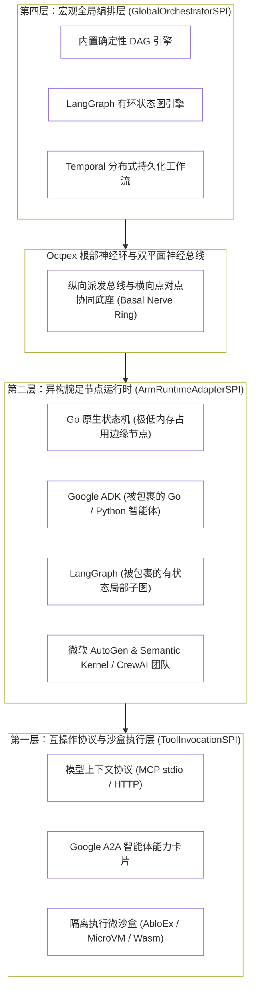
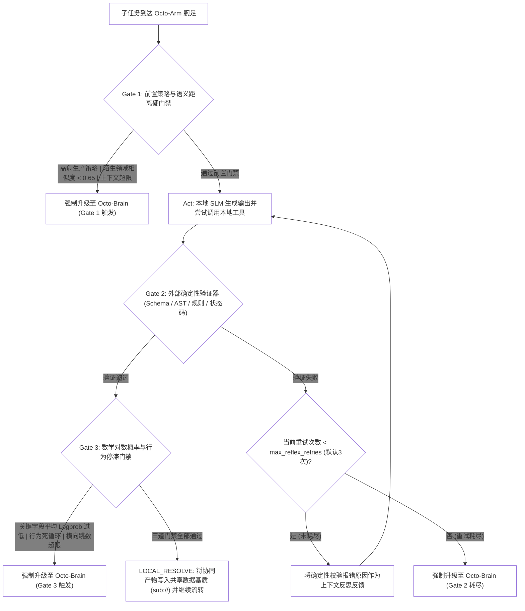
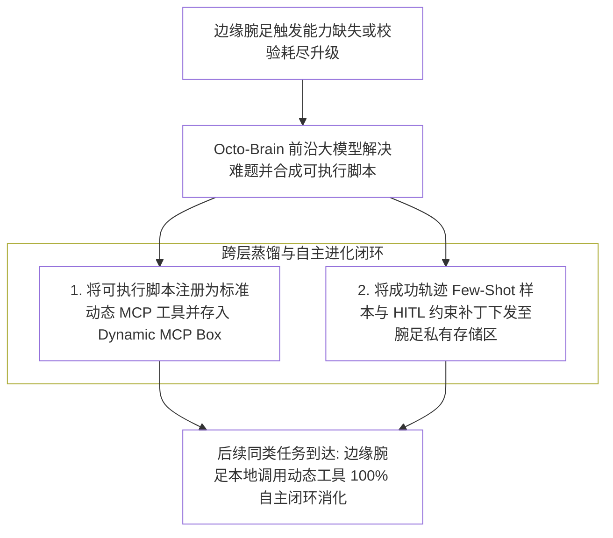

# 系统架构与工程实现规范：Octpex

**文档版本：** 1.1.0  
**适用范围：** 仿生分布式拓扑、多框架生态集成、客观升级漏斗、标准数据契约、SPI 接口定义及分阶段实施路径  

---

## 1. 仿生系统拓扑架构

Octpex 借鉴头足类动物（章鱼）的分布式神经生物学结构，将智能体算力与状态组织为三个核心层级：**Octo-Brain（中枢大脑皮层）**、**Basal Nerve Ring（腕足根部神经环 / 共享协调底座）** 以及 **Octo-Arms（边缘神经节腕足）**。



---

## 2. 多智能体框架生态集成架构

Octpex 的核心设计理念是成为一套**非侵入式的分布式智能体认知底座（Distributed Cognitive Fabric）**，而非封闭的单进程 SDK。通过三层标准化适配器接口，业界主流框架无需重写业务逻辑即可无缝嵌入 Octpex 协同网络：



### 生态框架集成对照表

| 生态框架 / 协议 | 挂载扩展层 | 集成方式与核心架构价值 |
| :--- | :--- | :--- |
| **LangGraph** | `GlobalOrchestratorSPI` 或 `ArmRuntimeAdapterSPI` | 在大脑层利用其原生 `interrupt()` 检查点驱动带人工审批的全局有环状态图；或在边缘端将现有 LangGraph 子图直接封装为专业腕足节点。 |
| **Google ADK (Go / Python)** | `ArmRuntimeAdapterSPI` | 将轻量级 ADK 智能体包装进 `Octo-Arm` 内部，把 ADK 简洁的会话/工具抽象与 Octpex 的本地小模型自愈循环及根部服务发现结合。 |
| **Microsoft AutoGen / Semantic Kernel** | `ArmRuntimeAdapterSPI` | 将多智能体辩论群组或 .NET/Python 企业级语义插件封装为一个统一注册能力标签的 `Octo-Arm` 接入总线。 |
| **CrewAI** | `ArmRuntimeAdapterSPI` | 将角色扮演型任务团队挂载为领域专属边缘腕足，跨团队路由与大体积中间状态交由根部共享数据基质统一托管。 |
| **Temporal** | `GlobalOrchestratorSPI` | 为 `Octo-Brain` 提供基于事件溯源的持久化执行保障，适用于跨天级、不可中断的金融或供应链关键业务流。 |
| **MCP 与 Google A2A** | `ToolInvocationSPI` 与 `CapabilityRegistry` | 外部工具调用全面收口至标准 `MCP`（`stdio` / `HTTP+SSE`），同时让 `ArmManifest` 能力清单兼容 `Google A2A` 智能体卡片规范。 |

---

## 3. 核心子系统与分布式运行机制

### 3.1 腕足根部神经环（Basal Nerve Ring）机制

#### A. 能力与对等节点注册中心（Capability & Peer Registry）
* **动态注册与租约：** 每个 `Octo-Arm` 启动时向注册中心（生产集群使用 `etcd`、`Consul` 或 `NATS KV`；单机模式使用内存注册表）写入带租约的声明式清单，并每 `5s` 续约心跳。
* **智能路由解析：** 无论是 `Octo-Brain` 派发任务，还是腕足之间发起横向接力，均通过 `capability_tags` 精确匹配或 `role_embedding` 余弦相似度检索目标能力节点，并自动过滤掉不健康节点，优先路由至 `active_queue_depth`（当前推理队列深度）最低的副本。

#### B. 共享数据基质（Shared Data Substrate）与腕足私有数据区分层架构
Octpex 采用“**局部私有存储 + 根部共享基质**”的两级数据存储模型，既解决大数据跨网络拷贝损耗，又消除隐私数据泄露风险：
* **腕足私有数据区（Private Ganglion Store）：** 位于每个腕足本地，存放未脱敏的原始日志、海量高频传感器数据、本地嵌入式向量索引（LanceDB/SQLite-vss）、Scratchpad 工作草稿及私有 Few-shot 规则。此区域物理隔离，其他腕足和大脑默认不可见，避免敏感数据外泄。
* **共享数据基质（Shared Data Substrate）：** 位于 Basal Nerve Ring 上的轻量共享协作区域，专为跨节点低成本共享而设计。
* **引用传递模式（Pass-by-Reference）：** 腕足提炼出的中间产物存入共享数据基质后，总线仅传输轻量 URI 指针（如 `sub://{session_id}/{artifact_id}`，体积 `< 1KB`），大幅减少跨网络或跨进程的大报文深拷贝开销，并杜绝大报文广播造成的网络阻塞。
* **并发控制与分布式租约：** 协同产物统一存入 `Redis/Valkey`（热状态 `< 1MB`）或 `对象存储/SQLite`（大文件）。任何腕足写入基质数据时，必须持有基于 `session_id` 鉴权的分布式写租约（`TTL = 30s`）并通过单调递增版本号的 **CAS（Compare-And-Swap / `ETag`）** 校验，彻底防止并发写入冲突。

#### C. 双平面神经总线与编排模式
* **纵向控制总线（`Brain <-> Arm`）：** 基于 `gRPC` 或 `NATS JetStream`（主题如 `octpex.vertical.dispatch.{capability}`、`octpex.vertical.escalate`），承担 **协调器模式（Coordinator Pattern）** 的任务扇出/汇总、升级请求上报，以及当腕足小模型队列饱和时的**背压流控信号（`PAUSE` / `RESUME`）**。
* **横向协同总线（`Arm <-> Arm`）：** 基于 `NATS` 队列组（`octpex.lateral.handoff.{capability}`）或节点间直连 `gRPC`，支持 **顺序模式（Sequential Pattern）** 流水线交接、同行评判迭代（Peer Critic）以及空闲节点任务窃取（Work Stealing）。每条横向消息均携带并递增 `hop_count` 跳数计数器。

#### D. 协议矩阵

| 通信路径 | 传输 / 协议 | 载荷 / 职责 |
| :--- | :--- | :--- |
| `Octo-Brain <-> Octo-Arm` | gRPC / NATS JetStream | 使用 Protobuf 或 JSON 信封传递任务、背压信号和升级请求 |
| `Octo-Arm <-> Octo-Arm` | NATS 发布订阅 / 节点间 gRPC | 轻量级接力事件与共享数据基质引用（`sub://`） |
| `Octo-Arm <-> Data Substrate` | Redis 协议 / 对象存储 API / SQLite | 带 CAS 版本控制和租约的协同产物存储 |
| `Octo-Arm -> 外部工具` | MCP（`stdio` / Streamable HTTP）、REST/gRPC | JSON-RPC 或 HTTP 工具请求 |

#### E. 任务持久性

在 `cluster` 模式下，已接收任务必须采用持久化投递。工作节点仅在完成状态及共享数据基质引用提交后确认任务；若节点在确认前故障，任务可重试或重新分配。由于重新投递可能导致重复执行，处理器必须具备幂等性，或按任务 / 信封 ID 去重。`local` 模式不承诺进程或机器故障后的任务恢复。

---

### 3.2 客观升级漏斗门禁（对小模型自评保持“零信任”）

> **核心工程原则：** *永远不要相信本地小模型（0.5B–3B）对自己输出置信度的主观打分。所有升级（Escalation）边界必须由宿主运行时代码通过前置策略与语义距离门禁、外部确定性验证器、数学对数概率以及行为死循环检测器强制执行。*



#### 三道客观漏斗详述：
1. **Gate 1 — 前置策略与语义边界门禁（0ms 零消耗拦截）：**
   * 涉及修改生产配置、资金操作、权限变更等标记为 `risk: HIGH` 的任务，直接拦截升级并触发 HITL 审批。
   * 计算当前任务向量与腕足本地已掌握技能库（含历史进化经验）的余弦相似度，若低于 `0.65`（属于从未见过的陌生领域 OOD），直接交由大脑处理，防止小模型强行编造。
   * 若输入上下文超过本地小模型的安全窗口上限（`safe_context_limit`，如 6144 Tokens），防止因注意力退化导致漏信息，直接路由给拥有超长窗口的 `Octo-Brain`。
2. **Gate 2 — 确定性外部验证器与有限次自愈循环（`Act -> Inspect -> Retry`）：**
   * 利用 **JSON Schema、Pydantic、SQL/代码 AST 解析器、正则业务规则及 MCP 工具返回状态码** 对小模型输出进行客观真值校验。
   * 校验失败时，宿主运行时将具体报错原因注入上下文，驱动小模型局部自愈重试（最多 3 次）。一旦重试耗尽仍未通过，宿主运行时强制掐断并打包报错现场上报 `Octo-Brain`。
3. **Gate 3 — 数学令牌概率与行为死循环门禁：**
   * 在推理接口开启 `logprobs=True`，若关键决策字段的平均对数概率（`avg_logprob`）低于阈值（说明模型在“掷骰子猜词”），强制判定为低置信度并升级。
   * 对每轮输出和工具调用参数计算 SHA-256 哈希；若连续两轮出现完全重复的无效操作（死循环停滞），或横向接力达到 `max_lateral_hops` 上限，立即触发升级。

---

### 3.3 跨层级自进化与动态工具蒸馏流水线

Octpex 构建了一个闭环进化飞轮，将中枢前沿大模型的一次性高昂推理，逐步沉淀为边缘端可无限次免费复用的确定性工具：



---

## 4. 标准数据契约（Canonical Data Contracts）

### 4.1 腕足能力清单（`ArmManifest`）
```json
{
  "arm_id": "arm-log-triage-01",
  "runtime_adapter": "go-native-fsm",
  "role_name": "telemetry-distiller",
  "capability_tags": ["log-parsing", "stacktrace-dedup", "k8s-diagnostics"],
  "endpoint": "nats://octpex.arm.telemetry-distiller",
  "slm_profile": {
    "provider": "ollama",
    "model": "qwen2.5:3b",
    "safe_context_limit": 6144
  },
  "escalation_gates": {
    "min_capability_similarity": 0.65,
    "min_token_logprob": -0.51,
    "max_reflex_retries": 3,
    "max_lateral_hops": 3
  },
  "telemetry": {
    "active_queue_depth": 1,
    "status": "HEALTHY",
    "last_heartbeat_unix": 1794690000
  }
}
```

### 4.2 神经总线消息信封（`NervousEnvelope`）
```json
{
  "envelope_id": "env-9f8e7d6c",
  "trace_id": "tr-20261115-001",
  "session_id": "sess-8841",
  "plane": "LATERAL",
  "orchestration_pattern": "SEQUENTIAL",
  "message_type": "HANDOFF_REQUEST",
  "source_node": "arm-log-triage-01",
  "target_capability": "patch-synthesizer",
  "hop_count": 1,
  "substrate_refs": [
    {
      "uri": "sub://sess-8841/distilled-error-summary",
      "version": 2,
      "content_type": "application/json",
      "byte_size": 640
    }
  ],
  "directive": "Synthesize remediation configuration for the distilled OOM error.",
  "timestamp_unix": 1794690005
}
```

### 4.3 升级仲裁上下文包（`EscalationPayload`）
```json
{
  "escalation_id": "esc-4412",
  "trace_id": "tr-20261115-001",
  "source_arm": "arm-patch-synthesizer-02",
  "triggered_gate": "GATE_2_REFLEX_EXHAUSTED",
  "objective_metrics": {
    "attempts_made": 3,
    "avg_key_logprob": -0.34,
    "capability_similarity": 0.84
  },
  "last_validation_error": "Schema violation: target replica count exceeds policy limit.",
  "distilled_context_refs": ["sub://sess-8841/distilled-error-summary"],
  "proposed_action_summary": "Scale deployment payment-worker from 4 to 16 replicas."
}
```

### 4.4 自进化技能与动态 MCP 记录（`EvolvedSkillRecord`）
```json
{
  "skill_id": "skill-waybill-csv-normalizer",
  "origin_escalation_id": "esc-4412",
  "target_capability": "manifest-parsing",
  "evolution_type": "DYNAMIC_MCP_TOOL",
  "mcp_server_uri": "mcp://basal-ring/dynamic-tools/waybill-normalizer",
  "context_patch": {
    "few_shot_examples": [
      {
        "input_pattern": "Unstructured carrier manifest with multi-line SKU blocks",
        "tool_invocation": "normalize_waybill_v1(strict_schema=true)"
      }
    ],
    "hitl_constraints": [
      "Always flag shipments exceeding 500kg for manual customs verification."
    ]
  },
  "metrics": {
    "times_reused_locally": 42,
    "estimated_tokens_saved": 185000
  }
}
```

---

## 5. 服务提供者接口 (SPI) 与推荐代码目录结构

### 5.1 五大可插拔核心抽象接口

#### 1. 全局编排层接口（`GlobalOrchestratorSPI`）
```go
type GlobalOrchestratorSPI interface {
    // 规划全局任务有向无环图或状态机
    Plan(ctx context.Context, goal string, contextData map[string]any) (*PlanDAG, error)
    // 仲裁来自边缘腕足的升级请求
    Arbitrate(ctx context.Context, escalation *EscalationPayload) (*ArbitrationDecision, error)
    // 挂起状态并等待人工审批 (HITL)
    SuspendForHITL(ctx context.Context, sessionID string, approvalReq *HITLRequest) error
}
```

#### 2. 腕足执行适配器接口（`ArmRuntimeAdapterSPI`）
```go
type ArmRuntimeAdapterSPI interface {
    // 初始化腕足内部运行时（绑定 ADK / LangGraph / 原生状态机）
    Init(ctx context.Context, manifest *ArmManifest) error
    // 执行由总线投递的子任务
    ExecuteStep(ctx context.Context, envelope *NervousEnvelope) (*StepResult, error)
    // 获取腕足当前健康与队列状态
    Telemetry(ctx context.Context) (*ArmTelemetry, error)
}
```

#### 3. 本地小模型推理接口（`SLMInferenceSPI`）
```go
type SLMInferenceSPI interface {
    // 生成推理结果并强制提取关键字段对数概率 (Logprobs)
    Generate(ctx context.Context, req *InferenceRequest) (*InferenceResponse, error)
    // 验证当前模型是否具备指定上下文窗口支持
    ContextCapacity() int
}
```

#### 4. 共享数据基质接口（`DataSubstrateSPI`）
```go
type DataSubstrateSPI interface {
    // 写入跨节点协同产物，基于 CAS 乐观锁版本号校验
    PutArtifact(ctx context.Context, uri string, expectedVersion int64, data []byte, ttl time.Duration) (newVersion int64, err error)
    // 读取协同产物内容与当前版本
    GetArtifact(ctx context.Context, uri string) (data []byte, version int64, err error)
    // 获取或续约分布式写租约
    AcquireLease(ctx context.Context, uri string, ttl time.Duration) (leaseToken string, err error)
}
```

#### 5. 工具与沙盒调用接口（`ToolInvocationSPI`）
```go
type ToolInvocationSPI interface {
    // 调用静态或动态注册的 MCP 工具/外部 API
    InvokeTool(ctx context.Context, toolURI string, params map[string]any) (*ToolResult, error)
    // 探测工具健康度与能力 Schema
    InspectTool(ctx context.Context, toolURI string) (*ToolSchema, error)
}
```

### 5.2 推荐仓库目录结构
```text
octpex/
├── README.md                        # 项目总览与快速上手（英文缺省）
├── README_CN.md                     # 项目总览与快速上手（中文版）
├── LICENSE                          # Apache License 2.0
├── docs/
│   ├── PRD.md                       # 英文产品需求文档 (English PRD)
│   ├── PRD_CN.md                    # 中文产品需求文档 (Chinese PRD)
│   ├── ARCHITECTURE.md              # 英文系统架构规范 (English Architecture Spec)
│   └── ARCHITECTURE_CN.md           # 中文系统架构规范 (Chinese Architecture Spec)
├── proto/
│   └── octpex/v1/nervous_bus.proto  # gRPC 与神经总线消息信封 Protobuf 定义
├── pkg/ (or octpex/)
│   ├── core/
│   │   ├── spi.go (or spi.py)       # 五大核心 SPI 接口契约定义
│   │   ├── envelope.go              # NervousEnvelope、EscalationPayload 与 EvolvedSkillRecord 数据模型
│   │   └── telemetry.go             # FinOps 指标统计（本地消化率、Token 节省量、技能复用率）
│   ├── brain/
│   │   ├── cortex.go                # Octo-Brain 全局规划器、升级仲裁器与 HITL 钩子
│   │   ├── distiller.go             # 动态 MCP 工具合成与经验蒸馏器
│   │   └── llm_adapter.go           # 云端前沿大模型客户端适配器
│   ├── ring/
│   │   ├── registry.go              # 能力与对等节点注册中心 (In-Memory / etcd / NATS KV)
│   │   ├── substrate.go             # 支持 CAS 乐观锁的共享数据基质工作内存
│   │   ├── mcp_box.go               # 根部共享动态 MCP 工具注册箱
│   │   └── bus.go                   # 纵向与横向双平面神经总线路由器
│   ├── arm/
│   │   ├── ganglion.go              # Octo-Arm 生命周期管理与心跳保活循环
│   │   ├── reflex.go                # Act -> Inspect -> Retry 局部反思引擎
│   │   ├── escalation_gate.go       # 三道门禁客观升级漏斗 (策略/验证器/Logprob与死循环检测)
│   │   └── local_storage.go         # 腕足本地嵌入式向量库、Few-shot 与 KV 暂存区
│   └── adapters/
│       ├── slm_ollama.go            # 支持 Logprobs 提取的本地小模型运行时适配器
│       ├── tool_mcp.go              # 标准 MCP 协议客户端适配器
│       └── framework_bridge.go      # Google ADK、LangGraph、AutoGen 与 CrewAI 包装适配器
└── examples/
    ├── local_quickstart/            # 零集群依赖的单机快速启动示例
    ├── aiops_triage_mesh/           # 多腕足日志蒸馏与横向流水线排障示例
    └── self_evolving_parser/        # “大脑教腕足”动态 MCP 工具合成进化示例
```

---

## 6. 核心系统特性与生产级能力架构

Octpex 提供了完备的、生产就绪的仿生分布式智能体神经底座，划分为五大核心能力矩阵：

### 6.1 单机极速仿生内核（`profile: local`）
* **标准化协议契约（`pkg/protocol`）**：定义 `NervousEnvelope`、`ArmManifest`、`SubstrateRef` 与 `SecurityContext`，内置不可变 CAS 版本标签与权限单调衰减。
* **本地双平面神经总线（`pkg/bus`）**：微秒级内存通道调度器，物理分离纵向任务派发与同级横向接力。
* **零拷贝共享数据基质（`pkg/substrate`）**：纯内存原子 Compare-And-Swap（CAS）数据基座，通过 `sub://{session_id}/{artifact}` 传引不传值，杜绝上下文膨胀。
* **三道门禁客观升级漏斗（`pkg/gates`）**：硬确定性校验拦截链（Gate 1 前置策略与容量、Gate 2 JSON Schema/AST/退出码、Gate 3 对数概率与跳数上限）。

### 6.2 根部神经环与分布式集群中枢（`profile: cluster`）
* **NATS JetStream 双平面传输中枢**：支持水平横向扩展的发布订阅消息总线，具备消费组弹性扩缩容与背压控制机制。
* **Redis/Valkey 分布式 CAS 基质**：结合 Lua 脚本保证多节点并发下 Compare-And-Swap 原子性，支持分布式 TTL 租约。
* **高可用基底神经环能力注册表（`pkg/ring`）**：集成 etcd 集群，维持 5 秒租约心跳，节点故障秒级感知并自动踢出。
* **跨地域多集群联邦路由（`pkg/ring/federation.go`）**：支持跨数据中心对等节点发现、跨地域边界转发探针及多跳跳数熔断拦截。

### 6.3 异构多框架生态与 Python 智能体网格（`bridge/python`）
* **全谱系智能分级解耦**：无缝容纳 Level 0（Go 原生 FSM）、Level 1（基于 Ollama 的边缘 SLM）、Level 2（单 Agent 封装）与 Level 3（多角色辩论组）。
* **四大主流框架原生包装器**：提供 **Google ADK**、**LangGraph**、**Microsoft AutoGen** 与 **CrewAI** 官方生产级适配器。
* **常驻腕足守护进程（`OctoArmDaemon`）**：支持 Python 智能体作为独立容器常驻运行，驱动本地反射自愈并与 Go 内核 HTTP 握手。

### 6.4 跨层级自进化与动态 MCP 工具箱（`pkg/tool`, `pkg/mcp`）
* **“大脑教腕足”能力蒸馏闭环**：任务升级至 Octo-Brain 后动态合成代码工具，编译下发至基底神经环，实现后续任务 0 云端 Token 消化。
* **完整支持 MCP 2024-11-05 协议**：标准 MCP 客户端全面支持 `stdio` 子进程管道与流式 HTTP/SSE 协议。
* **AbloEx 零信任安全沙盒（`pkg/sandbox`）**：准入前静态 AST 语法树安全扫描（拦截危险系统调用、磁盘格式化与网络外联），施加内存与超时硬配额。

### 6.5 实时可视化看板与 FinOps 财务审计（`pkg/server`, `pkg/telemetry`）
* **嵌入式异步 Web 实时看板**：基于 Server-Sent Events（SSE: `/api/v1/events`）的交互式单页应用，动态展示神经拓扑与脉冲流。
* **FinOps 降本与 Token ROI 引擎**：实时审计云端 Token 消耗、边缘小模型 Token 节省量、端到端时延降低幅度及美元成本节约。
* **极致性能压测验证**：实测吞吐超越 **960 万 CAS ops/s**、**810 万总线信封/s** 与 **160 万门禁校验/s**。

### 6.6 云原生容器编排与企业级 Helm 交付（`deploy/`）
* **生产级容器技术栈**：25MB 极简 Alpine 多阶段 Docker 镜像、一键式 `docker-compose.yaml` 集群全栈。
* **企业级 Helm v3 生产包（`deploy/helm/octpex`）**：内置 Horizontal Pod Autoscaler（HPA）、ConfigMap 与 Kubernetes 存活/就绪健康探针。

---

## 7. 安全治理与边缘韧性规范

### 7.1 动态工具合成的沙盒安全护栏（Dynamic Tool Guardrails）
大模型在“大脑教腕足”闭环中动态编写的代码与脚本具有不可控性，进入 **Dynamic MCP Box** 之前必须严格通过三层安全审查：
1. **静态 AST 白名单扫描：** 扫描动态脚本的抽象语法树，禁止引入危险内置模块（如危险系统调用、非受信网络外联库、磁盘格式化等），强制限制可执行上下文。
2. **零信任微沙盒隔离：** 动态工具执行时通过 `ToolInvocationSPI` 托管在受限微沙盒（如 Wasm 运行时或只读容器沙盒）中运行，施加严格的 CPU、内存（如上限 256MB）与执行时延（如上限 5s）配额。
3. **特权操作双签名（Brain + HITL）：** 凡涉及写库、修改外部配置或调用外部收费接口的动态工具，必须经过人工审核员（HITL）确认签名方可激活并开放给腕足调用。

### 7.2 零信任凭证与权限逐跳衰减（Token Attenuation）
* **数据基质访问鉴权与租约隔离：** 任何腕足节点只能基于其任务信封中的 `session_id` 申请对应作用域的共享数据基质读写租约，杜绝跨会话越权窥探。
* **逐跳权限衰减：** 在横向总线点对点交接（Sequential Pipeline）中，每次 `hop_count` 递增，消息信封携带的操作权限范围单调递减，防止边缘节点在串行流转中权限被无序放大。

### 7.3 边缘离线与弱网降级容灾（Air-Gap & Offline Resilience）
* **断网自治与本地闭环：** 当边缘腕足与云端 `Octo-Brain` 之间的纵向总线失联或心跳超时（如网络闪断或边缘弱网）时，腕足自动切入**离线降级模式（Autonomous Degradation Mode）**。
* **离线门禁安全策略：** 在离线模式下，凡命中 Gate 1、Gate 2 需向上升级的任务，禁止盲目自行执行；系统将子任务挂起并持久化沉淀至本地 WAL（Write-Ahead Log）队列，或转入本地交互终端等待就地人工介入，待网络恢复且心跳重新对齐后，批量回传升级决策现场。

