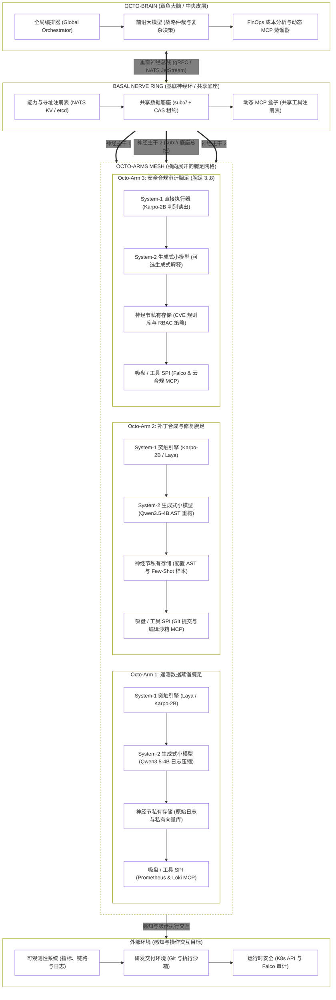
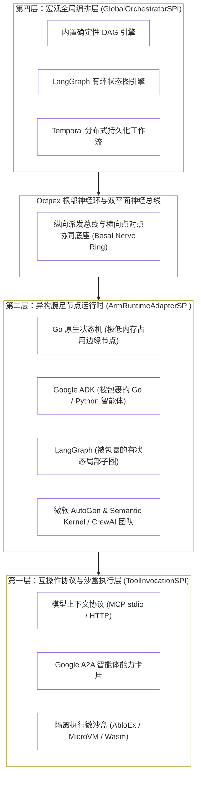
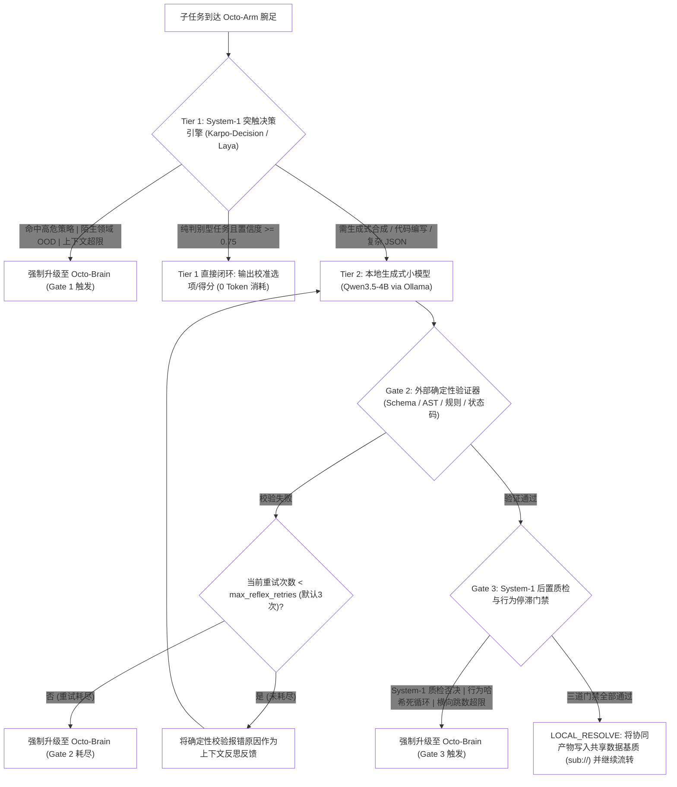
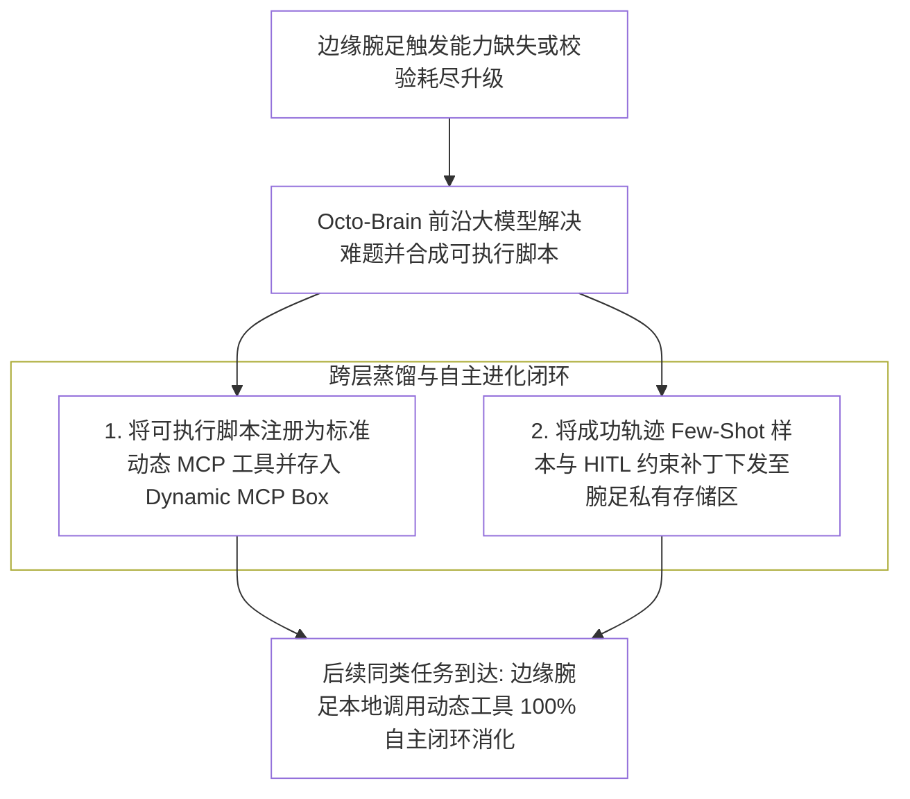

# 系统架构与工程实现规范：Octpex

**文档版本：** 2.2.0  
**适用范围：** 仿生分布式拓扑、多框架生态集成、三级认知阶梯升级漏斗、硬件感知 System-1 决策引擎、标准数据契约、SPI 接口定义及安全治理规范  

---

## 1. 仿生系统拓扑架构

Octpex 借鉴头足类动物（章鱼）的分布式神经生物学结构，将智能体算力与状态组织为三个核心层级：**Octo-Brain（中枢大脑皮层）**、**Basal Nerve Ring（腕足根部神经环 / 共享协调底座）** 以及 **Octo-Arms（边缘神经节腕足）**。每条 Octo-Arm 腕足内置双层神经结构：**System-1 非自回归突触决策引擎**（`Karpo-Decision` / `Laya`）与 **System-2 生成式小模型**（`Qwen3.5-4B` / `1.5B`）。



---

## 2. 多智能体框架生态集成架构

Octpex 的核心设计理念是成为一套**非侵入式的分布式智能体认知底座（Distributed Cognitive Fabric）**，而非封闭的单进程 SDK。通过三层标准化适配器接口，业界主流框架无需重写业务逻辑即可无缝嵌入 Octpex 协同网络：



### 生态框架集成对照表

| 生态框架 / 协议 | 挂载扩展层 | 集成方式与核心架构价值 |
| :--- | :--- | :--- |
| **LangGraph** | `GlobalOrchestratorSPI` 或 `ArmRuntimeAdapterSPI` | 在大脑层利用其原生 `interrupt()` 检查点驱动带人工审批的全局有环状态图；或在边缘端将现有 LangGraph 子图直接封装为专业腕足节点。 |
| **Google ADK (Go / Python)** | `ArmRuntimeAdapterSPI` | 将轻量级 ADK 智能体包装进 `Octo-Arm` 内部，把 ADK 简洁的会话/工具抽象与 Octpex 的本地 System-1/System-2 反射弧及根部服务发现结合。 |
| **Microsoft AutoGen / Semantic Kernel** | `ArmRuntimeAdapterSPI` | 将多智能体辩论群组或 .NET/Python 企业级语义插件封装为一个统一注册能力标签的 `Octo-Arm` 接入总线。 |
| **CrewAI** | `ArmRuntimeAdapterSPI` | 将角色扮演型任务团队挂载为领域专属边缘腕足，跨团队路由与大体积中间状态交由根部共享数据基质统一托管。 |
| **Temporal** | `GlobalOrchestratorSPI` | 为 `Octo-Brain` 提供基于事件溯源的持久化执行保障，适用于跨天级、不可中断的金融或供应链关键业务流。 |
| **MCP 与 Google A2A** | `ToolInvocationSPI` 与 `CapabilityRegistry` | 外部工具调用全面收口至标准 `MCP`（`stdio` / `HTTP+SSE`），同时让 `ArmManifest` 能力清单兼容 `Google A2A` 智能体卡片规范。 |

---

## 3. 核心子系统与分布式运行机制

### 3.1 腕足根部神经环（Basal Nerve Ring）机制

#### A. 能力与对等节点注册中心（Capability & Peer Registry）
* **动态注册与租约：** 每个 `Octo-Arm` 启动时向注册中心（生产集群使用 `etcd`、`Consul` 或 `NATS KV`；单机模式使用内存注册表）写入带租约的声明式清单，并每 `5s` 续约心跳。
* **智能路由解析：** 无论是 `Octo-Brain` 派发任务，还是腕足之间发起横向接力，均通过 `capability_tags` 精确匹配或 `role_embedding` 余弦相似度检索目标能力节点，并自动过滤掉不健康节点，优先路由至 `active_queue_depth`（当前推理队列深度）最低的副本。

#### B. 共享数据基质（Shared Data Substrate）与腕足私有数据区分层架构
Octpex 采用“**局部私有存储 + 根部共享基质**”的两级数据存储模型，既解决大数据跨网络拷贝损耗，又消除隐私数据泄露风险：
* **腕足私有数据区（Private Ganglion Store）：** 位于每个腕足本地，存放未脱敏的原始日志、海量高频传感器数据、本地嵌入式向量索引（LanceDB/SQLite-vss）、Scratchpad 工作草稿及私有 Few-shot 规则。此区域物理隔离，其他腕足和大脑默认不可见，避免敏感数据外泄。
* **共享数据基质（Shared Data Substrate）：** 位于 Basal Nerve Ring 上的轻量共享协作区域，专为跨节点低成本共享而设计。
* **引用传递模式（Pass-by-Reference）：** 腕足提炼出的中间产物存入共享数据基质后，总线仅传输轻量 URI 指针（如 `sub://{session_id}/{artifact_id}`，体积 `< 1KB`），大幅减少跨网络或跨进程的大报文深拷贝开销，并杜绝大报文广播造成的网络阻塞。
* **并发控制与分布式租约：** 协同产物统一存入 `Redis/Valkey`（热状态 `< 1MB`）或 `对象存储/SQLite`（大文件）。任何腕足写入基质数据时，必须持有基于 `session_id` 鉴权的分布式写租约（`TTL = 30s`）并通过单调递增版本号的 **CAS（Compare-And-Swap / `ETag`）** 校验，彻底防止并发写入冲突。

#### C. 双平面神经总线与编排模式
* **纵向控制总线（`Brain <-> Arm`）：** 基于 `gRPC` 或 `NATS JetStream`（主题如 `octpex.vertical.dispatch.{capability}`、`octpex.vertical.escalate`），承担 **协调器模式（Coordinator Pattern）** 的任务扇出/汇总、升级请求上报，以及当腕足小模型队列饱和时的**背压流控信号（`PAUSE` / `RESUME`）**。
* **横向协同总线（`Arm <-> Arm`）：** 基于 `NATS` 队列组（`octpex.lateral.handoff.{capability}`）或节点间直连 `gRPC`，支持 **顺序模式（Sequential Pattern）** 流水线交接、同行评判迭代（Peer Critic）以及空闲节点任务窃取（Work Stealing）。每条横向消息均携带并递增 `hop_count` 跳数计数器。

#### D. 协议矩阵

| 通信路径 | 传输 / 协议 | 载荷 / 职责 |
| :--- | :--- | :--- |
| `Octo-Brain <-> Octo-Arm` | gRPC / NATS JetStream | 使用 Protobuf 或 JSON 信封传递任务、背压信号和升级请求 |
| `Octo-Arm <-> Octo-Arm` | NATS 发布订阅 / 节点间 gRPC | 轻量级接力事件与共享数据基质引用（`sub://`） |
| `Octo-Arm <-> Data Substrate` | Redis 协议 / 对象存储 API / SQLite | 带 CAS 版本控制和租约的协同产物存储 |
| `Octo-Arm -> 外部工具` | MCP（`stdio` / Streamable HTTP）、REST/gRPC | JSON-RPC 或 HTTP 工具请求 |
| `Octo-Arm -> System-1 决策引擎` | HTTP（`POST /v1/systemone`）/ 进程内 ONNX | 非自回归单次前向读出（`choice` / `noul` / `score`） |

#### E. 任务持久性

在 `cluster` 模式下，已接收任务必须采用持久化投递。工作节点仅在完成状态及共享数据基质引用提交后确认任务；若节点在确认前故障，任务可重试或重新分配。由于重新投递可能导致重复执行，处理器必须具备幂等性，或按任务 / 信封 ID 去重。`local` 模式不承诺进程或机器故障后的任务恢复。

---

### 3.2 三级认知阶梯与客观升级漏斗（对生成式大模型自评保持“零信任”）

> **核心设计原则：** *永远不要相信自回归生成式小模型对自己输出置信度的主观打分。任务路由分流、判别型末端执行与生成后置质检，由非自回归 System-1 突触决策引擎（`Karpo-Decision` / `Laya`）、确定性硬校验器（Schema/AST/退出码）以及行为死循环检测器联合进行确定性强制裁决。*



#### 硬件感知自适应决策引擎与防 OOM 显存守卫（`DecisionEngineSPI`）
由于自回归生成式模型（如通过 Ollama 部署的 `Qwen3.5-4B`）无法在 Ollama 进程内部直接挂载专用的非自回归判别读出头，Octpex 在架构上将 **System-1 突触决策推理（`DecisionEngineSPI`）** 与 **System-2 生成式推理（`SLMInferenceSPI`）** 彻底解耦。启动时，每个 Octo-Arm 运行**硬件探测器（Hardware Probe）**实施严格的**显存预算守卫（VRAM Budget Guard）**——杜绝在无独显笔记本或 GTX 1080（8GB 显存且无原生 FP16 Tensor Core）等旧显卡上发生 OOM 崩溃：

| 硬件分级 | 检测到的硬件配置 Profile | System-2 生成式小模型 (`SLMInferenceSPI`) | System-1 突触决策引擎 (`DecisionEngineSPI`) | OOM 与延迟防护机制 |
| :--- | :--- | :--- | :--- | :--- |
| **Tier 0 (CPU 边缘端)** | 无独立显卡，系统 RAM $< 16\text{GB}$ | `qwen3.5:0.8b` / `1.5b` (Q4) | `Laya`（CPU 运行 INT8 ONNX） | 严格限制总内存占用 $< 2.5\text{GB}$；决策延迟 $< 15\text{ms}$。 |
| **Tier 1 (老旧显卡 / 8GB 显存)** | 8GB VRAM（如 GTX 1080） | `qwen3.5:4b` (Q4_K_M, 8K 上下文) | `Laya`（CPU ONNX）主选；`karpo-decision-2B`（4-bit）备选 | 将 `Laya` 强行固定在系统内存运行（0 显存占用），避免与 `Qwen3.5-4B` 争抢 8GB 显存天花板。 |
| **Tier 2 (主流显卡 / Apple Silicon)** | 12–16GB 显存或统一内存 | `qwen3.5:4b` (Q4/Q8, 16K 上下文) | `karpo-decision-2B` / `4B` | 开启 32K 超长决策上下文，支持多模态界面截图解析。 |
| **Tier 3 (企业级 GPU)** | $\ge 24\text{GB}$ 显存（如 A10/A100/4090） | `qwen3.5:9b` (Q8/FP8) | `karpo-decision-4B` / `31B` | 全量多分支并行门禁，启用极高精度的决策索引校准。 |

#### `Laya` 与 `Karpo-Decision` 之间的动态任务感知路由
1. **多模态或超长上下文（`tokens > 1024` 或包含图像输入）：** 自动路由给 `Karpo-Decision`（原生支持最高 32K 上下文与图形 UI/截图视觉输入）。
2. **高基数路由或工具选型（`options > 20` 或 `When2Call` 工具判定）：** 路由给 `Karpo-Decision`（支持多达 255 个候选项分类，具备优异的分布外 OOD 泛化能力）。
3. **高频极速短文本初筛（`tokens <= 1024`）：** 路由给 `Laya`（进程内极速 ONNX/MLX 推理，延迟 $< 15\text{ms}$，零网络与零显存开销）。
4. **反向选项校准校验（Reverse-Option Calibration Check / FlexDM 范式）：** 当最高概率项落入不确定性区间（`0.50 <= p_max < 0.65`）时，运行时自动发起第二次反转选项顺序的前向传播并对两次概率分布取平均；若反转前后产生严重分歧（一致性校验失败），立即触发 `ESCALATE_TO_BRAIN` 升级。

---

### 3.3 跨层级自进化与动态工具蒸馏流水线

Octpex 构建了一个闭环进化飞轮，将中枢前沿大模型的一次性高昂推理，逐步沉淀为边缘端可无限次免费复用的确定性工具：



---

## 4. 标准数据契约（Canonical Data Contracts）

### 4.1 腕足能力清单（`ArmManifest`）
```json
{
  "arm_id": "arm-log-triage-01",
  "runtime_adapter": "go-native-fsm",
  "role_name": "telemetry-distiller",
  "capability_tags": ["log-parsing", "stacktrace-dedup", "k8s-diagnostics"],
  "endpoint": "nats://octpex.arm.telemetry-distiller",
  "hardware_tier": "TIER_1_LEGACY_8GB",
  "decision_engine_profile": {
    "primary_engine": "laya-onnx-int8",
    "secondary_engine": "karpo-decision-2b-4bit",
    "endpoint": "http://127.0.0.1:8091/v1/systemone",
    "safe_decision_context": 32768,
    "vram_budget_mb": 0
  },
  "slm_profile": {
    "provider": "ollama",
    "model": "qwen3.5:4b",
    "safe_context_limit": 8192
  },
  "escalation_gates": {
    "min_capability_similarity": 0.65,
    "min_system1_confidence": 0.75,
    "uncertainty_band_low": 0.50,
    "max_reflex_retries": 3,
    "max_lateral_hops": 3
  },
  "telemetry": {
    "active_queue_depth": 1,
    "status": "HEALTHY",
    "last_heartbeat_unix": 1794690000
  }
}
```

### 4.2 神经总线消息信封（`NervousEnvelope`）
```json
{
  "envelope_id": "env-9f8e7d6c",
  "trace_id": "tr-20261117-001",
  "session_id": "sess-8841",
  "plane": "LATERAL",
  "orchestration_pattern": "SEQUENTIAL",
  "message_type": "HANDOFF_REQUEST",
  "source_node": "arm-log-triage-01",
  "target_capability": "patch-synthesizer",
  "hop_count": 1,
  "substrate_refs": [
    {
      "uri": "sub://sess-8841/distilled-error-summary",
      "version": 2,
      "content_type": "application/json",
      "byte_size": 640
    }
  ],
  "directive": "Synthesize remediation configuration for the distilled OOM error.",
  "timestamp_unix": 1794690005
}
```

### 4.3 升级仲裁上下文包（`EscalationPayload`）
```json
{
  "escalation_id": "esc-4412",
  "trace_id": "tr-20261117-001",
  "source_arm": "arm-patch-synthesizer-02",
  "triggered_gate": "GATE_2_REFLEX_EXHAUSTED",
  "objective_metrics": {
    "attempts_made": 3,
    "system1_engine": "karpo-decision-2b-4bit",
    "system1_confidence": 0.58,
    "reverse_option_consistent": false
  },
  "last_validation_error": "Schema violation: target replica count exceeds policy limit.",
  "distilled_context_refs": ["sub://sess-8841/distilled-error-summary"],
  "proposed_action_summary": "Scale deployment payment-worker from 4 to 16 replicas."
}
```

### 4.4 自进化技能与动态 MCP 记录（`EvolvedSkillRecord`）
```json
{
  "skill_id": "skill-waybill-csv-normalizer",
  "origin_escalation_id": "esc-4412",
  "target_capability": "manifest-parsing",
  "evolution_type": "DYNAMIC_MCP_TOOL",
  "mcp_server_uri": "mcp://basal-ring/dynamic-tools/waybill-normalizer",
  "context_patch": {
    "few_shot_examples": [
      {
        "input_pattern": "Unstructured carrier manifest with multi-line SKU blocks",
        "tool_invocation": "normalize_waybill_v1(strict_schema=true)"
      }
    ],
    "hitl_constraints": [
      "Always flag shipments exceeding 500kg for manual customs verification."
    ]
  },
  "metrics": {
    "times_reused_locally": 42,
    "estimated_tokens_saved": 185000
  }
}
```

---

## 5. 服务提供者接口 (SPI) 与推荐代码目录结构

### 5.1 六大可插拔核心抽象接口

#### 1. 全局编排层接口（`GlobalOrchestratorSPI`）
```go
type GlobalOrchestratorSPI interface {
    // 规划全局任务有向无环图或状态机
    Plan(ctx context.Context, goal string, contextData map[string]any) (*PlanDAG, error)
    // 仲裁来自边缘腕足的升级请求
    Arbitrate(ctx context.Context, escalation *EscalationPayload) (*ArbitrationDecision, error)
    // 挂起状态并等待人工审批 (HITL)
    SuspendForHITL(ctx context.Context, sessionID string, approvalReq *HITLRequest) error
}
```

#### 2. 腕足执行适配器接口（`ArmRuntimeAdapterSPI`）
```go
type ArmRuntimeAdapterSPI interface {
    // 初始化腕足内部运行时（绑定 ADK / LangGraph / 原生状态机）
    Init(ctx context.Context, manifest *ArmManifest) error
    // 执行由总线投递的子任务
    ExecuteStep(ctx context.Context, envelope *NervousEnvelope) (*StepResult, error)
    // 获取腕足当前健康与队列状态
    Telemetry(ctx context.Context) (*ArmTelemetry, error)
}
```

#### 3. 突触级 System-1 决策引擎接口（`DecisionEngineSPI`）
```go
type DecisionQuestion struct {
    QID     string   `json:"qid"`
    QType   string   `json:"qtype"`   // "choice" | "noul" | "score"
    Prompt  string   `json:"prompt"`
    Options []string `json:"options"` // 当 QType 为 "choice" 时，最多支持 255 个候选项
}

type DecisionResult struct {
    QID           string             `json:"qid"`
    Probabilities map[string]float64 `json:"probabilities"`
    TopOption     string             `json:"top_option"`
    Confidence    float64            `json:"confidence"`
    EngineUsed    string             `json:"engine_used"` // 例如 "laya-onnx-int8" 或 "karpo-decision-2b"
    LatencyMs     int64              `json:"latency_ms"`
}

type DecisionEngineSPI interface {
    // 在单次非自回归前向传播中评估类型化问题列表（问题列表优先排版）
    Decide(ctx context.Context, stateText string, questions []DecisionQuestion, images [][]byte) ([]DecisionResult, error)

    // FlexDM 反向选项二次校准校验（当 0.50 <= 置信度 < 0.65 时触发）
    ReverseOptionCheck(ctx context.Context, stateText string, question DecisionQuestion) (primary *DecisionResult, isConsistent bool, err error)

    // 报告当前检测到的硬件层级与底层激活引擎
    ActiveProfile() string
}
```

#### 4. 本地生成式小模型推理接口（`SLMInferenceSPI`）
```go
type SLMInferenceSPI interface {
    // 生成推理结果并强制提取关键字段对数概率 (Logprobs)
    Generate(ctx context.Context, req *InferenceRequest) (*InferenceResponse, error)
    // 验证当前模型是否具备指定上下文窗口支持
    ContextCapacity() int
}
```

#### 5. 共享数据基质接口（`DataSubstrateSPI`）
```go
type DataSubstrateSPI interface {
    // 写入跨节点协同产物，基于 CAS 乐观锁版本号校验
    PutArtifact(ctx context.Context, uri string, expectedVersion int64, data []byte, ttl time.Duration) (newVersion int64, err error)
    // 读取协同产物内容与当前版本
    GetArtifact(ctx context.Context, uri string) (data []byte, version int64, err error)
    // 获取或续约分布式写租约
    AcquireLease(ctx context.Context, uri string, ttl time.Duration) (leaseToken string, err error)
}
```

#### 6. 工具与沙盒调用接口（`ToolInvocationSPI`）
```go
type ToolInvocationSPI interface {
    // 调用静态或动态注册的 MCP 工具/外部 API
    InvokeTool(ctx context.Context, toolURI string, params map[string]any) (*ToolResult, error)
    // 探测工具健康度与能力 Schema
    InspectTool(ctx context.Context, toolURI string) (*ToolSchema, error)
}
```

### 5.2 推荐仓库目录结构
```text
octpex/
├── README.md                        # 项目总览与快速上手（英文缺省）
├── README_CN.md                     # 项目总览与快速上手（中文版）
├── LICENSE                          # Apache License 2.0
├── docs/
│   ├── PRD.md                       # 英文产品需求文档 (English PRD)
│   ├── PRD_CN.md                    # 中文产品需求文档 (Chinese PRD)
│   ├── ARCHITECTURE.md              # 英文系统架构规范 (English Architecture Spec)
│   └── ARCHITECTURE_CN.md           # 中文系统架构规范 (Chinese Architecture Spec)
├── proto/
│   └── octpex/v1/nervous_bus.proto  # gRPC 与神经总线消息信封 Protobuf 定义
├── pkg/ (or octpex/)
│   ├── core/
│   │   ├── spi.go (or spi.py)       # 五大核心 SPI 接口契约定义
│   │   ├── envelope.go              # NervousEnvelope、EscalationPayload 与 EvolvedSkillRecord 数据模型
│   │   └── telemetry.go             # FinOps 指标统计（本地消化率、Token 节省量、技能复用率）
│   ├── brain/
│   │   ├── cortex.go                # Octo-Brain 全局规划器、升级仲裁器与 HITL 钩子
│   │   ├── distiller.go             # 动态 MCP 工具合成与经验蒸馏器
│   │   └── llm_adapter.go           # 云端前沿大模型客户端适配器
│   ├── ring/
│   │   ├── registry.go              # 能力与对等节点注册中心 (In-Memory / etcd / NATS KV)
│   │   ├── substrate.go             # 支持 CAS 乐观锁的共享数据基质工作内存
│   │   ├── mcp_box.go               # 根部共享动态 MCP 工具注册箱
│   │   └── bus.go                   # 纵向与横向双平面神经总线路由器
│   ├── arm/
│   │   ├── ganglion.go              # Octo-Arm 生命周期管理与心跳保活循环
│   │   ├── synaptic_router.go       # System-1 非自回归决策引擎 (Karpo / Laya)
│   │   ├── reflex.go                # System-2 Act -> Inspect -> Retry 局部反思自愈引擎
│   │   ├── escalation_gate.go       # 三级认知阶梯与客观升级漏斗 (策略/验证器/质检批评)
│   │   └── local_storage.go         # 腕足本地嵌入式向量库、Few-shot 与 KV 暂存区
│   └── adapters/
│       ├── decision_laya.go         # Laya CPU INT8 进程内 ONNX 极速决策适配器
│       ├── decision_karpo.go        # Karpo-Decision 2B/4B HTTP REST 决策适配器
│       ├── slm_ollama.go            # 本地生成式小模型运行时适配器 (Qwen3.5-4B / 1.5B)
│       ├── tool_mcp.go              # 标准 MCP 协议客户端适配器
│       └── framework_bridge.go      # Google ADK、LangGraph、AutoGen 与 CrewAI 包装适配器
└── examples/
    ├── local_quickstart/            # 零集群依赖的单机快速启动示例
    ├── aiops_triage_mesh/           # 多腕足日志蒸馏与横向流水线排障示例
    └── self_evolving_parser/        # “大脑教腕足”动态 MCP 工具合成进化示例
```

---

## 6. 核心系统特性与生产级能力架构

Octpex 提供了完备的、生产就绪的仿生分布式智能体神经底座，划分为六大核心能力矩阵：

### 6.1 单机极速仿生内核（`profile: local`）
* **标准化协议契约（`pkg/protocol`）**：定义 `NervousEnvelope`、`ArmManifest`、`SubstrateRef` 与 `SecurityContext`，内置不可变 CAS 版本标签与权限单调衰减。
* **本地双平面神经总线（`pkg/bus`）**：微秒级内存通道调度器，物理分离纵向任务派发与同级横向接力。
* **零拷贝共享数据基质（`pkg/substrate`）**：纯内存原子 Compare-And-Swap（CAS）数据基座，通过 `sub://{session_id}/{artifact}` 传引不传值，杜绝上下文膨胀。
* **三级认知阶梯升级漏斗（`pkg/gates`）**：结合 System-1 突触级非自回归读出（`Karpo-Decision` / `Laya`）、System-2 本地生成式小模型（`Qwen3.5-4B` via Ollama）与确定性硬校验器，内置硬件显存守卫。

### 6.2 根部神经环与分布式集群中枢（`profile: cluster`）
* **NATS JetStream 双平面传输中枢**：支持水平横向扩展的发布订阅消息总线，具备消费组弹性扩缩容与背压控制机制。
* **Redis/Valkey 分布式 CAS 基质**：结合 Lua 脚本保证多节点并发下 Compare-And-Swap 原子性，支持分布式 TTL 租约。
* **高可用基底神经环能力注册表（`pkg/ring`）**：集成 etcd 集群，维持 5 秒租约心跳，节点故障秒级感知并自动踢出。
* **跨地域多集群联邦路由（`pkg/ring/federation.go`）**：支持跨数据中心对等节点发现、跨地域边界转发探针及多跳跳数熔断拦截。

### 6.3 异构多框架生态与 Python 智能体网格（`bridge/python`）
* **全谱系智能分级解耦**：无缝容纳 Level 0（Go 原生 FSM）、Level 1（基于 Karpo/Laya 的非自回归决策读出）、Level 2（基于 Ollama 的本地生成式小模型）与 Level 3（多角色辩论组/Wrapped Agents）。
* **四大主流框架原生包装器**：提供 **Google ADK**、**LangGraph**、**Microsoft AutoGen** 与 **CrewAI** 官方生产级适配器。
* **常驻腕足守护进程（`OctoArmDaemon`）**：支持 Python 智能体作为独立容器常驻运行，驱动本地反射自愈并与 Go 内核 HTTP 握手。

### 6.4 跨层级自进化与动态 MCP 工具箱（`pkg/tool`, `pkg/mcp`）
* **“大脑教腕足”能力蒸馏闭环**：任务升级至 Octo-Brain 后动态合成代码工具，编译下发至基底神经环，实现后续任务 0 云端 Token 消化。
* **完整支持 MCP 2024-11-05 协议**：标准 MCP 客户端全面支持 `stdio` 子进程管道与流式 HTTP/SSE 协议。
* **AbloEx 零信任安全沙盒（`pkg/sandbox`）**：准入前静态 AST 语法树安全扫描（拦截危险系统调用、磁盘格式化与网络外联），施加内存与超时硬配额。

### 6.5 实时可视化看板与 FinOps 财务审计（`pkg/server`, `pkg/telemetry`）
* **嵌入式异步 Web 实时看板**：基于 Server-Sent Events（SSE: `/api/v1/events`）的交互式单页应用，动态展示神经拓扑与脉冲流。
* **FinOps 降本与 Token ROI 引擎**：实时审计云端 Token 消耗、边缘小模型 Token 节省量、System-1 零 Token 闭环消化率、端到端时延降低幅度及美元成本节约。
* **极致性能压测验证**：实测吞吐超越 **960 万 CAS ops/s**、**810 万总线信封/s** 与 **160 万门禁校验/s**。

### 6.6 云原生容器编排与企业级 Helm 交付（`deploy/`）
* **生产级容器技术栈**：25MB 极简 Alpine 多阶段 Docker 镜像、一键式 `docker-compose.yaml` 集群全栈。
* **企业级 Helm v3 生产包（`deploy/helm/octpex`）**：内置 Horizontal Pod Autoscaler（HPA）、ConfigMap 与 Kubernetes 存活/就绪健康探针。

---

## 7. 安全治理与边缘韧性规范

### 7.1 动态工具合成的沙盒安全护栏（Dynamic Tool Guardrails）
大模型在“大脑教腕足”闭环中动态编写的代码与脚本具有不可控性，进入 **Dynamic MCP Box** 之前必须严格通过三层安全审查：
1. **静态 AST 白名单扫描：** 扫描动态脚本的抽象语法树，禁止引入危险内置模块（如危险系统调用、非受信网络外联库、磁盘格式化等），强制限制可执行上下文。
2. **零信任微沙盒隔离：** 动态工具执行时通过 `ToolInvocationSPI` 托管在受限微沙盒（如 Wasm 运行时或只读容器沙盒）中运行，施加严格的 CPU、内存（如上限 256MB）与执行时延（如上限 5s）配额。
3. **特权操作双签名（Brain + HITL）：** 凡涉及写库、修改外部配置或调用外部收费接口的动态工具，必须经过人工审核员（HITL）确认签名方可激活并开放给腕足调用。

### 7.2 零信任凭证与权限逐跳衰减（Token Attenuation）
* **数据基质访问鉴权与租约隔离：** 任何腕足节点只能基于其任务信封中的 `session_id` 申请对应作用域的共享数据基质读写租约，杜绝跨会话越权窥探。
* **逐跳权限衰减：** 在横向总线点对点交接（Sequential Pipeline）中，每次 `hop_count` 递增，消息信封携带的操作权限范围单调递减，防止边缘节点在串行流转中权限被无序放大。

### 7.3 边缘离线与弱网降级容灾（Air-Gap & Offline Resilience）
* **断网自治与本地闭环：** 当边缘腕足与云端 `Octo-Brain` 之间的纵向总线失联或心跳超时（如网络闪断或边缘弱网）时，腕足自动切入**离线降级模式（Autonomous Degradation Mode）**。
* **离线门禁安全策略：** 在离线模式下，凡命中 Gate 1、Gate 2 需向上升级的任务，禁止盲目自行执行；系统将子任务挂起并持久化沉淀至本地 WAL（Write-Ahead Log）队列，或转入本地交互终端等待就地人工介入，待网络恢复且心跳重新对齐后，批量回传升级决策现场。

