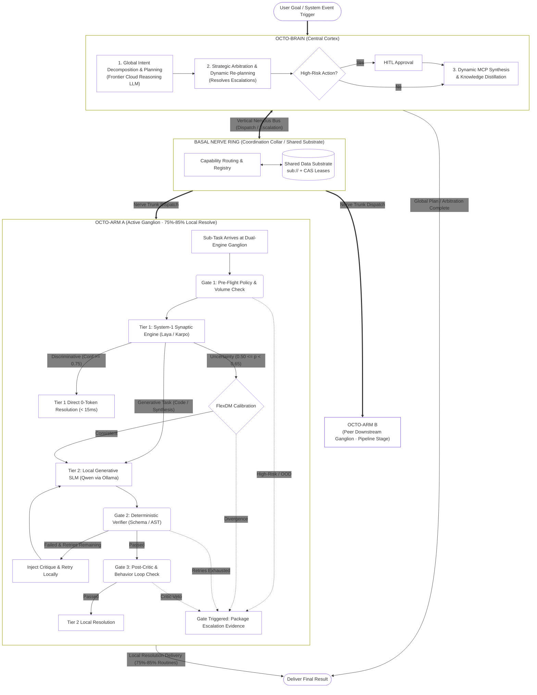

# Product Requirements Document (PRD): Octpex

**Project Name:** Octpex  
**Tagline:** Biomimetic Distributed Cognitive Topology & Self-Evolving Edge-Cloud Agent Fabric  
**Document Version:** 2.2.0  
**License:** Apache License 2.0  
**Status:** Ready for Implementation  

---

## 1. Product Vision & Strategic Overview

### 1.1 Vision Statement
Modern multi-agent systems predominantly rely on centralized frontier Large Language Models (LLMs) for every step of perception, data normalization, tool invocation, and routing. This centralized paradigm creates several critical bottlenecks in production.

**Octpex** aims to make production multi-agent systems economically sustainable, ultra-responsive, and self-improving. Inspired by cephalopod neurobiology—where two-thirds of an octopus's neurons reside in its eight arms rather than its central brain—Octpex shifts AI agent architecture from **centralized cloud-LLM dependence** to a **distributed, edge-first cognitive topology**.

### 1.2 What Octpex Is (and What It Is Not)
* **What Octpex IS:** A domain-agnostic **Distributed Cognitive Fabric & Scheduling Runtime** that coordinates autonomous edge workers (**Octo-Arms** running dual-tier System-1 non-autoregressive decision engines and System-2 local Small Language Models) through a shared coordination substrate (**Basal Nerve Ring**) under the strategic oversight of a central reasoning model (**Octo-Brain**).
* **What Octpex IS NOT:** Octpex is **not** another monolithic, single-process agent SDK (like LangGraph, Google ADK, or CrewAI) and **not** a low-level OS/container isolation sandbox (like AbloEx). Instead, Octpex acts as the **distributed nervous system** that wraps existing single-node agents, routes tasks across heterogeneous runtimes, eliminates redundant cloud LLM calls, and delegates high-risk execution to pluggable sandboxes.

---

## 2. Problem Statement & Pain Points Solved

Enterprise teams transitioning multi-agent prototypes into production consistently hit four structural walls:

| Pain Point | Root Cause in Centralized Architectures | How Octpex Solves It |
| :--- | :--- | :--- |
| **1. Token Cost Explosion** | Frontier cloud LLMs are invoked for every trivial step: log deduplication, JSON formatting, API parameter retries, and routine tier-1 lookups (wasting up to 80% of tokens). | **Three-Tier Cognitive Escalation:** System-1 decision models (`Karpo-Decision` / `Laya`) resolve discriminative routing/classification in $< 50\text{ms}$ with zero token generation, while local 0.5B–4B generative SLMs resolve 70%–85% of routine tasks locally. |
| **2. High End-to-End Latency** | Multi-turn reasoning loops over public cloud APIs accumulate 5–30 seconds of network and inference latency per workflow. | **Single-Pass Readout & Lateral Bus:** Non-autoregressive single-forward-pass classification, sub-second local `Act -> Inspect -> Retry` cycles, and direct peer-to-peer Arm handoffs eliminate central round-trips. |
| **3. Context Window Pollution & Hallucination** | Dumping 50KB of raw logs or database rows directly into a central LLM degrades reasoning quality and causes SLMs to fail silently with overconfident hallucinations. | **Two-Tier Data Storage & Objective Gates:** Raw sensitive data stays in private Arm storage; cross-node collaboration passes lightweight URI pointers (`sub://`) across the **Shared Data Substrate**; escalation boundaries are enforced by deterministic verifiers and calibrated System-1 probability readouts. |
| **4. Static Tooling & Siloed Frameworks** | Teams build isolated agents in different frameworks (Go, LangGraph, ADK, AutoGen) that cannot share discovered tools or learn from past escalations. | **Basal Nerve Ring & Self-Evolution:** Wraps heterogeneous frameworks onto one discovery bus and crystallizes Brain-solved problems into shared **Dynamic MCP Tools**. |

### 2.1 The Biomimetic Solution: Octpex
Inspired by the distributed nervous system of an octopus—where two-thirds of neurons reside in the arms rather than the central brain—**Octpex** decouples high-level strategic reasoning from localized operational reflexes:

* **Octo-Brain (Central Cortex):** A frontier reasoning plane responsible exclusively for global intent decomposition, cross-domain conflict arbitration, and high-risk escalations. Backed by vendor-agnostic frontier reasoning models—including Anthropic Claude, OpenAI GPT, Google Gemini, and top-tier models such as Qwen (通义千问) and DeepSeek—without architectural lock-in to specific version releases.
* **Basal Nerve Ring (Shared Coordination Substrate):** A lightweight distributed control and cooperative memory ring uniting all edge nodes via dynamic capability discovery, pass-by-reference **Shared Data Substrate** storage, and peer-to-peer lateral signaling.
* **Octo-Arms (Edge Ganglia):** Autonomous distributed worker nodes equipped with an **Arm-Private Data Store**, a **System-1 Non-Autoregressive Decision Engine** (`Karpo-Decision` / `Laya`), and a **System-2 Local Generative SLM** (`Qwen3.5-4B` / `1.5B`), executing self-correcting reflex loops (`Act -> Inspect -> Retry`). Edge arms process high-frequency and sensitive raw data locally, resolving 70%–85% of routine tasks and publishing only sanitized collaborative summaries to the Shared Data Substrate or escalating low-confidence anomalies upward.

The nervous-system language describes Octpex's distributed coordination topology, not an artificial neural network that performs orchestration. Runtime planners, routing policies, registries, and the collaboration patterns in Section 6 determine how work is decomposed and coordinated.

### 2.2 End-to-End Cognitive Execution & Evolution Flow

The diagram below illustrates how Octpex processes incoming workloads across its three cognitive tiers—resolving routine discriminative requests via System-1 at zero token cost, self-healing generative tasks via local SLMs, and escalating complex anomalies to `Octo-Brain` for arbitration and skill distillation:

#### Diagram Legend & Visual Semantics

| Visual Element | Syntax | Architectural Meaning & Runtime Semantics |
| :--- | :--- | :--- |
| **Thick Double Arrow** | `==>` | **Mainline Bus Transport**: Vertical task dispatch, re-planned execution flow, and upward escalation feedback. |
| **Thin Solid Arrow** | `-->` | **Standard Control & Data Flow**: Sequential step execution, writing state to Shared Data Substrate, and active delivery. |
| **Dashed Arrow** | `-.->` | **Asynchronous / Exception Flow**: Objective gate escalation triggers, and dynamic tool/few-shot downward distillation. |
| **Solid Outer Subgraph** | Solid Boundary | **First-Class Core Autonomous Subsystems**: `OCTO-BRAIN` (Central Cortex), `BASAL NERVE RING` (Shared Coordination Substrate), and parallel `OCTO-ARM A/B` (Autonomous Edge Ganglia, all rendered with solid boundaries). |
| **Rounded Rectangle** | `(...)` | **Multi-Condition Deterministic Gates**: Comfortable text layout preventing diamond clipping or overflow. |
| **Lightweight Diamond** | `{...}` | **Binary Decision Branching**: Strictly reserved for concise 2-3 word branching (e.g. High-Risk Action?, FlexDM Consistent?). |

---

## 3. Product Goals & Quantified Objectives

### 3.1 Primary Business & Engineering Goals
1. **Radical FinOps Efficiency:** Cut frontier LLM token consumption by **$\ge 60\%$** across multi-step enterprise workflows without sacrificing final decision accuracy.
2. **Sub-Second Edge Responsiveness:** Achieve **$< 50\text{ ms}$** System-1 synaptic decision latency, **$< 800\text{ ms}$** local generative reflex cycle latency (on GPU/Apple Silicon), and **$< 15\text{ ms}$** peer-to-peer lateral handoff overhead.
3. **Zero-Trust SLM Governance:** Guarantee that unreliable local SLMs never execute unverified or high-risk actions by enforcing deterministic verifiers and calibrated System-1 readout models rather than relying on generative self-assessment.
4. **Hardware-Adaptive Edge Portability:** Automatically adapt local model pairings across CPU-only laptops, legacy 8GB GPUs (e.g., NVIDIA GTX 1080), Apple Silicon, and enterprise GPU nodes without Out-Of-Memory (OOM) failures.
5. **Continuous Autonomous Evolution:** Enable the system to grow smarter over time—converting recurring central escalations into reusable local MCP tools and few-shot rules so the **Local Offload Rate** organically climbs from **70% to 90%+**.

### 3.2 Target Success Metrics (KPIs)

| Metric Category | Key Performance Indicator (KPI) | Target Benchmark |
| :--- | :--- | :--- |
| **Cost Efficiency** | Local Offload Rate (`LOCAL_RESOLVE` / Total Sub-tasks) | $\ge 75\%$ baseline; $\ge 85\%$ post-evolution |
| **Cost Efficiency** | Net Frontier Token Cost Reduction | $\ge 60\%$ vs. monolithic cloud-LLM baseline |
| **Performance** | System-1 Synaptic Decision Latency (P95) | $< 15\text{ ms}$ (`Laya` CPU ONNX) / $< 60\text{ ms}$ (`Karpo-2B`) |
| **Performance** | Basal Ring Lateral Handoff Overhead (P95) | $< 15\text{ ms}$ |
| **Reliability** | Escalation Precision (False-Negative Escape Rate) | $< 1\%$ high-risk or invalid outputs bypassing gates |
| **Reliability** | Cluster Task Durability | Accepted tasks survive a single Arm crash through durable delivery and retry |
| **Evolution** | Distilled Skill / Dynamic MCP Reuse Ratio | $\ge 5\times$ reuse per synthesized tool within 30 days |

### 3.3 Supported Deployment Profiles

* **Standalone / Developer (`profile: local`):** Runs on a single workstation without cluster services, using local SLM runtimes (Ollama), in-process/local System-1 decision engines (`Laya` / `Karpo-Decision`), and embedded storage and coordination. Suitable for development, prototyping, and edge deployments.
* **Distributed / Enterprise (`profile: cluster`):** Scales across edge servers, containers, or Kubernetes, connecting heterogeneous Arm runtimes through distributed buses and shared coordination services (NATS JetStream, Redis/Valkey, etcd).

---

## 4. Target Users & Personas

1. **AI Platform & Infrastructure Architects:**
   * *Need:* A vendor-neutral, horizontally scalable backbone to unify fragmented agent teams (Python/Go, LangGraph/ADK) while enforcing strict FinOps budgets and observability.
2. **Enterprise Application & Backend Engineers:**
   * *Need:* Clean Service Provider Interfaces (SPIs) and standard protocols (MCP, gRPC, NATS) to wrap existing business logic into edge workers without building custom distributed state machines from scratch.
3. **Edge, IoT & Cloud-Native Operations Teams:**
   * *Need:* Bandwidth-conscious, hardware-aware local processing that distills high-volume telemetry on-site and only escalates actionable anomalies to central cloud intelligence.

---

## 5. Relationship & Positioning with Other Agent Frameworks

Octpex is designed as a **complementary infrastructure layer** above transport protocols and below/around single-node agent frameworks:

### 5.1 Architectural Stack Positioning
* **Layer 4 — Macro Orchestration (`GlobalOrchestratorSPI`):** LangGraph (cyclic graphs), Temporal (durable workflows), or Octpex's built-in DAG planner.
* **Layer 3 — Octpex Distributed Cognitive Fabric (This Project):** Vertical/Lateral Nervous Buses, Basal Capability Registry, CAS-versioned Shared Data Substrate, Three-Tier Cognitive Escalation Ladder (`System-1 Decision -> Edge SLM -> Brain LLM`), Dynamic MCP Box, and FinOps Telemetry.
* **Layer 2 — Intra-Node Agent Runtimes (`ArmRuntimeAdapterSPI`):** Google ADK, LangGraph subgraphs, Microsoft AutoGen / Semantic Kernel, CrewAI, or lightweight native Go/Python state machines.
* **Layer 1 — Tooling & Zero-Trust Sandboxes (`ToolInvocationSPI`):** Model Context Protocol (MCP), Google A2A capability cards, REST/gRPC APIs, and isolated execution sandboxes (e.g., AbloEx).

### 5.2 Comparative Positioning Matrix

| Framework / Tool | Primary Scope | Core Strength | Relationship with Octpex |
| :--- | :--- | :--- | :--- |
| **LangGraph** | Single-node / logical cyclic state graph | Fine-grained cyclic control, native `interrupt()` HITL checkpoints | **Embedded / Integrated:** Can drive `Octo-Brain` macro orchestration or run wrapped inside an `Octo-Arm`. |
| **Google ADK (Go / Python)** | Lightweight agent & tool runtime | Clean multi-language agent primitives, session/tool abstractions | **Wrapped Worker:** ADK agents mount cleanly as `Octo-Arms` via `ArmRuntimeAdapterSPI`. |
| **Microsoft AutoGen / Semantic Kernel** | Conversational multi-agent groups & enterprise plugins | Rich multi-agent debate patterns & .NET/Python enterprise connectors | **Wrapped Worker:** Encapsulated as specialized capability nodes on the Basal Nerve Ring. |
| **CrewAI** | Role-based task crews | Rapid prototyping of role-playing agent teams | **Wrapped Worker:** Mounted as domain-specific edge ganglia sharing state via the Shared Data Substrate. |
| **Temporal** | Distributed durable execution engine | Crash recovery, event-sourced replay for mission-critical workflows | **Macro Backing Engine:** Optionally backs `Octo-Brain` for long-running enterprise durability. |
| **MCP / Google A2A** | Standardized tool & peer communication protocols | Eliminates $M \times N$ tool integration glue; standardizes agent cards | **Native First-Class Protocols:** Used for Arm-to-Tool execution (`MCP`) and peer discovery (`A2A`-aligned manifests). |
| **AbloEx** | Zero-trust token attenuation & sandbox isolation | Hop-by-hop JWT scoping, MicroVM/container isolation, security guardrails | **Complementary Security Sister Project:** Plugs into `ToolInvocationSPI` to isolate high-risk tool executions. |

---

## 6. Core Functional Requirements

### 6.1 Octo-Brain (Central Cortex Plane)
* **FR-1.1 Global Intent Decomposition & Planning:** Decompose complex user goals into a DAG or cyclic state machine mapped to abstract `capability_tags` rather than hardcoded worker endpoints.
* **FR-1.2 Escalation Arbitration:** Receive compressed escalation bundles (`EscalationPayload`) when edge Arms hit objective boundaries; synthesize authoritative resolutions, re-plan workflows, or trigger HITL approval.
* **FR-1.3 FinOps & Evolution Telemetry:** Aggregate real-time telemetry across all nodes, reporting **Local Offload Rate**, **System-1 Direct Resolution Rate**, **Token Savings ($)**, **Gate Trigger Distribution**, and **Dynamic Skill Reuse**.

### 6.2 Basal Nerve Ring (Shared Coordination Substrate)
* **FR-2.1 Capability & Peer Registry:** Maintain live manifests (`ArmManifest`) with semantic role embeddings, capability tags, SLM queue depth, and health heartbeats for dynamic service discovery.
* **FR-2.2 Shared Data Substrate (Pass-by-Reference Cooperative Memory):** A low-overhead shared region storing intermediate collaborative artifacts with Compare-And-Swap (`CAS` / `ETag`) versioning and TTL leases. Nervous buses transmit lightweight (`< 1KB`) URI pointers (`sub://session/artifact`) rather than large payloads.
* **FR-2.3 Dual-Plane Nervous Bus:**
  * *Vertical Bus (`Brain <-> Arm`):* Handles task dispatch, backpressure (`PAUSE`/`RESUME`), and escalations.
  * *Lateral Bus (`Arm <-> Arm`):* Handles direct peer handoffs, sequential pipelines, and work stealing bounded by `max_lateral_hops`.
* **FR-2.4 Dynamic MCP Box:** A shared registry storing reusable MCP tools and composite scripts synthesized by Octo-Brain for immediate discovery by edge Arms.
* **FR-2.5 Adaptive Arm Lifecycle:** In the `cluster` profile, detect unhealthy or unavailable Arms, make eligible work recoverable through durable retry or reassignment, and scale capacity by starting or stopping Arm instances from registered capabilities and approved templates.

### 6.3 Octo-Arms (Edge Ganglia)
* **FR-3.1 Arm-Private Storage & Local Distillation:** Each Arm maintains a private data area where local models ingest noisy, sensitive raw inputs, parsing and distilling them before selectively writing sanitized collaborative artifacts to the Shared Data Substrate.
* **FR-3.2 Three-Tier Cognitive Execution & Hardware-Aware Routing:**
  * *Tier 1 — System-1 Synaptic Decision Engine (`Karpo-Decision` / `Laya`):* Executes single-forward-pass non-autoregressive inference over `choice`, `noul` (boolean), and `score` primitives. Purely discriminative tasks (classification, policy auditing, alert filtering, discrete tool selection) resolve directly at Tier 1 without invoking generative LLMs.
  * *Tier 2 — System-2 Edge Generative SLM (`Qwen3.5-4B` / `1.5B`):* Handles generative sub-tasks (summarization, JSON extraction, patch synthesis) bounded by `Act -> Inspect -> Retry` deterministic verifiers and System-1 critic checks.
  * *Tier 3 — Hardware Probe & VRAM Budget Guard:* Automatically selects optimal local model tiers based on detected hardware (CPU-only laptop, legacy 8GB GPU such as GTX 1080, Apple Silicon, or enterprise GPU) to prevent VRAM contention and OOM crashes.
* **FR-3.3 Objective Escalation Funnel (Zero-Trust in SLM Self-Rating):** Host runtime deterministically enforces upward escalation across three objective gates:
  1. *Gate 1 (Pre-Flight Synaptic & Policy Gate):* System-1 decision model evaluates policy risk (`risk: HIGH`), out-of-distribution capability match (`OOD`), or token context overflow.
  2. *Gate 2 (Deterministic Verifier Exhaustion):* Failure to pass schema/code/tool validation after `max_reflex_retries`.
  3. *Gate 3 (System-1 Critic & Behavioral Stagnation Gate):* System-1 post-generation quality critique fails, output/tool hashes repeat (loop detection), or `hop_count >= max_lateral_hops`.
* **FR-3.4 Evolving Ganglion Storage:** Embedded zero-network-hop storage (Embedded Vector Store + Local KV/SQLite) holding domain RAG chunks, distilled few-shot examples, tool parameter optimizations, and HITL critique rules.

### 6.4 Multi-Agent Orchestration Patterns
Octpex natively supports four canonical collaboration patterns across distributed nodes:
* **FR-4.1 Coordinator Pattern:** `Octo-Brain` fans out parallel sub-tasks by capability tag and aggregates results.
* **FR-4.2 Sequential Pattern:** `Octo-Arms` chain processing steps linearly over the Lateral Bus (`Arm A -> Arm B -> Arm C`) using Shared Data Substrate pointers (`sub://`).
* **FR-4.3 Iterative Refinement Pattern:** Supported intra-arm (`Generator SLM -> Deterministic/System-1 Critic Inspector`) and inter-arm (peer Generator and Evaluator Arms iterating until quality criteria pass).
* **FR-4.4 Human-in-the-Loop (HITL) Governance:** Suspends execution on high-risk policies or unresolved escalations, emitting structured approval requests and persisting human corrections as authoritative rules.

### 6.5 Self-Evolution & Cross-Tier Capability Distillation
* **FR-5.1 Dynamic MCP Tool Synthesis ("Brain Teaches Arm"):** When `Octo-Brain` resolves a capability gap, it generates an executable script/workflow, registers it as a standardized MCP tool in the **Dynamic MCP Box**, and notifies edge Arms so future occurrences resolve locally.
* **FR-5.2 Enhanced Context & Parameter Evolution:** Arms distill successful trajectories, HITL corrections, and API field-projection optimizations into Local Ganglion Memory to improve future SLM accuracy and reduce context bloat.

### 6.6 Protocol & Framework Interoperability
* **FR-6.1 Tool Invocation:** Expose a common `ToolInvocationSPI` for MCP tools over `stdio` and Streamable HTTP, REST/gRPC services, and pluggable isolated execution sandboxes.
* **FR-6.2 Framework Adapters:** Expose SPIs that allow supported agent runtimes to be mounted as Octo-Arms or global orchestrators without requiring their domain logic to be rewritten.

---

## 7. Cross-Domain Use Cases & Demo Blueprints

### Use Case 1: Cloud-Native AIOps & Incident Triage
* **Octo-Arm #1 (Telemetry Distiller):** System-1 engine (`Laya` / `Karpo`) filters 90% of routine log noise in $< 20\text{ms}$; local generative SLM (`Qwen3.5-4B`) deduplicates remaining stack traces and writes a 150-word anomaly summary to the Shared Data Substrate.
* **Octo-Arm #2 (Diagnostics & Patch Synthesizer):** Triggered via Lateral Bus (`Sequential Pattern`), queries live cluster state via MCP, and drafts a remediation manifest validated against dry-run schema gates (`Iterative Refinement`).
* **Octo-Brain:** Engaged only for cross-cluster outages or destructive production mutations (triggering `HITL` approval).

### Use Case 2: Self-Evolving Supply Chain & Logistics Parser
* **Octo-Arm #1 (Manifest & Waybill Normalizer):** Local SLM parses unstructured carrier shipping manifests into strict JSON schemas. When an unseen carrier format exhausts Gate 2 retries and escalates, `Octo-Brain` synthesizes a deterministic Python parser, registers it into the **Dynamic MCP Box**, and updates the Arm's local few-shot memory—allowing all subsequent manifests from that carrier to resolve 100% locally.
* **Octo-Arm #2 (Inventory & Fleet Monitor):** Filters routine warehouse telemetry locally and publishes only stockout/delay exceptions to the Lateral Bus.

### Use Case 3: Enterprise Customer Support & Ticket Triage
* **Octo-Arm #1 (Frontline Triage Ganglion):** System-1 decision engine classifies ticket intent across 50 categories and checks tool-calling readiness (`When2Call`), resolving ~80% of Tier-1 inquiries locally with a 4B SLM and embedded FAQ vector store.
* **Octo-Arm #2 (ERP/Order Lookup Ganglion):** Queries internal order databases via MCP and compresses multi-table joins into concise Shared Data Substrate summaries.
* **Octo-Brain:** Arbitrates high-value refund disputes and policy exceptions, storing human agent resolutions as permanent local constraints.

### Use Case 4: Financial Risk & Compliance Auditing
* **Octo-Arm #1 (Transaction Feature Extractor):** Streams high-volume transaction records locally within its private data store, normalizing merchant metadata and tagging standard flows via single-pass System-1 readouts.
* **Octo-Arm #2 (Watchlist & Baseline Verifier):** Cross-references anomalies against local historical baselines to eliminate false positives before central escalation.
* **Octo-Brain:** Synthesizes corroborated multi-arm evidence into an auditable Suspicious Activity Report (SAR).

---

## 8. Scope Boundaries & Delivered Feature Matrix

### 8.1 Out of Scope (Non-Goals for v1.0)
* Training or fine-tuning base SLM/LLM model weights (Octpex focuses on inference routing, context engineering, and tool synthesis).
* Replacing OS/hypervisor container sandboxes (delegated via `ToolInvocationSPI` to pluggable sandboxes such as AbloEx).
* Building a consumer-facing graphical drag-and-drop workflow canvas (v1.0 focuses on high-performance programmatic SPIs, real-time web observability dashboards, and structured REST APIs).

### 8.2 Production Capabilities Delivered & Verified
* **Single-Node Biomimetic Kernel (`profile: local`):** In-memory Basal Ring, Ollama SLM adapter, Dual-Engine System-1 Decision Adapter (`Karpo-Decision` + `Laya`) with Hardware VRAM Guard, Tri-Gate Objective Escalation Funnel, and FinOps token savings logger.
* **Enterprise Distributed Cluster (`profile: cluster`):** NATS JetStream dual-plane buses with queue groups, Redis/Valkey CAS Shared Data Substrate (`sub://`), etcd 5-second lease heartbeats, and backpressure work stealing.
* **Self-Evolution & Dynamic MCP Tool Box:** Brain-to-Arm tool synthesis pipeline, standard MCP client (`stdio` and streaming HTTP/SSE), and AbloEx static AST pre-admission security checks.
* **Multi-Framework Python SDK (`octpex-sdk`):** Native production adapters for Google ADK, LangGraph, Microsoft AutoGen, and CrewAI, backed by `OctoArmDaemon` for standalone worker hosting.
* **Real-Time Observability & Performance:** Embedded HTTP server with Server-Sent Events (SSE: `/api/v1/events`), dynamic web dashboard, and verified throughput (>9.6M CAS ops/s, >8.1M bus msgs/s).
* **Multi-Region Cross-Cluster Federation:** Inter-datacenter peer capability discovery, boundary hop attenuation, and latency probe telemetry.
* **Cloud-Native Deployment Artifacts:** Multi-stage Docker images, Docker Compose cluster stack, and production Helm v3 Chart (`deploy/helm/octpex`) with HPA and health probes.