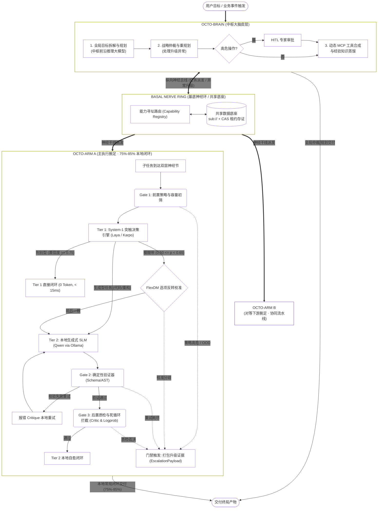

# 产品需求文档 (PRD)：Octpex

**项目名称：** Octpex  
**核心定位：** 仿生分布式认知拓扑与自我进化的端云协同智能体底座（Biomimetic Distributed Cognitive Topology & Self-Evolving Edge-Cloud Agent Fabric）  
**文档版本：** 2.2.0  
**开源协议：** Apache License 2.0  
**当前状态：** 定稿 / 可进入研发实施阶段  

---

## 1. 产品愿景与战略定位

### 1.1 愿景陈述
**Octpex** 旨在让企业级生产环境中的多智能体系统（Multi-Agent Systems）在经济成本上可持续、在响应速度上达到亚秒级、在能力上具备持续自我进化特性。受头足类动物（章鱼）分布式神经系统的启发——章鱼约三分之二的神经元分布在八条腕足的神经节中，而非全部集中于大脑——Octpex 将智能体架构从**“中心化云端大模型重度依赖”**转变为**“分布式、边缘优先的仿生认知拓扑”**。

### 1.2 项目边界定义（Octpex 是什么，不是什么）
* **Octpex 是什么：** 一个领域无关的**分布式认知调度底座与运行时（Distributed Cognitive Fabric & Scheduling Runtime）**。它通过共享协调神经环（**Basal Nerve Ring**），在顶层中枢推理模型（**Octo-Brain**）的宏观统筹下，调度大量搭载双层非自回归 System-1 决策引擎与 System-2 本地生成式小模型（SLM）的自主边缘执行节点（**Octo-Arms**）。
* **Octpex 不是什么：** Octpex **不是**另一个单机/单进程 Agent 开发 SDK（如 LangGraph、Google ADK 或 CrewAI），也**不是**底层操作系统或容器隔离沙盒（如 AbloEx）。相反，Octpex 充当连接异构智能体的**“分布式神经系统”**——它向下包裹现有的单机 Agent 运行时，跨节点路由协同任务，拦截并消化掉 70%–85% 的低价值大模型调用，并将高危工具执行委托给可插拔的安全沙盒。

---

## 2. 行业痛点与破局之道

企业团队将多智能体原型推向生产环境时，普遍会撞上四堵结构性高墙：

| 核心痛点 | 传统中心化架构的根源 | Octpex 的架构破局方案 |
| :--- | :--- | :--- |
| **1. Token 推理成本爆炸** | 无论任务多琐碎（日志去噪、JSON 格式化、API 报错重试、常规一级查询），全部调用云端前沿大模型，导致高达 80% 的 Token 费用被浪费。 | **三级认知阶梯与分流：** System-1 突触决策模型（`Karpo-Decision` / `Laya`）在 $< 50\text{ms}$ 内以零生成 Token 消化判别式路由与校验，本地 0.5B–4B 生成式小模型就地闭环 70%–85% 的常规任务。 |
| **2. 端到端响应延迟过高** | 经过公网 API 的多轮思考循环，单次工作流往往累积 5–30 秒的网络与推理延迟，无法满足实时业务 SLA。 | **单次前向读出与横向总线：** 非自回归单次前向分类读出、亚秒级本地 `执行 -> 检视 -> 重试` 微循环，配合腕足间点对点横向总线直接交接，彻底消除绕行中枢的往返开销。 |
| **3. 上下文污染与小模型盲目自信** | 将 50KB 原始日志或数据库杂乱记录直接塞入大模型会劣化规划精度；而本地小模型在面对陌生难题时极易产生“过度自信的幻觉”。 | **两级数据存储与客观门禁：** 腕足保留私有数据区隔离高频原始与敏感数据；跨节点协作通过**共享数据基质（Shared Data Substrate）**传输轻量引用指针（`sub://`），杜绝全量深拷贝与泄密风险；升级边界由宿主代码客观门禁强制裁决。 |
| **4. 静态工具僵化与框架孤岛** | 企业内不同团队使用不同框架（Go、LangGraph、ADK、AutoGen）开发 Agent，彼此无法共享新发现的工具，也无法从历史失败中沉淀经验。 | **根部神经环与跨层自进化：** 将异构框架统一挂载到同一能力发现总线上，并将中枢大模型解决过的难题自动蒸馏为共享的 **动态 MCP 工具（Dynamic MCP Box）**。 |

---

### 2.1 仿生解决方案：Octpex

受章鱼分布式神经系统的启发——章鱼约三分之二的神经元分布在腕足中，而非集中于大脑——**Octpex** 将高层战略推理与边缘局部执行反射解耦：

* **Octo-Brain（中枢大脑）：** 顶层战略推理中枢，专注于全局意图拆解、跨领域冲突仲裁和高风险任务升级。后端以厂商中立的可插拔架构对接前沿商用及开源推理大模型——包括海外前沿模型（如 Anthropic Claude、OpenAI GPT、Google Gemini）以及国内顶尖大模型（如阿里通义千问 Qwen、DeepSeek 等），不强行绑定具体版本号，随上游大模型生态演进平滑升级。
* **Basal Nerve Ring（腕足根部神经环）：** 轻量级分布式控制与协同记忆层，通过动态能力发现、引用传递式**共享数据基质（Shared Data Substrate）**和腕足间横向通信连接各边缘节点。
* **Octo-Arms（边缘腕足）：** 自主分布式工作节点，配备**腕足私有数据区（Private Ganglion Store）**、**System-1 非自回归突触决策引擎**（`Karpo-Decision` / `Laya`）与 **System-2 本地生成式小模型**（`Qwen3.5-4B` / `1.5B`），运行自纠正反射循环（`Act -> Inspect -> Retry`）。边缘腕足在本地就地处理高频与敏感原始数据，70%–85% 的常规任务在本地消化，仅将精炼产物写入共享数据基质或将低置信度异常升级至中枢。腕足通过验证工具与经验蒸馏持续进化；在集群部署中，故障腕足可被替换，符合条件的工作可重新分配，系统也可根据已注册能力和获准模板启动新的腕足实例以扩展容量。

这里的“神经系统”描述的是 Octpex 的分布式协同拓扑，并非负责编排的人工神经网络模型。任务如何拆解和协同，由运行时规划器、路由策略、注册中心及第 6 章所述协作模式决定。

### 2.2 端到端认知执行与自进化流转架构

下图详细展示了 Octpex 如何在三级认知阶梯中处理接收到的任务流——通过 System-1 在零 Token 消耗下极速闭环常规判别任务，通过本地 SLM 自愈修复生成任务，并仅将复杂异常升级至 `Octo-Brain` 进行仲裁与动态技能蒸馏：

#### 流程图图例与视觉符号说明

| 视觉元素 | 符号表现 | 架构含义与运行语义 |
| :--- | :--- | :--- |
| **粗实线双箭头** | `==>` | **主干总线调度流**：纵向控制总线任务派发、大脑重规划下发，以及边缘向上逆流反馈升级通道。 |
| **细实线单箭头** | `-->` | **常规控制与数据流**：顺序执行、状态流转、写入共享数据基质存证以及智能体主体交付结果。 |
| **虚线单箭头** | `-.->` | **异步/异常反馈流**：客观门禁触发升级抛出、动态 MCP 工具合成入库以及 Few-Shot 经验向下蒸馏。 |
| **实线外框容器** | 实线 Subgraph | **系统一等公民核心自治子系统**：`OCTO-BRAIN`（中枢大脑）、`BASAL NERVE RING`（基底神经环底座）与并排排布的 `OCTO-ARM A/B`（边缘自治腕足，全实框展示）。 |
| **圆角矩形** | `(...)` | **多条件确定性门禁检查**：内部文本宽松排版，杜绝棱形文本截断穿框。 |
| **轻量菱形** | `{...}` | **二值判定分流**：仅用于极其简短的分支选择（如是否高危、FlexDM 是否一致）。 |

---

## 3. 产品目标与量化考核指标 (KPIs)

### 3.1 核心业务与工程目标
1. **极致 FinOps 降本增效：** 在不牺牲最终决策准确率的前提下，将跨步骤企业工作流的前沿大模型 Token 消耗降低 **$\ge 60\%$**。
2. **亚秒级边缘响应能力：** 实现 System-1 突触决策延迟 **$< 50\text{ ms}$**，本地生成式反思循环延迟 **$< 800\text{ ms}$**（基于 GPU / Apple Silicon），根部神经环横向节点交接开销 **$< 15\text{ ms}$**。
3. **对小模型“零信任”的确定性治理：** 杜绝不可靠的本地小模型在未经校验的情况下执行高危操作，通过确定性硬校验器与校准后的 System-1 判别模型强制裁决，替代小模型的主观自评。
4. **硬件感知自适应边缘便携性：** 自动适配无独显轻薄本、老旧 8GB 显卡（如 NVIDIA GTX 1080）、Apple Silicon 统一内存及企业级 GPU，杜绝显存溢出（OOM）崩溃。
5. **持续自主进化能力：** 系统随着运行时间推移越来越聪明——将反复触发中枢升级的难题自动转化为本地可复用的 MCP 工具和 Few-shot 规则，使**本地消化率（Local Offload Rate）**从初始的 **70% 自然攀升至 90% 以上**。

### 3.2 量化成功基准指标

| 指标维度 | 关键绩效指标 (KPI) | 目标基准值 |
| :--- | :--- | :--- |
| **经济性 (FinOps)** | 本地消化率（`LOCAL_RESOLVE` 任务数 / 总子任务数） | 初始基准 $\ge 75\%$；自进化后 $\ge 85\%$ |
| **经济性 (FinOps)** | 前沿大模型净 Token 成本降幅 | 相比单体大模型基线降低 $\ge 60\%$ |
| **性能与延迟** | System-1 突触决策延迟 (P95) | $< 15\text{ ms}$（`Laya` CPU ONNX）/ $< 60\text{ ms}$（`Karpo-2B`） |
| **性能与延迟** | 腕足内部局部反思循环延迟 (P95) | $< 800\text{ ms}$（不含冷启动加载） |
| **性能与延迟** | 根部神经环横向节点交接耗时 (P95) | $< 15\text{ ms}$ |
| **可靠性与安全** | 升级漏报率（高危或非法输出绕过门禁的比例） | $< 1\%$ |
| **可靠性** | 集群任务持久性 | 通过持久化投递与重试，单个 Arm 崩溃后已接收任务仍可恢复 |
| **自进化能力** | 蒸馏技能 / 动态 MCP 工具复用率 | 每个动态生成工具 30 天内平均复用 $\ge 5\text{ 次}$ |

### 3.3 支持的部署模式

* **单机 / 开发者模式（`profile: local`）：** 无需集群服务即可在单台工作站运行，使用本地小模型运行时及嵌入式或进程内存储与协调组件，适用于开发、原型验证和边缘部署。
* **分布式 / 企业模式（`profile: cluster`）：** 可扩展至边缘服务器、容器或 Kubernetes，通过分布式总线与共享协调服务连接异构腕足运行时。消息传输可采用 gRPC 或 NATS JetStream，共享状态可采用 Redis/Valkey 等后端。

---

## 4. 目标用户与典型画像

1. **AI 平台与基础设施架构师：**
   * *核心诉求：* 寻找一套厂商中立、可水平扩展的分布式调度底座，统一收编企业内部技术栈各异（Python/Go、LangGraph/ADK）的智能体团队，同时严格控制云端大模型预算并建立全链路可观测性。
2. **企业应用与后端研发工程师：**
   * *核心诉求：* 希望通过标准化的服务提供者接口（SPI）和开放协议（MCP、gRPC、NATS），快速将现有业务逻辑包装为边缘执行节点，而无需从零编写复杂的分布式状态机与并发控制代码。
3. **边缘计算、IoT 与云原生运维团队：**
   * *核心诉求：* 在网络带宽受限或海量监控日志场景下，实现本地高噪数据就地清洗与故障自愈，仅将高价值异常摘要上报云端中枢大脑。

---

## 5. 与其他主流 Agent 框架的生态定位关系

Octpex 定位为位于底层通信/安全协议之上、包围单机 Agent 框架的**基础设施调度层**：

### 5.1 架构分层定位
* **第四层 — 宏观全局编排层（`GlobalOrchestratorSPI`）：** LangGraph（带环状态机）、Temporal（长周期持久化工作流）或 Octpex 内置的轻量 DAG 规划器。
* **第三层 — Octpex 分布式认知底座（本项目）：** 纵向/横向双平面神经总线、根部能力注册中心、CAS 版本控制共享数据基质（Shared Data Substrate）、三级认知阶梯客观升级漏斗（`System-1 突触决策 -> 边缘生成式 SLM -> 中枢大脑 LLM`）、动态 MCP 工具箱以及 FinOps 遥测引擎。
* **第二层 — 节点内部智能体运行时（`ArmRuntimeAdapterSPI`）：** Google ADK、LangGraph 子图、Microsoft AutoGen / Semantic Kernel、CrewAI 或轻量级原生 Go/Python 状态机。
* **第一层 — 外部工具与零信任沙盒层（`ToolInvocationSPI`）：** 模型上下文协议（MCP）、Google A2A 能力卡片、REST/gRPC 接口以及隔离执行沙盒（如 AbloEx）。

### 5.2 主流框架对比与融合矩阵

| 框架 / 工具名称 | 主要定位与适用范围 | 核心优势 | 与 Octpex 的集成关系 |
| :--- | :--- | :--- | :--- |
| **LangGraph** | 单节点 / 逻辑层有环状态图 | 精细的状态循环控制、原生的 `interrupt()` 人工审批挂起机制 | **嵌入式集成：** 既可驱动 `Octo-Brain` 的宏观全局编排，也可作为子图被包裹进单个 `Octo-Arm` 中运行。 |
| **Google ADK (Go / Python)** | 轻量级智能体与工具运行时 | 简洁的多语言智能体原语、会话与工具生命周期抽象 | **被包裹的边缘节点：** ADK 智能体通过 `ArmRuntimeAdapterSPI` 无缝挂载为分布式 `Octo-Arm`。 |
| **Microsoft AutoGen / Semantic Kernel** | 对话式多智能体群组与企业插件 | 丰富的多智能体辩论/批评模式，以及强大的 .NET/Python 企业连接器 | **被包裹的边缘节点：** 封装为根部神经环上具备特定能力标签的独立执行单元。 |
| **CrewAI** | 基于角色分工的任务协作团队 | 快速构建角色扮演型智能体协作流水线 | **被包裹的边缘节点：** 作为领域专属腕足群落接入总线，通过共享数据基质交换中间产物。 |
| **Temporal** | 分布式持久化执行引擎 | 进程崩溃自动恢复、基于事件溯源的重放，适合关键业务长周期任务 | **宏观底层引擎：** 可选作 `Octo-Brain` 的持久化执行底座，保障跨天级任务的容灾可靠性。 |
| **MCP / Google A2A** | 标准化工具与跨智能体通信协议 | 消除 $M \times N$ 工具对接胶水代码；统一智能体能力卡片描述 | **原生一等公民协议：** 腕足调用外部工具原生采用 `MCP`，横向节点能力发现兼容 `A2A` 规范。 |
| **AbloEx** | 零信任令牌衰减与多级隔离沙盒 | 逐跳 JWT 权限收敛、MicroVM/容器硬隔离、安全护栏与审计 | **姊妹安全底座项目：** 挂载于 `ToolInvocationSPI` 之下，专门承接高危工具与动态生成代码的安全隔离执行。 |

---

## 6. 核心功能需求规范

### 6.1 Octo-Brain（中枢大脑 / Central Cortex Plane）
* **FR-1.1 全局意图拆解与规划：** 将用户的复杂高层目标拆解为有向无环图（DAG）或带环状态机，子任务映射到抽象的**能力标签（`capability_tags`）**而非写死的节点 IP。
* **FR-1.2 升级仲裁与决策：** 当边缘腕足触碰客观升级门禁并上报压缩后的升级上下文包（`EscalationPayload`）时，给出权威裁决、动态调整全局计划或触发人工审批（HITL）。
* **FR-1.3 FinOps 与自进化遥测：** 实时聚合全网指标，输出**本地消化率（Local Offload Rate）**、**节省 Token 金额（$）**、**各门禁触发分布**以及**动态技能复用次数**。

### 6.2 Basal Nerve Ring（腕足根部神经环 / Shared Coordination Substrate）
* **FR-2.1 能力与对等节点注册中心：** 维护所有在线腕足的声明式清单（`ArmManifest`），包含角色语义向量、能力标签、本地小模型队列深度及健康心跳，实现动态服务发现。
* **FR-2.2 共享数据基质（Shared Data Substrate — 引用传递协同内存）：** 作为方便跨节点共享的轻量内存区域，采用基于乐观锁版本号（`CAS` / `ETag`）和分布式租约（TTL）存储协同产物。神经总线仅传输轻量级（`< 1KB`）URI 指针（`sub://session/artifact`），大幅减少跨网络大报文拷贝开销，并消除敏感数据广播泄露风险。
* **FR-2.3 双平面神经总线：**
  * *纵向控制总线（`Brain <-> Arm`）：* 负责子任务派发、背压流控（`PAUSE`/`RESUME`）以及异常升级上报。
  * *横向协同总线（`Arm <-> Arm`）：* 支持腕足之间点对点任务接力、顺序流水线（Sequential Pipeline）和空闲节点任务窃取（Work Stealing），受严格的 `max_lateral_hops` 最大跳数限制。
* **FR-2.4 动态 MCP 工具箱（Dynamic MCP Box）：** 集中存放由中枢大脑动态编写并注册的标准化 MCP 工具与复合脚本，所有具备权限的边缘腕足均可实时发现并调用。
* **FR-2.5 腕足自适应生命周期管理：** 在 `cluster` 模式下，检测不健康或不可用的腕足，通过持久化重试或任务重新分配恢复符合条件的工作，并依据已注册能力和获准模板启动或停止腕足实例以调整容量。全过程必须遵守配置的策略、资源配额和健康检查；不得创建不受限制的新能力或绕过授权。

### 6.3 Octo-Arms（边缘腕足 / Edge Ganglia）
* **FR-3.1 腕足私有数据区与轻量蒸馏：** 每条腕足配备独立的**私有数据区**，本地模型在私有区对海量高噪、原始敏感输入进行解析、去重与脱敏摘要，仅将需协同的精炼结果发布至根部共享数据基质（`Shared Data Substrate`）。
* **FR-3.2 三级认知执行阶梯与硬件感知路由：**
  * *Tier 1 — System-1 突触决策引擎（`Karpo-Decision` / `Laya`）：* 在非自回归架构下以单次前向读出处理 `choice`（多选项）、`noul`（布尔）与 `score`（打分）基础原语。纯判别型任务（分类、策略审计、告警去噪、离散工具路由）在 Tier 1 毫秒级直接闭环，无需调用生成式大模型。
  * *Tier 2 — System-2 边缘生成式小模型（`Qwen3.5-4B` / `1.5B`）：* 负责文本摘要、复杂 JSON 抽取、代码补丁编写等生成式子任务，受控于 `Act -> Inspect -> Retry` 确定性校验器与 System-1 质检批评。
  * *Tier 3 — 硬件探测与显存预算守卫（VRAM Budget Guard）：* 依据自动探测的硬件层级（无独显笔记本、8GB 显存 GTX 1080、Apple Silicon 统一内存或企业级显卡）动态选择本地模型档位，严防显存争抢与 OOM 崩溃。
* **FR-3.3 客观升级漏斗门禁（对小模型自评保持“零信任”）：** 由宿主运行时代码通过三道客观漏斗强制裁决是否上升中枢：
  1. *前置策略与语义门禁（Gate 1）：* System-1 评估策略风险（`risk: HIGH`）、陌生领域 OOD 匹配度、或输入长度超出本地安全窗口。
  2. *确定性验证器耗尽门禁（Gate 2）：* 经过 `max_reflex_retries` 局部自愈循环后，仍无法通过 Schema、代码语法或工具执行校验。
  3. *System-1 质检与死循环门禁（Gate 3）：* System-1 生成后置质量批评否决、输出/工具调用哈希高度重复（行为死循环）、或横向接力跳数达到上限（`hop_count >= max_lateral_hops`）。
* **FR-3.4 持续自进化局部神经节存储：** 为每条腕足配备零网络延迟的嵌入式本地存储（嵌入式向量库 + 本地 KV/SQLite），用于存放领域知识切片、蒸馏后的 Few-shot 成功范例、工具参数调优模板以及人工审批纠正约束。
* **FR-3.5 腕足故障恢复：** 腕足任务及恢复所需状态必须通过持久化任务机制和共享数据基质记录。腕足故障后，运行时可重启或替换实例，并重试或重新分配符合条件的任务；具有副作用的处理器必须实现幂等，或按任务 ID 去重。这属于运行时故障恢复，不代表节点丢失后仍能保留易失的本地状态。

### 6.4 多智能体经典协作模式支持
Octpex 在分布式节点拓扑层面原生支持四大经典编排范式：
* **FR-4.1 协调器模式（Coordinator Pattern）：** `Octo-Brain` 将非线性复杂请求拆分为多个并行子任务，按能力标签扇出分发给不同专长的 `Octo-Arm`，最后汇总生成终局答案。
* **FR-4.2 顺序模式（Sequential Pattern）：** 多条 `Octo-Arm` 在横向总线上组成确定性处理流水线（`Arm A -> Arm B -> Arm C`），通过共享数据基质指针（`sub://`）依次接力处理，全程无需惊动中枢大脑。
* **FR-4.3 迭代优化模式（Iterative Refinement Pattern）：** 既支持腕足内部的“生成 SLM $\rightarrow$ 规则/校验器批评 $\rightarrow$ 重试”微循环，也支持跨腕足的“生成腕足 $\leftrightarrow$ 评判腕足”对抗迭代，直至达到质量标准。
* **FR-4.4 人机协作模式（Human-in-the-Loop, HITL）：** 命中高危操作策略或升级仲裁边界时，系统干净挂起当前状态机并推送结构化审批单；人类专家的放行或修正指令不仅驱动后续执行，还会作为最高权重强化信号写入腕足局部约束库。

### 6.5 跨层级自我进化与能力蒸馏（“大脑教腕足”）
* **FR-5.1 动态 MCP 工具合成：** 当 `Octo-Brain` 解决了一个因能力缺失而升级上来的难题（例如解析某种全新的非结构化报文）时，中枢大模型不仅返回本次结果，还会编写一段可复用的脚本，将其注册为标准 MCP 工具存入根部的 **Dynamic MCP Box** 并广播通知边缘腕足。下次再遇到同类任务时，腕足本地小模型直接调用该工具即可 100% 本地闭环。
* **FR-5.2 上下文与工具参数持续优化：** 腕足自动记录运行轨迹中的成功经验、人工纠正反馈（HITL）以及 API 返回字段裁剪规则（Parameter Tuning），持续优化后续推理的上下文质量并降低 Token 占用。
* **FR-5.3 有界的能力扩展：** 系统可根据配置的负载或健康策略，使用获准模板为已注册能力启动腕足实例以扩展执行容量。新能力、可执行工具和特权操作在投入使用前必须通过相应的验证、授权与资源限制。

### 6.6 协议与框架互操作
* **FR-6.1 工具调用：** 通过统一的 `ToolInvocationSPI` 支持 `stdio` 和 Streamable HTTP 上的 MCP 工具、REST/gRPC 服务，以及可插拔的隔离执行沙箱。
* **FR-6.2 框架适配：** 提供标准 SPI，使受支持的 Agent 运行时可作为 Octo-Arm 或全局编排器接入，无需重写其领域逻辑。

---

## 7. 跨行业通用业务用例蓝图

### 用例 1：云原生智能运维（AIOps）与故障自愈
* **Octo-Arm #1（遥测与日志蒸馏腕足）：** System-1 突触引擎（`Laya` / `Karpo`）在 $< 20\text{ms}$ 内过滤 90% 常规日志噪声；本地生成式小模型（`Qwen3.5-4B`）对其余堆栈报错去重并提炼 150 字异常摘要写入共享数据基质。
* **Octo-Arm #2（诊断与补丁合成腕足）：** 通过横向总线接收基质指针事件（**顺序模式**），调用 MCP 工具检查实时容器与网络状态，生成修复配置草稿并通过干跑（Dry-run）Schema 校验（**迭代优化模式**）。
* **Octo-Brain：** 仅当故障波及多个集群或修复动作涉及生产环境高危变更时介入（触发 **HITL 人工审批**）。

### 用例 2：自进化供应链与物流单证自动化
* **Octo-Arm #1（运单与报关单规整腕足）：** 本地小模型将非结构化发货单、提单和地址文本解析为严格 JSON 格式。当遇到从未见过的新承运商模板导致 Gate 2 重试耗尽并升级时，`Octo-Brain` 自动编写一段确定性 Python 解析脚本注册进 **Dynamic MCP Box**，并下发 Few-shot 示例到该腕足——此后该承运商的所有后续单据全部在边缘 100% 本地秒级消化。
* **Octo-Arm #2（库存与运力感知腕足）：** 本地轮询仓库库容与车辆状态 API，过滤正常心跳波动，仅将缺货或延误异常发布至横向总线。

### 用例 3：企业级智能客服与工单自动分流
* **Octo-Arm #1（一线接待与初筛腕足）：** System-1 决策引擎在 50 个类别中精准识别工单意图并检查工具就绪度（`When2Call`），结合 4B 小模型与嵌入式 FAQ 向量库在本地消化约 80% 的一级咨询。
* **Octo-Arm #2（订单与账单查询腕足）：** 通过 MCP 查询内部 ERP/CRM 数据库，将多表关联的杂乱记录压缩为 3 行关键摘要存入共享数据基质。
* **Octo-Brain：** 专责处理大额退款争议、SLA 违约升级或合规政策例外，并将人类客服主管的裁决沉淀为腕足的永久本地约束规则。

### 用例 4：金融风控与反洗钱合规审计
* **Octo-Arm #1（交易流水特征提取腕足）：** 在腕足私有数据区内以 System-1 单次前向读出流式扫描高频交易流水，规整商户元数据并标记常规消费模式。
* **Octo-Arm #2（历史基线与黑名单核验腕足）：** 将初步异常与本地 KV/向量库中的历史行为基线交叉比对，在升级前过滤掉绝大多数低风险误报。
* **Octo-Brain：** 当多条腕足证据链交叉印证出高置信度可疑欺诈团伙时，由中枢大模型综合生成可审计的可疑交易报告（SAR）。

---

## 8. 范围边界与已交付核心特性矩阵

### 8.1 v1.0 非目标边界（Out of Scope）
* 不涉及基座大模型或小模型权重的预训练与微调（Octpex 聚焦于推理路由、上下文工程与动态工具合成）。
* 不重复实现操作系统级或虚拟化容器隔离沙盒（通过 `ToolInvocationSPI` 委托给专业安全底座如 AbloEx 执行）。
* v1.0 暂不开发面向终端消费者的重型图形化拖拽编排画布（聚焦于高性能标准化 SPI 接口、实时 Web 动态看板与结构化 REST API）。

### 8.2 生产级已交付与验证特性全景
* **单机极速仿生内核（`profile: local`）：** 纯内存基底神经环、Ollama 本地小模型适配器、Dual-Engine System-1 决策适配器（`Karpo-Decision` + `Laya`）及硬件显存守卫、三级认知阶梯客观升级漏斗及 FinOps Token 节省统计器。
* **企业级分布式集群中枢（`profile: cluster`）：** NATS JetStream 消费组双平面总线、Redis/Valkey 原子 CAS 共享数据基质（`sub://`）、etcd 5秒租约心跳注册表与背压任务窃取调度。
* **跨层级自进化与动态 MCP 工具箱：** “大脑教腕足”动态工具合成流水线、完整标准 MCP 客户端（`stdio` 与流式 HTTP/SSE），以及 AbloEx 静态 AST 准入安全拦截。
* **异构多框架生态与 Python SDK（`octpex-sdk`）：** 提供 Google ADK、LangGraph、Microsoft AutoGen、CrewAI 官方原生适配器，以及常驻智能体守护进程 `OctoArmDaemon`。
* **实时动态看板与微秒级吞吐：** 内置 Server-Sent Events（SSE: `/api/v1/events`）实时事件推流的异步 Web 动态看板，实测验证吞吐超越 960 万 CAS ops/s 与 810 万消息/s。
* **跨地域多集群联邦路由：** 跨数据中心对等节点发现、跨集群边界跳数与权限衰减及网络探活机制。
* **云原生生产交付包：** 多阶段极简 Docker 镜像、一键式 Docker Compose 依赖全栈，以及企业级 Helm v3 生产包（`deploy/helm/octpex`），支持 HPA 水平弹性伸缩。