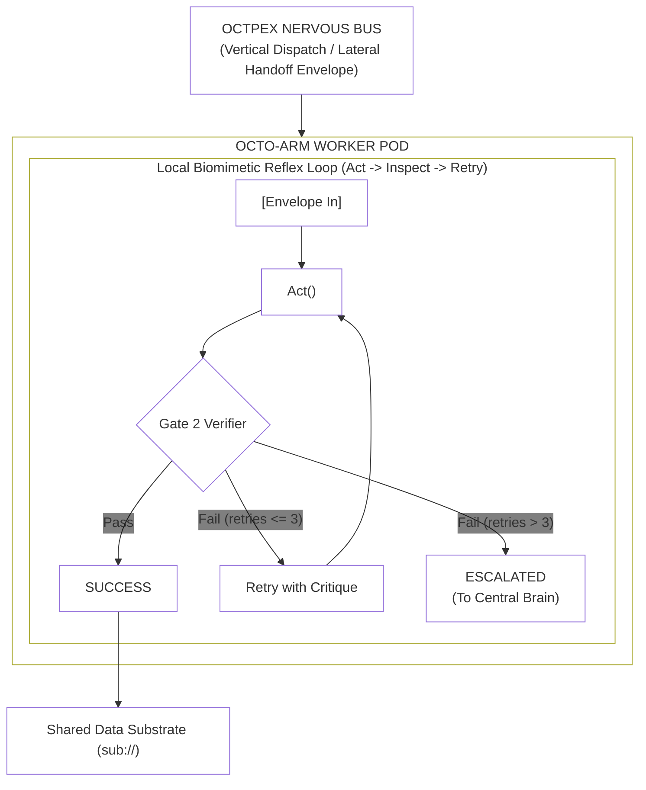
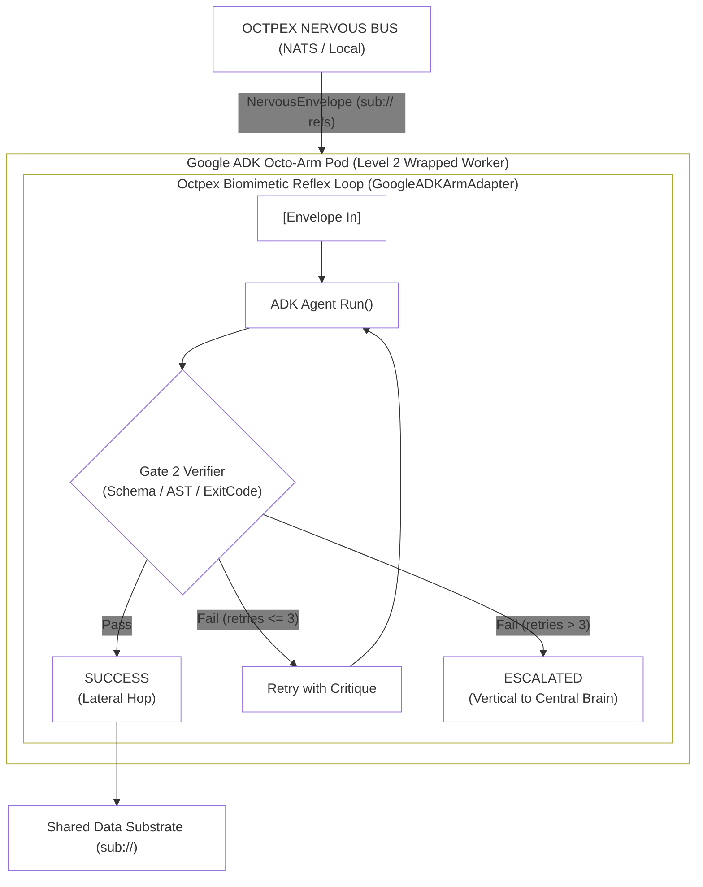

# Octpex Comprehensive Developer & Integration Guide

This guide provides developers, contributors, and integrators with everything needed to build, wrap, and extend agents on the Octpex Biomimetic Nervous System.

---

## 1. Core Architecture for Developers

In Octpex, an **Octo-Arm (Ganglion)** is a standardized distributed execution worker. Its intelligence level is decoupled across a flexible spectrum:
- **Level 0 (Zero-Intelligence FSM)**: Deterministic Go rules (< 5ms, 0 tokens).
- **Level 1 (Edge SLM Ganglion)**: Local small models (0.5B-3B via Ollama) executing with local self-healing reflex loops.
- **Level 2 (Single-Agent Wrapper)**: Python agents using Google ADK or LangGraph.
- **Level 3 (Multi-Agent Crew)**: Encapsulated debate teams or crews (AutoGen, CrewAI) acting as single high-cohesion nodes.



---

## 2. Writing Go Arms (Level 0 & Native Adapters)

To implement a high-speed Level 0 deterministic arm in Go:

```go
package main

import (
    "context"
    "octpex/pkg/adapter"
    "octpex/pkg/protocol"
    "octpex/pkg/substrate"
)

func RegisterMetricsArm(bus bus.NervousBus, sub substrate.DataSubstrateSPI) {
    fsm := adapter.NewNativeFSMAdapter(sub)
    fsm.RegisterHandler("metrics_filter", func(ctx context.Context, env *protocol.NervousEnvelope, sub substrate.DataSubstrateSPI) (*protocol.StepResult, error) {
        // Deterministic Go execution - 0 Token cost, <2ms execution
        uri := "sub://" + env.SessionID + "/filtered.json"
        _, err := sub.PutArtifact(ctx, uri, 0, []byte(`{"status":"clean"}`), 10*time.Minute)
        return &protocol.StepResult{
            Status: "SUCCESS",
            OutputMessage: "Cleaned metrics stored",
            SubstrateRefs: []protocol.SubstrateRef{{URI: uri, Version: 1}},
        }, err
    })
    bus.Subscribe("metrics_filter", fsm.ExecuteStep)
}
```

---

## 3. Python SDK & Framework Integration (`bridge/python/octpex`)

The Python SDK (`octpex-sdk`) wraps existing agent frameworks with the biomimetic reflex loop and zero-copy substrate access.

### 3.1 Installation

```bash
pip install -e bridge/python
```

### 3.2 LangGraph Integration

```python
from octpex import ArmConfig, NervousEnvelope
from octpex.adapters import LangGraphArmAdapter

def run_langgraph(state: dict) -> dict:
    critique = state.get("critique")
    # LangGraph logic here...
    return {"status": "ok", "patch": "applied"}

config = ArmConfig(arm_id="arm-langgraph-01", capability="code_patcher")
adapter = LangGraphArmAdapter(config, run_langgraph)
result = adapter.execute_envelope(incoming_envelope)
```

### 3.3 CrewAI Integration

```python
from octpex import ArmConfig
from octpex.adapters import CrewAIArmAdapter

def run_crew(inputs: dict) -> str:
    # crew.kickoff(inputs=inputs)
    return "Crew analysis completed"

config = ArmConfig(arm_id="arm-crew-01", capability="deep_analysis")
adapter = CrewAIArmAdapter(config, run_crew)
result = adapter.execute_envelope(incoming_envelope)
```

### 3.4 Google ADK Integration

In Octpex, Google Agent Development Kit (ADK) agents are encapsulated as **Level 2 (Wrapped Single Agent)** execution workers. Octpex does not replace Google ADK; instead, it serves as its distributed nervous coordination substrate, providing zero-copy data substrate access, host-enforced Gate 2 schema validation, local reflex retry loops, and lateral peer-to-peer handoffs.

#### 3.4.1 Architectural Role & Workflow



1. **Context Mapping**: The incoming `NervousEnvelope.parameters` and `session_id` are mapped into ADK's session context. Heavy payloads are resolved via `sub://` substrate pointers instead of being packed into the prompt.
2. **Local Reflex Loop**: If output fails external verification, `GoogleADKArmAdapter` passes targeted critique via `revision_instructions` back into the ADK Agent, driving self-correction without escalating to the central cloud model.
3. **Deterministic Gate 2**: Instead of relying on LLM self-evaluation, Octpex enforces external deterministic verification (JSON Schema, AST compiler, or shell exit codes).
4. **Lateral Handoff**: Once verified, the ADK arm emits output to `sub://` and dispatches a lateral envelope directly to the next peer arm (e.g. a Level 0 Go Verifier).
5. **Zero-Trust Attenuation**: Security tokens, permissions, and `max_allowed_hops` attenuate monotonically across hops to prevent runaway loops.

#### 3.4.2 Production Code Example

```python
import json
from octpex import (
    ArmConfig,
    NervousEnvelope,
    InMemorySubstrateClient,
    SubstrateRef,
)
from octpex.adapters import GoogleADKArmAdapter

# 1. Initialize Google ADK Agent runner
def build_adk_runner():
    # Standard Google ADK agent wrapper function
    def adk_runner(context: dict) -> dict:
        inputs = context.get("inputs", {})
        instructions = context.get("revision_instructions")

        # Self-correction path when revision instructions are supplied
        if instructions:
            return {
                "status": "ok",
                "resolved": True,
                "patch": "if (conn != null) { conn.close(); }",
                "notes": f"Applied fix per critique: {instructions}",
            }

        # Initial attempt output
        return {
            "status": "pending_check",
            "patch": "conn.close();",
        }

    return adk_runner

# 2. Configure Substrate and Arm parameters
substrate = InMemorySubstrateClient()
substrate.put_artifact(
    "sub://sess-001/raw_error.log",
    0,
    b"CRITICAL: NullPointerException at Service.java:102",
)

config = ArmConfig(
    arm_id="arm-adk-patcher-01",
    capability="code_patch_generator",
    max_reflex_retries=3,
    timeout_seconds=15.0,
)

# 3. Instantiate GoogleADKArmAdapter
adapter = GoogleADKArmAdapter(
    config=config,
    adk_run_fn=build_adk_runner(),
    substrate=substrate,
)

# 4. Attach deterministic Gate 2 verifier (External Objective Verification)
def gate2_verifier(output_str: str) -> str | None:
    try:
        data = json.loads(output_str)
        if data.get("status") != "ok":
            return "Output validation failed: 'status' must be 'ok'"
        if not data.get("patch"):
            return "Output validation failed: 'patch' cannot be empty"
        return None  # Verification passed
    except Exception as e:
        return f"JSON Parse error: {str(e)}"

adapter.set_gate2_verifier(gate2_verifier)

# 5. Execute incoming nervous envelope
incoming_envelope = NervousEnvelope(
    envelope_id="env-adk-001",
    trace_id="trace-cluster-001",
    session_id="sess-001",
    plane="VERTICAL",
    message_type="TASK_DISPATCH",
    source_node="octo-brain",
    substrate_refs=[SubstrateRef(uri="sub://sess-001/raw_error.log", version=1)],
    parameters={"target_file": "Service.java"},
)

step_result = adapter.execute_envelope(incoming_envelope)
print(f"Execution Status: {step_result.status}")
print(f"Reflex Retries  : {step_result.metadata.get('retries')}")
print(f"Output Payload  : {step_result.output_message}")
```

#### 3.4.3 Value Comparison: Standalone ADK vs. Octpex ADK Arm

| Dimension | Standalone Google ADK | Google ADK on Octpex Nervous System |
| :--- | :--- | :--- |
| **Token Consumption** | Full raw payloads injected into prompt; multi-turn central retries. | Zero-copy `sub://` substrate pointers; 70%-85% token reduction via edge offloading. |
| **End-to-End Latency** | Central cloud round-trips for every step (5-15s per cycle). | Sub-second intra-arm reflex loops (<800ms) and direct lateral handoffs (<15ms). |
| **Verification Reliability** | Reliant on LLM self-evaluation; susceptible to hallucinated success. | Host-enforced Gate 2 deterministic verifiers (Schema, AST, unit tests). |
| **Multi-Framework Interop** | Siloed within Python ecosystem; difficult to coordinate with Go FSMs. | Uniform `NervousEnvelope` protocol enables seamless Go, LangGraph, and ADK mesh. |
| **Safety Governance** | Unbounded recursive calls unless manually constrained. | Monotonically attenuating capability scopes and hard hop limits (`max_allowed_hops`). |

### 3.5 Microsoft AutoGen Integration

In Octpex, Microsoft AutoGen multi-agent debate teams (e.g. Coder, Critic, Tester) are encapsulated as **Level 3 (Multi-Agent Crew)** workers using `AutoGenArmAdapter`:

```python
from octpex import ArmConfig, NervousEnvelope
from octpex.adapters import AutoGenArmAdapter

def run_autogen_group_chat(context: dict) -> dict:
    # Simulates AutoGen GroupChat consensus resolution
    max_rounds = context.get("max_rounds", 3)
    return {
        "consensus": "Security fix reviewed and approved",
        "patch": "validateInput(data)",
        "rounds_used": 2,
    }

config = ArmConfig(arm_id="arm-autogen-01", capability="security_debate", max_reflex_retries=2)
adapter = AutoGenArmAdapter(config, run_autogen_group_chat, max_debate_rounds=3)
result = adapter.execute_envelope(incoming_envelope)
```

### 3.6 OctoArmDaemon Worker Runner (`octpex.worker`)

`OctoArmDaemon` provides a production worker runner to host Python arms as standalone daemons communicating with the Octpex Go kernel via REST APIs:

```python
from octpex import OctoArmDaemon
from octpex.adapters import GoogleADKArmAdapter

daemon = OctoArmDaemon(
    worker=adapter,
    server_url="http://localhost:8080",
    poll_interval=1.0,
)

# Execute an envelope locally
step_result = daemon.handle_envelope(envelope)

# Dispatch back to kernel
response = daemon.dispatch_to_kernel(envelope)
```

---

## 4. Model Context Protocol (MCP) and Compute

- **Local Edge SLM (Ollama)**: `pkg/adapter/ollama.go` connects to `localhost:11434` with strict JSON mode.
- **Central Frontier LLM**: `pkg/brain/frontier.go` connects to Gemini / OpenAI / Claude API endpoints.
- **MCP Client (`pkg/mcp`)**: Spawns external tool processes over `stdio` or connects via streaming HTTP.
- **Dynamic MCP Box (`pkg/tool`)**: Integrates external MCP servers via `dynamicMCPBox.RegisterMCPServer(ctx, client)` with AbloEx pre-admission static AST safety checks.

---

## 5. Web Visual Dashboard and REST API (`pkg/server`)

Octpex embeds an asynchronous HTTP server providing a real-time topology dashboard and management APIs.

### 5.1 Endpoints
- `GET /`: Interactive single-page web visual dashboard displaying cluster status, active Octo-Arms, and live FinOps metrics.
- `GET /api/v1/topology`: JSON status endpoint returning healthy registered arms, capability tags, and cluster nodes.
- `GET /api/v1/finops`: Returns FinOps summary including task counts, edge decoupling ratio, and estimated token/cost savings.
- `POST /api/v1/dispatch`: Accepts JSON nervous envelopes for programmatic direct dispatch into the nervous bus.

### 5.2 Server Usage in Go
```go
import "octpex/pkg/server"

srv := server.NewHTTPServer(
    server.ServerConfig{Port: 8080},
    nervousBus,
    capabilityRegistry,
    sharedSubstrate,
    finOpsCollector,
)
_ = srv.Start()
defer srv.Shutdown(ctx)
```

---

## 6. Physical Network Driver Factory (`pkg/driver`)

The `pkg/driver` package provides connection dialers for distributed deployments:
- `DialClusterSubsystems(ctx, cfg)`: Simultaneously connects to Redis, NATS, and etcd based on configuration.
- `DialRedisCommander(endpoint)`: Verifies Redis connectivity with automatic fallback for zero-crash testing.
- `DialNATSClient(url)`: Connects to the NATS JetStream messaging bus.
- `DialETCDClient(endpoints)`: Connects to the etcd cluster for distributed lease heartbeating.
- `LiveTCPProber`: Utility for probing socket availability.

---

## 7. Testing and Contribution Benchmarks

All code submitted to Octpex must pass:
```bash
# Full Go test suite
go test -v ./...

# Performance & latency stress benchmarks
bin/octpex.exe bench

# Automated Go benchmark suite
go test -v -bench "Benchmark" octpex/test

# Python SDK tests
python -m unittest discover -s bridge/python/tests

# Binary build verification
go build -o bin/octpex.exe cmd/octpex/main.go
```
