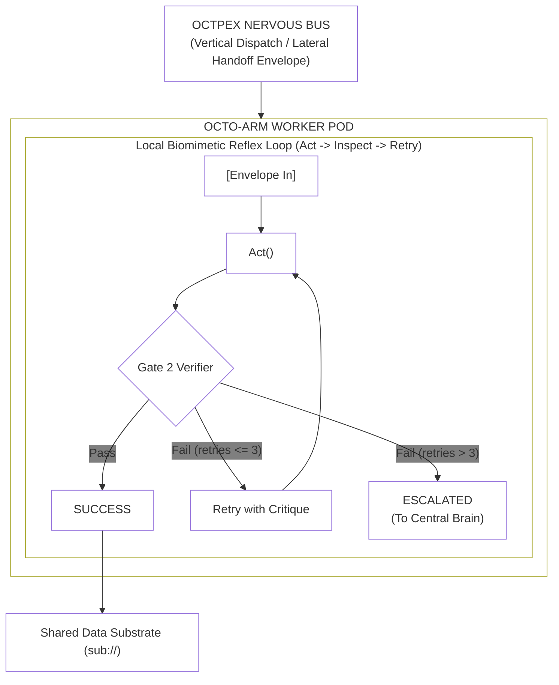
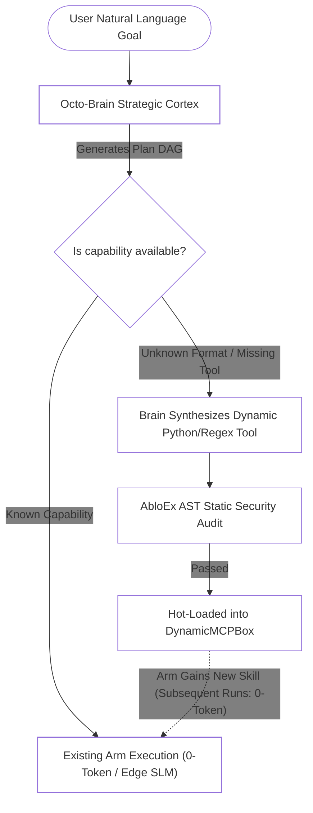
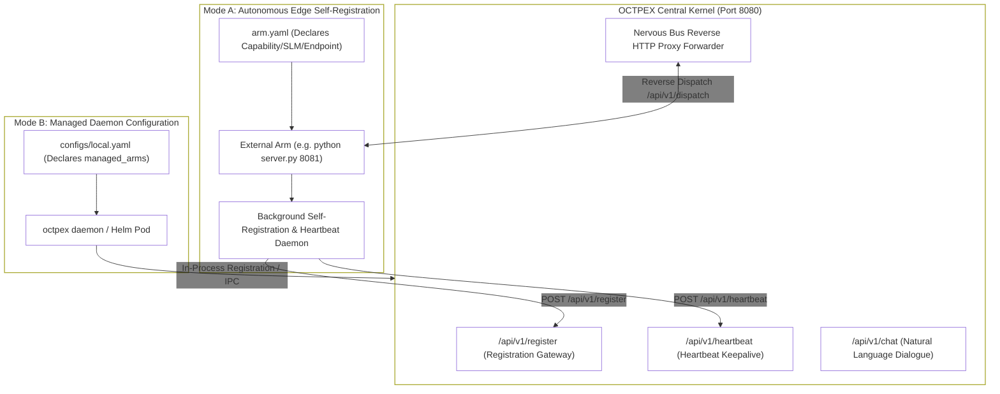
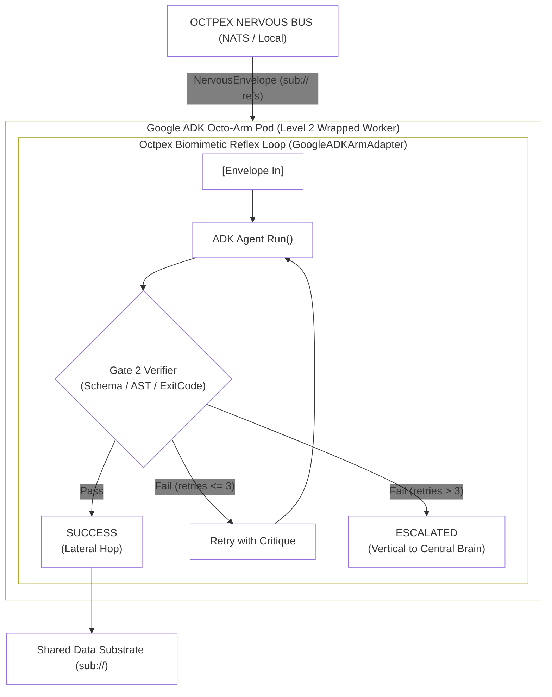

# Octpex Comprehensive Developer & Integration Guide

This guide provides developers, contributors, and integrators with everything needed to build, wrap, and extend agents on the Octpex Biomimetic Nervous System.

---

## 1. Core Architecture for Developers

In Octpex, an **Octo-Arm (Ganglion)** is a standardized distributed execution worker. Its intelligence level is decoupled across a flexible spectrum:
- **Level 0 (Zero-Intelligence FSM)**: Deterministic Go rules (< 5ms, 0 tokens).
- **Level 1 (Edge SLM Ganglion)**: Local small models (0.5B-3B via Ollama) executing with local self-healing reflex loops.
- **Level 2 (Single-Agent Wrapper)**: Python agents using Google ADK or LangGraph.
- **Level 3 (Multi-Agent Crew)**: Encapsulated debate teams or crews (AutoGen, CrewAI) acting as single high-cohesion nodes.



---

## 2. Octo-Arm Task Perception, Execution Dynamics & Self-Evolution Ecosystem

In a distributed agent fabric, developers often inquire how arms discover assignments, apply parameters, whether manual configuration is required, and how multi-language plugins are mounted.

### 2.1 Task Perception & Precision Routing (Capability Contract)
Octo-Arms and the central orchestrator are strictly decoupled via standard contracts:
1. **Capability Contract (`TargetCapability`)**:
   Every incoming `NervousEnvelope` declares its required capability (e.g., `distill-telemetry`, `blog-writer`). The NATS JetStream bus broadcasts or load-balances across consumer groups matching the subject `octpex.lateral.<capability>`.
2. **Capability Self-Registration (`ArmManifest`)**:
   Upon startup, each arm declares its supported `capability_tags` (e.g. `["distill-telemetry"]`) in its `ArmManifest` and self-registers with the etcd basal nerve ring.
3. **Internal Arm Handler Dispatch**:
   The arm adapter maintains an in-memory `handlers map[string]HandlerFunc`. Envelopes are routed to matching handlers in microseconds. Unhandled capabilities trigger a safe escalation (`ESCALATED`) back to the central cortex.

### 2.2 Dynamic Parameter Ingestion & Fallback Defaults
1. **Dynamic Parameters (`Parameters`)**:
   Callers or Octo-Brain pass custom regex rules (e.g. `parameters["pattern_regex"]`) or task-specific parameters inside `envelope.parameters`.
2. **Deterministic Defaults**:
   When parameters are omitted, arms fall back to high-throughput built-in algorithms (e.g. streaming line-level hash deduplication, achieving sub-millisecond response with 0 cloud tokens).
3. **Pass-by-Reference Data Transfer (`SubstrateRefs`)**:
   Voluminous logs and comprehensive draft outlines are never packed into envelopes. Instead, they are persisted into the shared substrate (Redis CAS / S3), with envelopes carrying lightweight `sub://` URI references.

### 2.3 Execution Paradigm: Automated Planning vs. Cross-Tier Self-Evolution
Do users need to manually configure and implement each arm? **No.**



1. **Standard Workflows (Automated)**: Users submit high-level natural language goals to `octpex-entry`. The brain decomposes goals into a Plan DAG and dispatches subtasks across existing arms.
2. **Unknown Formats (Self-Evolving)**: When encountering novel formats or missing parsers, arms trigger escalation. Octo-Brain dynamically synthesizes Python/regex tools, passes them through AST security scanning, and hot-loads them into the edge `DynamicMCPBox`, solving the task at 0 cloud tokens from the second invocation onwards.
3. **Enterprise Integration (Custom Workers)**: Developers only write lightweight worker scripts when connecting internal legacy databases or proprietary approval workflows.

### 2.4 Multi-Language Plugins & Default System Arm Matrix

#### 1. Multi-Language Mounting Patterns
- **Multi-Language Worker SDK**: Build independent worker pods in Python, TypeScript, Rust, or Java using `bridge/python` or lightweight NATS/Redis clients;
- **Standard MCP Plugins**: Mount off-the-shelf Stdio/SSE Model Context Protocol servers; Octpex wraps them natively into Octo-Arms;
- **Wasm & Sandboxed Scripts**: Execute dynamically synthesized scripts inside lightweight WebAssembly runtimes or container sandboxes without restarts.

#### 2. Default System Arm Matrix
- **Perception**: `distill-telemetry` (streaming hash log deduplication), `file-drain-harvester` (shared volume increment watcher);
- **Remediation**: `dynamic-mcp-executor` (executes synthesized tools), `k8s-remediation-arm` (stateless pod rollouts and self-healing);
- **Content Production**: `web-researcher` (fact extraction), `markdown-synthesizer` (draft generation), `critic-gate-evaluator` (multi-round objective rubric review);
- **HITL & Safety**: `hitl-notifier-arm` (suspends on high risk and alerts Slack/DingTalk), `git-ops-arm` (commits and opens pull requests);
- **Edge Inference**: `slm-classifier` (local 0.5B-7B models for semantic clustering at 0 cloud cost).

### 2.5 Arm Lifecycle Architecture: Autonomous Self-Registration vs Managed Config

In Octpex, the central brain (Octo-Brain) and edge arms (Octo-Arms) are loosely coupled. Arms can run either as standalone microservices or managed centrally by a daemon:



1. **Autonomous Edge Self-Registration Mode (e.g., Weather Arm)**:
   * The arm runs as a standalone process (Python/Node/Rust) with its own `arm.yaml`;
   * At startup, a background daemon POSTs its registration card (Arm ID, role, hardware tier, endpoint, and capability tags) to `http://127.0.0.1:8080/api/v1/register`;
   * The central brain mounts a reverse HTTP proxy forwarder on the nervous bus for those capability tags;
   * The arm sends heartbeats to `POST /api/v1/heartbeat` every 5 seconds. If heartbeats cease for > 15 seconds, the brain automatically deregisters the node.
2. **Managed Config-Driven Mode**:
   * In containerized daemon environments, declare system-level arms under `daemon.managed_arms` in `configs/local.yaml` or `configs/cluster.yaml`. `octpex daemon` initializes and supervises them centrally.
3. **Cloud-Native Kubernetes Mode**:
   * Each arm runs as a Kubernetes Deployment with `OCTPEX_BRAIN_URL=http://octpex-brain:8080` injected as an environment variable. K8s handles scaling and readiness probes while the arm auto-registers to the central service.

### 2.6 Web Dashboard Dialogue Console & Task Delegation

After starting `make run`, opening `http://localhost:8080` provides the full-featured Biomimetic Dashboard:
1. **Interactive Biomimetic Dialogue Panel**:
   * Located at the top of the page, offering a natural language input field, preset prompt chips (`Beijing Temperature`, `Tokyo Weather (Dual)`, `Telemetry Analysis`), and conversation history;
   * Upon submitting a prompt, the web UI calls `POST /api/v1/chat`;
   * The brain analyzes the intent, builds a standard `VERTICAL` `NervousEnvelope`, and routes it over the bus to the arm subscribing to that capability tag;
   * The arm executes the task, persists structured data to `sub://`, and returns the result, which is rendered directly into the chat stream.
2. **Dynamic Topology Visualization**:
   * The dashboard polls `/api/v1/topology` every 3 seconds. When an external arm registers and sends heartbeats, it instantly lights up under **OCTO-ARMS MESH**;
   * Live Server-Sent Events (`/api/v1/events`) display real-time pulse activity.

---

## 3. Writing Go Arms (Level 0 & Native Adapters)

To implement a high-speed Level 0 deterministic arm in Go:

```go
package main

import (
    "context"
    "octpex/pkg/adapter"
    "octpex/pkg/protocol"
    "octpex/pkg/substrate"
)

func RegisterMetricsArm(bus bus.NervousBus, sub substrate.DataSubstrateSPI) {
    fsm := adapter.NewNativeFSMAdapter(sub)
    fsm.RegisterHandler("metrics_filter", func(ctx context.Context, env *protocol.NervousEnvelope, sub substrate.DataSubstrateSPI) (*protocol.StepResult, error) {
        // Deterministic Go execution - 0 Token cost, <2ms execution
        uri := "sub://" + env.SessionID + "/filtered.json"
        _, err := sub.PutArtifact(ctx, uri, 0, []byte(`{"status":"clean"}`), 10*time.Minute)
        return &protocol.StepResult{
            Status: "SUCCESS",
            OutputMessage: "Cleaned metrics stored",
            SubstrateRefs: []protocol.SubstrateRef{{URI: uri, Version: 1}},
        }, err
    })
    bus.Subscribe("metrics_filter", fsm.ExecuteStep)
}
```

---

## 4. Python SDK & Framework Integration (`bridge/python/octpex`)

The Python SDK (`octpex-sdk`) wraps existing agent frameworks with the biomimetic reflex loop and zero-copy substrate access.

### 3.1 Installation

```bash
pip install -e bridge/python
```

### 3.2 LangGraph Integration

```python
from octpex import ArmConfig, NervousEnvelope
from octpex.adapters import LangGraphArmAdapter

def run_langgraph(state: dict) -> dict:
    critique = state.get("critique")
    # LangGraph logic here...
    return {"status": "ok", "patch": "applied"}

config = ArmConfig(arm_id="arm-langgraph-01", capability="code_patcher")
adapter = LangGraphArmAdapter(config, run_langgraph)
result = adapter.execute_envelope(incoming_envelope)
```

### 3.3 CrewAI Integration

```python
from octpex import ArmConfig
from octpex.adapters import CrewAIArmAdapter

def run_crew(inputs: dict) -> str:
    # crew.kickoff(inputs=inputs)
    return "Crew analysis completed"

config = ArmConfig(arm_id="arm-crew-01", capability="deep_analysis")
adapter = CrewAIArmAdapter(config, run_crew)
result = adapter.execute_envelope(incoming_envelope)
```

### 3.4 Google ADK Integration

In Octpex, Google Agent Development Kit (ADK) agents are encapsulated as **Level 2 (Wrapped Single Agent)** execution workers. Octpex does not replace Google ADK; instead, it serves as its distributed nervous coordination substrate, providing zero-copy data substrate access, host-enforced Gate 2 schema validation, local reflex retry loops, and lateral peer-to-peer handoffs.

#### 3.4.1 Architectural Role & Workflow



1. **Context Mapping**: The incoming `NervousEnvelope.parameters` and `session_id` are mapped into ADK's session context. Heavy payloads are resolved via `sub://` substrate pointers instead of being packed into the prompt.
2. **Local Reflex Loop**: If output fails external verification, `GoogleADKArmAdapter` passes targeted critique via `revision_instructions` back into the ADK Agent, driving self-correction without escalating to the central cloud model.
3. **Deterministic Gate 2**: Instead of relying on LLM self-evaluation, Octpex enforces external deterministic verification (JSON Schema, AST compiler, or shell exit codes).
4. **Lateral Handoff**: Once verified, the ADK arm emits output to `sub://` and dispatches a lateral envelope directly to the next peer arm (e.g. a Level 0 Go Verifier).
5. **Zero-Trust Attenuation**: Security tokens, permissions, and `max_allowed_hops` attenuate monotonically across hops to prevent runaway loops.

#### 3.4.2 Production Code Example

```python
import json
from octpex import (
    ArmConfig,
    NervousEnvelope,
    InMemorySubstrateClient,
    SubstrateRef,
)
from octpex.adapters import GoogleADKArmAdapter

# 1. Initialize Google ADK Agent runner
def build_adk_runner():
    # Standard Google ADK agent wrapper function
    def adk_runner(context: dict) -> dict:
        inputs = context.get("inputs", {})
        instructions = context.get("revision_instructions")

        # Self-correction path when revision instructions are supplied
        if instructions:
            return {
                "status": "ok",
                "resolved": True,
                "patch": "if (conn != null) { conn.close(); }",
                "notes": f"Applied fix per critique: {instructions}",
            }

        # Initial attempt output
        return {
            "status": "pending_check",
            "patch": "conn.close();",
        }

    return adk_runner

# 2. Configure Substrate and Arm parameters
substrate = InMemorySubstrateClient()
substrate.put_artifact(
    "sub://sess-001/raw_error.log",
    0,
    b"CRITICAL: NullPointerException at Service.java:102",
)

config = ArmConfig(
    arm_id="arm-adk-patcher-01",
    capability="code_patch_generator",
    max_reflex_retries=3,
    timeout_seconds=15.0,
)

# 3. Instantiate GoogleADKArmAdapter
adapter = GoogleADKArmAdapter(
    config=config,
    adk_run_fn=build_adk_runner(),
    substrate=substrate,
)

# 4. Attach deterministic Gate 2 verifier (External Objective Verification)
def gate2_verifier(output_str: str) -> str | None:
    try:
        data = json.loads(output_str)
        if data.get("status") != "ok":
            return "Output validation failed: 'status' must be 'ok'"
        if not data.get("patch"):
            return "Output validation failed: 'patch' cannot be empty"
        return None  # Verification passed
    except Exception as e:
        return f"JSON Parse error: {str(e)}"

adapter.set_gate2_verifier(gate2_verifier)

# 5. Execute incoming nervous envelope
incoming_envelope = NervousEnvelope(
    envelope_id="env-adk-001",
    trace_id="trace-cluster-001",
    session_id="sess-001",
    plane="VERTICAL",
    message_type="TASK_DISPATCH",
    source_node="octo-brain",
    substrate_refs=[SubstrateRef(uri="sub://sess-001/raw_error.log", version=1)],
    parameters={"target_file": "Service.java"},
)

step_result = adapter.execute_envelope(incoming_envelope)
print(f"Execution Status: {step_result.status}")
print(f"Reflex Retries  : {step_result.metadata.get('retries')}")
print(f"Output Payload  : {step_result.output_message}")
```

#### 3.4.3 Value Comparison: Standalone ADK vs. Octpex ADK Arm

| Dimension | Standalone Google ADK | Google ADK on Octpex Nervous System |
| :--- | :--- | :--- |
| **Token Consumption** | Full raw payloads injected into prompt; multi-turn central retries. | Zero-copy `sub://` substrate pointers; 70%-85% token reduction via edge offloading. |
| **End-to-End Latency** | Central cloud round-trips for every step (5-15s per cycle). | Sub-second intra-arm reflex loops (<800ms) and direct lateral handoffs (<15ms). |
| **Verification Reliability** | Reliant on LLM self-evaluation; susceptible to hallucinated success. | Host-enforced Gate 2 deterministic verifiers (Schema, AST, unit tests). |
| **Multi-Framework Interop** | Siloed within Python ecosystem; difficult to coordinate with Go FSMs. | Uniform `NervousEnvelope` protocol enables seamless Go, LangGraph, and ADK mesh. |
| **Safety Governance** | Unbounded recursive calls unless manually constrained. | Monotonically attenuating capability scopes and hard hop limits (`max_allowed_hops`). |

### 3.5 Microsoft AutoGen Integration

In Octpex, Microsoft AutoGen multi-agent debate teams (e.g. Coder, Critic, Tester) are encapsulated as **Level 3 (Multi-Agent Crew)** workers using `AutoGenArmAdapter`:

```python
from octpex import ArmConfig, NervousEnvelope
from octpex.adapters import AutoGenArmAdapter

def run_autogen_group_chat(context: dict) -> dict:
    # Simulates AutoGen GroupChat consensus resolution
    max_rounds = context.get("max_rounds", 3)
    return {
        "consensus": "Security fix reviewed and approved",
        "patch": "validateInput(data)",
        "rounds_used": 2,
    }

config = ArmConfig(arm_id="arm-autogen-01", capability="security_debate", max_reflex_retries=2)
adapter = AutoGenArmAdapter(config, run_autogen_group_chat, max_debate_rounds=3)
result = adapter.execute_envelope(incoming_envelope)
```

### 3.6 OctoArmDaemon Worker Runner (`octpex.worker`)

`OctoArmDaemon` provides a production worker runner to host Python arms as standalone daemons communicating with the Octpex Go kernel via REST APIs:

```python
from octpex import OctoArmDaemon
from octpex.adapters import GoogleADKArmAdapter

daemon = OctoArmDaemon(
    worker=adapter,
    server_url="http://localhost:8080",
    poll_interval=1.0,
)

# Execute an envelope locally
step_result = daemon.handle_envelope(envelope)

# Dispatch back to kernel
response = daemon.dispatch_to_kernel(envelope)
```

---

## 5. Model Context Protocol (MCP) and Compute

### 5.1 Compute Adapters & Architecture
- **Local Edge SLM (Ollama)**: [pkg/adapter/ollama.go](../pkg/adapter/ollama.go) connects to port `11434` with strict JSON mode and millisecond-level token telemetry.
- **Central Frontier LLM**: [pkg/brain/frontier.go](../pkg/brain/frontier.go) connects to Claude / GPT / Gemini / Qwen / DeepSeek API endpoints.
- **MCP Client (`pkg/mcp`)**: Spawns external tool processes over `stdio` or connects via streaming HTTP.
- **Dynamic MCP Box (`pkg/tool`)**: Integrates external MCP servers via `dynamicMCPBox.RegisterMCPServer(ctx, client)` with AbloEx pre-admission static AST safety checks.

### 5.2 WSL2 to Windows Host Ollama Connectivity & Firewall Guide

When developing on Windows workstations, developers frequently run Octpex or Kubernetes inside WSL2 (Linux subsystem) while running Ollama on the Windows host to take advantage of host GPU drivers. A common issue is WSL2 failing to connect to port `11434` on Windows host (`Connection refused` or timeout).

#### 1. Root Causes Analysis
1. **Ollama Default Binding (127.0.0.1)**:
   By default, Ollama on Windows binds strictly to `127.0.0.1:11434`. In standard WSL2 NAT mode, WSL2 is a virtual machine with its own virtual IP (e.g. `172.x.x.x`). Requests arriving from WSL2 are dropped by Ollama because they do not originate from Windows' local loopback.
2. **Windows Defender Firewall Inbound Block**:
   Windows Defender Firewall blocks incoming connections on third-party non-standard ports (11434) from virtual network adapters.
3. **Incorrect Target IP in WSL2**:
   Inside WSL2, `localhost` resolves to WSL2 itself, not the Windows host.

#### 2. Three-Step Resolution

##### Step 1: Bind Ollama to All Interfaces (`0.0.0.0`)
Set the environment variable on Windows and restart Ollama:
- **Temporary (PowerShell)**:
  ```powershell
  $env:OLLAMA_HOST = "0.0.0.0:11434"
  ollama serve
  ```
- **Permanent**:
  In Windows System Properties -> Environment Variables, add a System Variable:
  - Variable: `OLLAMA_HOST`
  - Value: `0.0.0.0:11434`
  - Exit Ollama from the system tray and restart it.
- **Verify Listening State (Windows PowerShell)**:
  ```powershell
  netstat -ano | findstr 11434
  # Output must show: TCP 0.0.0.0:11434 ... LISTENING
  ```

##### Step 2: Open Windows Defender Firewall for Port 11434
In Windows host, open **PowerShell as Administrator** and create an inbound rule:
```powershell
New-NetFirewallRule -DisplayName "Ollama Port 11434" -Direction Inbound -LocalPort 11434 -Protocol TCP -Action Allow
```

##### Step 3: Configure WSL2 Networking Mode or Target Host IP
- **Option A (Recommended: Enable WSL2 Mirrored Networking)**:
  In `%USERPROFILE%\.wslconfig` on Windows (create if absent):
  ```ini
  [wsl2]
  networkingMode=mirrored
  ```
  Run `wsl --shutdown` in Windows to restart WSL. Afterwards, WSL2 and Windows share the network stack, allowing `http://localhost:11434` directly from WSL2!
- **Option B (Classic NAT: Dynamic Gateway IP)**:
  In WSL2 terminal:
  ```bash
  export WINDOWS_HOST=$(ip route show default | awk '{print $3}')
  echo "Windows Host IP: $WINDOWS_HOST"
  ```
  Set `base_url` in `configs/local.yaml` to: `http://${WINDOWS_HOST}:11434`.

#### 3. Verification & Testing Procedure

Inside your WSL2 terminal, run these verification steps:

```bash
# 1. Test TCP port reachability
nc -zv ${WINDOWS_HOST:-localhost} 11434
# Expected: Connection to ... 11434 port [tcp/*] succeeded!

# 2. Test HTTP API and model listing
curl -s http://${WINDOWS_HOST:-localhost}:11434/api/tags | jq .
# Expected: Returns list of downloaded models (e.g. qwen2.5:3b)

# 3. Test end-to-end inference generation
curl -s http://${WINDOWS_HOST:-localhost}:11434/api/generate -d '{
  "model": "qwen2.5:3b",
  "prompt": "Hello from WSL2, are you ready?",
  "stream": false
}' | jq .
# Expected: "done": true with model response text
```

### 5.3 Automated Model Health Probe (`cluster/probe_models.py`)

Run the built-in diagnostic tool to test both local SLM and cloud LLM:
```bash
python cluster/probe_models.py
```

---

## 6. Web Visual Dashboard and REST API (`pkg/server`)

Octpex embeds an asynchronous HTTP server providing a real-time topology dashboard and management APIs.

### 5.1 Endpoints
- `GET /`: Interactive single-page web visual dashboard displaying cluster status, active Octo-Arms, and live FinOps metrics.
- `GET /api/v1/topology`: JSON status endpoint returning healthy registered arms, capability tags, and cluster nodes.
- `GET /api/v1/finops`: Returns FinOps summary including task counts, edge decoupling ratio, and estimated token/cost savings.
- `POST /api/v1/dispatch`: Accepts JSON nervous envelopes for programmatic direct dispatch into the nervous bus.

### 5.2 Server Usage in Go
```go
import "octpex/pkg/server"

srv := server.NewHTTPServer(
    server.ServerConfig{Port: 8080},
    nervousBus,
    capabilityRegistry,
    sharedSubstrate,
    finOpsCollector,
)
_ = srv.Start()
defer srv.Shutdown(ctx)
```

---

## 7. Physical Network Driver Factory (`pkg/driver`)

The `pkg/driver` package provides connection dialers for distributed deployments:
- `DialClusterSubsystems(ctx, cfg)`: Simultaneously connects to Redis, NATS, and etcd based on configuration.
- `DialRedisCommander(endpoint)`: Verifies Redis connectivity with automatic fallback for zero-crash testing.
- `DialNATSClient(url)`: Connects to the NATS JetStream messaging bus.
- `DialETCDClient(endpoints)`: Connects to the etcd cluster for distributed lease heartbeating.
- `LiveTCPProber`: Utility for probing socket availability.

---

## 8. Multi-Tier Testing Matrix & Verification Guide

To address validation requirements from lightweight single-node development up to containerized staging and production Kubernetes deployment, Octpex establishes a 3-tier testing hierarchy:

### 8.1 Tier 1: Local Native Testing

Ideal for day-to-day coding, unit verification, and sub-second feedback loops without launching Docker or Kubernetes:

```bash
# 1. Full Go unit test suite with race detection
go test -v -race ./pkg/... ./internal/...

# 2. Kernel throughput and microsecond latency stress benchmarks
./bin/octpex bench
# Or run automated Go benchmark suite:
go test -v -bench "Benchmark" octpex/test

# 3. Run daemon via parameterized Makefile
make run
# Or with cluster profile and custom port:
make run PROFILE=cluster PORT=9090

# 4. Automated kernel self-evaluation and audit (Eval)
./bin/octpex eval -profile=local

# 5. Python SDK test suite (cross-language bridge & gate primitives)
python -m unittest discover -s bridge/python/tests

# 6. Production Arm business logic and Gate 2 self-repair demo
python examples/weather_mcp_arm/main.py

# 7. SLM (Ollama) & Frontier LLM (Gemini/OpenAI) connectivity and latency probe
python cluster/probe_models.py
```

---

### 8.2 Tier 2: Docker Container & Multi-Node Integration Testing

Validates standard OCI packaging, environment isolation, and multi-node middleware interactions:

```bash
# 1. Single-container image build (cross-compiles static Linux binary)
make docker-build
# Verify standalone container execution:
docker run --rm -p 8080:8080 octpex/kernel:0.5.0

# 2. Docker Compose 5-container topology integration
docker compose -f deploy/docker-compose.yaml up -d
# Includes: Octpex kernel, NATS JetStream, Redis CAS substrate, etcd registry, and Ollama

# 3. Automated distributed end-to-end workflow verification
# Validates cross-node envelope routing, Redis CAS artifacts, and Node B failure recovery
python cluster/test_workflow.py

# 4. Inspect container runtime logs
docker compose -f deploy/docker-compose.yaml logs -f octpex-entry
```

---

### 8.3 Tier 3: Kubernetes Cloud-Native Multi-Agent Verification

For local Kind/Docker Desktop clusters or remote production environments, Makefile targets provide a fast inner development loop:

```bash
# 1. Automated inner development loop (build -> import to containerd -> rollout restart)
make dev

# 2. Inspect cluster Pod statuses (verify octpex-entry and octpex-worker are Running)
make status
# Or via kubectl directly:
kubectl get pods -n octpex-system -o wide

# 3. Stream real-time orchestrator dispatch logs
make logs

# 4. Port-forward and REST API end-to-end verification
kubectl port-forward svc/octpex-entry 8080:8080 -n octpex-system &

# Verify active topology and arm discovery:
curl http://localhost:8080/api/v1/topology

# Verify task dispatch and StepResult execution:
curl -X POST http://localhost:8080/api/v1/dispatch \
  -H "Content-Type: application/json" \
  -d '{
    "target_capability": "distill-telemetry",
    "parameters": {"metric": "latency", "window": "5m"}
  }'
```
