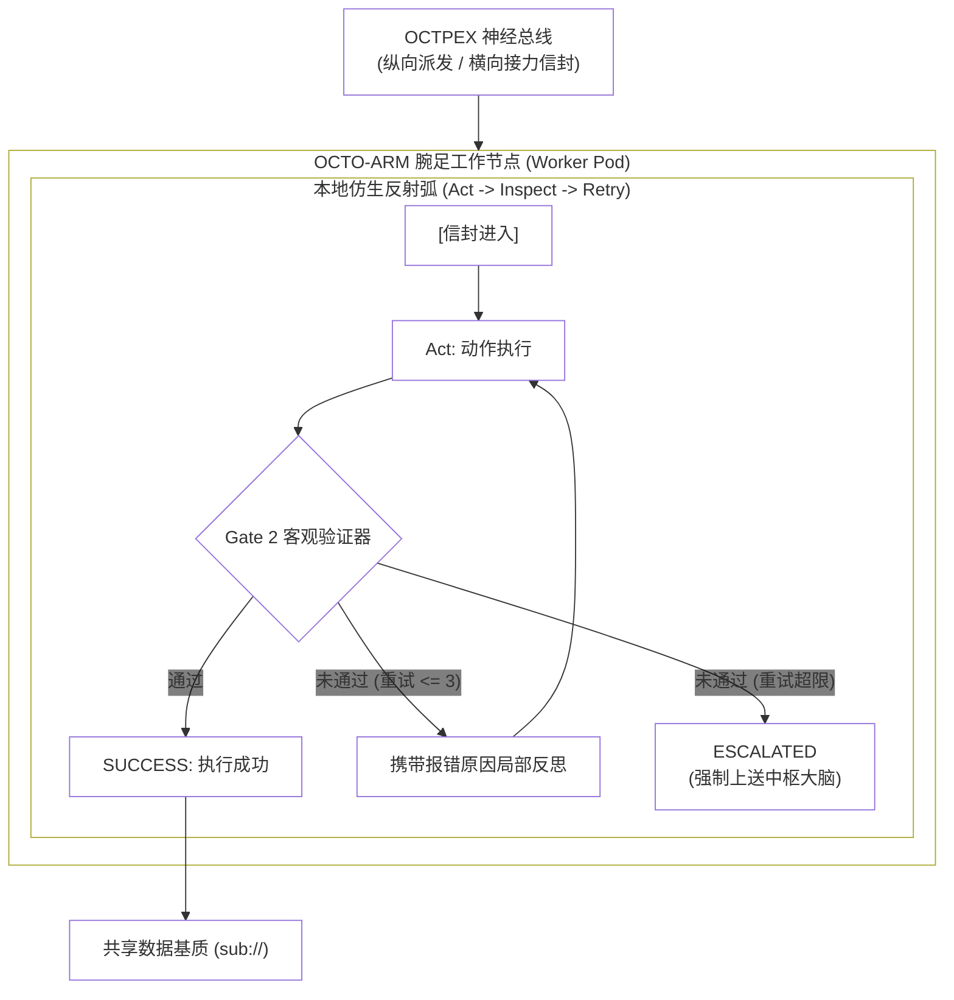
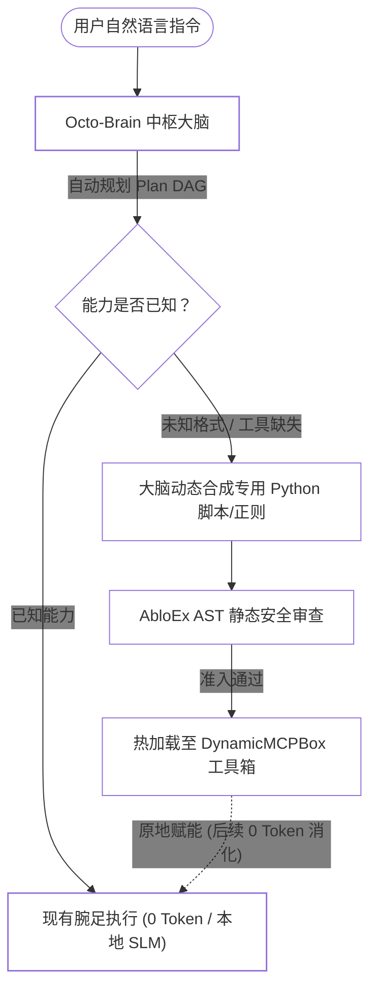
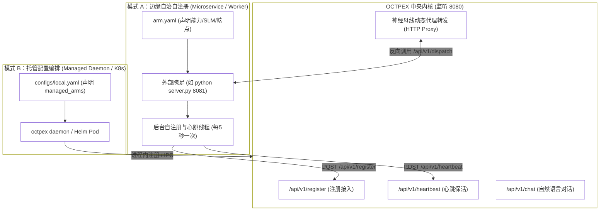
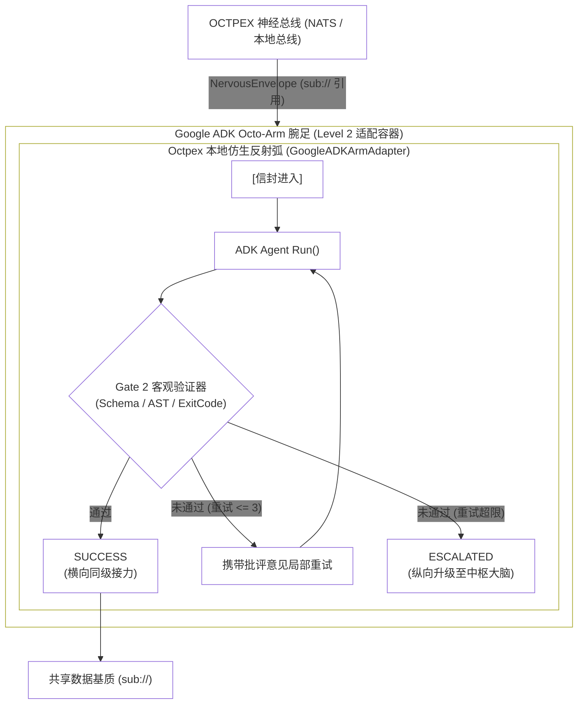

# Octpex 开发者与生态集成综合指南

本文档为二次开发者、社区贡献者与框架集成商提供在 Octpex 仿生智能体分布式基质上构建、封装与扩展 Agent 的全景指导。

---

## 1. 核心架构认知

在 Octpex 中，**Octo-Arm（腕足）** 本质是一个具备统一通信契约的分布式执行单元（Pod）。腕足内部的智能等级完全解耦，支持四级自适应阶梯：
- **Level 0（零智能吸盘）**：纯 Go 原生确定性状态机（< 5ms，0 Token 消耗）。
- **Level 1（边缘 SLM 反射）**：本地轻量小模型（0.5B-3B via Ollama），运行就地自愈微循环。
- **Level 2（包装单兵 Agent）**：通过 Python SDK 包装 Google ADK 或 LangGraph 智能体。
- **Level 3（封装多 Agent 团队）**：将 AutoGen 辩论组或 CrewAI 团队封装为单一高内聚专家节点。



---

## 2. 腕足任务感知、执行机理与自进化生态

在分布式环境中，许多开发者关心腕足如何获知任务指令、如何使用规则参数、是否需要手动配置，以及如何以多语言插件形式接入。

### 2.1 任务感知与精准分发（能力契约）
腕足与调度中枢之间解耦，完全通过统一契约流转：
1. **能力标签契约（`TargetCapability`）**：
   任务信封（`NervousEnvelope`）标明其目标能力（如 `distill-telemetry`、`blog-writer`）。NATS JetStream 消息总线按主题 `octpex.lateral.<capability>` 进行精准广播或负载均衡派发。
2. **能力自注册（`ArmManifest`）**：
   每个腕足启动时，在 `ArmManifest` 中声明其具备的 `capability_tags`（如 `["distill-telemetry"]`）并自注册至 etcd 基底神经环。
3. **腕足内部路由分发**：
   腕足适配器内部维护 `handlers map[string]HandlerFunc`，收到信封后依据 `env.TargetCapability` 毫秒级分派至具体函数。未注册的能力则安全阻断并向中枢升级（`ESCALATED`）。

### 2.2 参数动态传递与缺省策略回退
1. **动态入参（`Parameters`）**：
   调用方或中枢大脑可在 `envelope.parameters` 中下发专有提取正则（如 `parameters["pattern_regex"]`）或特定算法参数。
2. **缺省兜底策略**：
   若信封未指定规则，腕足执行内置的默认高性能策略（例如针对高频日志执行流式哈希唯一化去重，实现微秒级响应与 0 Token 消耗）。
3. **大数据零拷贝传递（`SubstrateRefs`）**：
   海量日志与长篇大纲绝不塞入信封体内部，而是写入共享数据底座（Redis CAS / S3），信封仅承载轻量指针 `sub://...`（Pass-by-Reference）。

### 2.3 任务执行模式：全自动编排 vs 跨层自进化（Self-Evolving）
用户是否需要手动编写每个腕足并配置全部正则？**不需要。**



1. **日常任务（全自动）**：用户仅需向 `octpex-entry` 下达自然语言指令，大脑自动将目标拆解为有向无环图（Plan DAG），自动调度预置腕足协同完成。
2. **未知格式与能力缺失（自进化）**：当遇到未曾见过的日志格式或无匹配正则时，腕足触发门禁升级，中枢大模型现场动态合成专用的 Python 脚本或正则，经安全沙箱 AST 静态审查后，热加载到动态 MCP 工具箱，原地赋予腕足新技能，后续同类格式 0-Token 消化。
3. **企业私有系统对接（轻量接入）**：仅在需要对接企业内网专有数据库或审批流时，开发者才需编写定制 Worker。

### 2.4 多语言插件化接入与系统缺省腕足矩阵

#### 1. 多语言插件化接入形态
- **多语言 Worker SDK**：利用 `bridge/python` 或轻量通信协议，使用 Python、TypeScript、Rust 或 Java 编写独立进程/Pod，启动后向总线报到即成活体腕足；
- **标准 MCP 协议插件挂载**：直接挂载开源社区现有的标准 Stdio/SSE MCP Server，Octpex 自动将其包装为边缘腕足；
- **Wasm / 脚本沙箱热加载**：针对大脑自进化合成的代码，通过 WebAssembly 或安全沙箱实现免重启热插拔。

#### 2. 系统建议缺省腕足矩阵
- **遥测感知类**：`distill-telemetry`（高频哈希流式去噪）、`file-drain-harvester`（共享卷增量嗅探）；
- **动态自愈类**：`dynamic-mcp-executor`（大脑合成脚本热执行）、`k8s-remediation-arm`（Pod 滚动重启与自愈）；
- **内容生产类**：`web-researcher`（技术事实提炼）、`markdown-synthesizer`（大纲起草）、`critic-gate-evaluator`（客观指标多轮评审）；
- **安全协同类**：`hitl-notifier-arm`（高危门禁挂起与飞书/Slack 报警）、`git-ops-arm`（产物 Git 提交与 PR 流水线）；
- **边缘语义类**：`slm-classifier`（本地 0.5B-7B 小模型处理模糊文本分类，0 云端成本）。

### 2.5 腕足生命周期管理：自治自注册 vs 托管配置模式

在 Octpex 仿生架构中，中央大脑（Octo-Brain）与边缘腕足（Octo-Arms）之间是松耦合的。腕足既可以作为独立微服务运行，也可以由宿主守护进程集中编排：



1. **边缘自治自注册模式（Autonomous Self-Registration / 如 Weather Arm）**：
   * 腕足为独立进程（Python/Node/Rust），自身携带专属的 `arm.yaml`；
   * 启动时后台线程自动向中枢发起 `POST /api/v1/register`，提交元数据卡片（包含 Arm ID、角色、硬件等级、端点与能力标签）；
   * 中枢在神经母线上动态挂载反向 HTTP 代理监听器。当有任务匹配到该能力时，自动转发给对应端点；
   * 腕足每 5 秒向 `POST /api/v1/heartbeat` 发送心跳，中枢租约超时（默认 15 秒无心跳）自动摘除节点。
2. **托管配置模式（Managed / Config-Driven）**：
   * 生产环境或单机容器中，通过主配置文件（如 `configs/local.yaml`）声明系统级腕足列表，`octpex daemon` 启动时统一步骤挂载。
3. **云原生 Kubernetes 编排**：
   * 每个腕足作为独立的 Deployment 运行，通过环境变量注入 `OCTPEX_BRAIN_URL=http://octpex-brain:8080`，由 K8s 调度扩缩容与探针。

### 2.6 Web 控制台交互对话框与任务委派闭环

在启动 `make run` 后，访问 `http://localhost:8080` 可进入全功能仿生看板：
1. **Interactive Biomimetic Dialogue Panel**：
   * 位于页面首屏，提供对话输入框、快捷测试胶囊（如 `北京当前气温`、`东京天气 (双显)`、`遥测分析`）与历史流窗口；
   * 用户输入自然语言指令后，前端调用 `POST /api/v1/chat`；
   * 中枢大脑解析意图，构造标准 `VERTICAL` 平面的 `NervousEnvelope`，自动派发给订阅了对应能力的腕足；
   * 腕足执行后将结构化结果写入共享数据底座（`sub://`），中枢将结果渲染返回给用户。
2. **活跃腕足拓扑即时呈现**：
   * 看板每 3 秒自动轮询 `/api/v1/topology`，外部腕足自注册并维持心跳后，立即在 **OCTO-ARMS MESH** 中点亮卡片；
   * 实时 SSE 脉冲流窗口（`/api/v1/events`）同步显示信封派发与自注册事件。

---

## 3. 编写 Go 原生腕足 (Level 0 / 高性能状态机)

在 Go 中实现一个超低延迟、零 Token 消耗的确定性吸盘：

```go
package main

import (
    "context"
    "octpex/pkg/adapter"
    "octpex/pkg/protocol"
    "octpex/pkg/substrate"
    "time"
)

func RegisterMetricsArm(bus bus.NervousBus, sub substrate.DataSubstrateSPI) {
    fsm := adapter.NewNativeFSMAdapter(sub)
    fsm.RegisterHandler("metrics_filter", func(ctx context.Context, env *protocol.NervousEnvelope, sub substrate.DataSubstrateSPI) (*protocol.StepResult, error) {
        // 纯 Go 原生执行 - 0 Token 消耗，< 2ms 延迟
        uri := "sub://" + env.SessionID + "/filtered.json"
        _, err := sub.PutArtifact(ctx, uri, 0, []byte(`{"status":"clean"}`), 10*time.Minute)
        return &protocol.StepResult{
            Status:        "SUCCESS",
            OutputMessage: "Cleaned metrics stored",
            SubstrateRefs: []protocol.SubstrateRef{{URI: uri, Version: 1}},
        }, err
    })
    bus.Subscribe("metrics_filter", fsm.ExecuteStep)
}
```

---

## 4. Python SDK 与异构框架集成 (`bridge/python/octpex`)

Python SDK (`octpex-sdk`) 为各主流智能体框架提供仿生自愈循环与基质指针读写支持。

### 3.1 本地安装

```bash
pip install -e bridge/python
```

### 3.2 LangGraph 集成

```python
from octpex import ArmConfig, NervousEnvelope
from octpex.adapters import LangGraphArmAdapter

def run_langgraph(state: dict) -> dict:
    critique = state.get("critique")
    # LangGraph 计算图逻辑...
    return {"status": "ok", "patch": "applied"}

config = ArmConfig(arm_id="arm-langgraph-01", capability="code_patcher")
adapter = LangGraphArmAdapter(config, run_langgraph)
result = adapter.execute_envelope(incoming_envelope)
```

### 3.3 CrewAI 集成

```python
from octpex import ArmConfig
from octpex.adapters import CrewAIArmAdapter

def run_crew(inputs: dict) -> str:
    # crew.kickoff(inputs=inputs)
    return "Crew analysis completed"

config = ArmConfig(arm_id="arm-crew-01", capability="deep_analysis")
adapter = CrewAIArmAdapter(config, run_crew)
result = adapter.execute_envelope(incoming_envelope)
```

### 3.4 Google ADK 集成

在 Octpex 仿生分布式架构中，Google Agent Development Kit (ADK) 被定义为 **Level 2：单 Agent 封装运行时（Wrapped Single Agent）**。Octpex 并不替代 Google ADK，而是作为其分布式神经调度宿主与仿生协调底座，为其赋予数据基质零拷贝、硬性客观门禁、本地自愈反射弧以及侧向同级移交能力。

#### 3.4.1 架构职责与工作流程



1. **上下文映射与解耦**：将传入的 `NervousEnvelope.parameters` 与 `session_id` 自动映射为 ADK 的上下文输入字典。大体积数据通过 `sub://` 引用指针解析，避免长上下文污染与 Token 浪费。
2. **本地自愈反射弧**：当输出未通过验证时，`GoogleADKArmAdapter` 将门禁反馈（`critique`）注入为 `revision_instructions` 要求 ADK Agent 定向修复，无需全链路惊动中心大脑。
3. **外部客观硬门禁（Gate 2）**：摒弃不可靠的 LLM 自评机制，宿主强制执行确定性的 JSON Schema 解析、AST 编译或 Shell 退出码校验，阻断幻觉瞒报。
4. **侧向同级移交（Lateral Handoff）**：校验通过后，ADK 腕足将结果写入 `sub://`，并沿侧向总线直接将任务指针移交给下一个下游腕足（例如 Go 编写的 Level 0 极速验签腕足）。
5. **权限与跳数衰减**：安全凭证、写权限以及 `max_allowed_hops` 随侧向跳数单调递减，杜绝死循环与权限溢出。

#### 3.4.2 生产级接入代码示例

```python
import json
from octpex import (
    ArmConfig,
    NervousEnvelope,
    InMemorySubstrateClient,
    SubstrateRef,
)
from octpex.adapters import GoogleADKArmAdapter

# 1. 初始化 Google ADK Agent 执行函数
def build_adk_runner():
    # 模拟 Google ADK 标准 Agent 执行体
    def adk_runner(context: dict) -> dict:
        inputs = context.get("inputs", {})
        instructions = context.get("revision_instructions")

        # 接收到门禁批评指导时，Agent 执行定向修复
        if instructions:
            return {
                "status": "ok",
                "resolved": True,
                "patch": "if (conn != null) { conn.close(); }",
                "notes": f"Applied fix per critique: {instructions}",
            }

        # 首次执行可能产生的格式不全粗略结果
        return {
            "status": "pending_check",
            "patch": "conn.close();",
        }

    return adk_runner

# 2. 初始化数据基质客户端与腕足配置
substrate = InMemorySubstrateClient()
substrate.put_artifact(
    "sub://sess-001/raw_error.log",
    0,
    b"CRITICAL: NullPointerException at Service.java:102",
)

config = ArmConfig(
    arm_id="arm-adk-patcher-01",
    capability="code_patch_generator",
    max_reflex_retries=3,
    timeout_seconds=15.0,
)

# 3. 构造 GoogleADKArmAdapter
adapter = GoogleADKArmAdapter(
    config=config,
    adk_run_fn=build_adk_runner(),
    substrate=substrate,
)

# 4. 配置宿主级 Gate 2 客观验证器（强校验，拦截幻觉）
def gate2_verifier(output_str: str) -> str | None:
    try:
        data = json.loads(output_str)
        if data.get("status") != "ok":
            return "Output validation failed: 'status' must be 'ok'"
        if not data.get("patch"):
            return "Output validation failed: 'patch' cannot be empty"
        return None  # 验证通过
    except Exception as e:
        return f"JSON Parse error: {str(e)}"

adapter.set_gate2_verifier(gate2_verifier)

# 5. 模拟接收神经总线发来的仿生信封并执行
incoming_envelope = NervousEnvelope(
    envelope_id="env-adk-001",
    trace_id="trace-cluster-001",
    session_id="sess-001",
    plane="VERTICAL",
    message_type="TASK_DISPATCH",
    source_node="octo-brain",
    substrate_refs=[SubstrateRef(uri="sub://sess-001/raw_error.log", version=1)],
    parameters={"target_file": "Service.java"},
)

step_result = adapter.execute_envelope(incoming_envelope)
print(f"执行状态 : {step_result.status}")
print(f"局部重试 : {step_result.metadata.get('retries')}")
print(f"输出内容 : {step_result.output_message}")
```

#### 3.4.3 核心收益对比：原生 ADK 独立运行 vs. Octpex ADK 腕足

| 维度 | 原生独立 Google ADK | 接入 Octpex 神经底座后的 Google ADK |
| :--- | :--- | :--- |
| **Token 消耗** | 原始日志全量注入 Prompt，多轮重试耗费昂贵云端 Token。 | 边缘零拷贝（`sub://` 指针），高频任务本地闭环，节省 70%~85% 费用。 |
| **端到端延迟** | 每一步均往返云端模型 API，单任务耗时 5~15 秒。 | 腕内毫秒级反射自愈循环（<800ms），侧向同级移交（<15ms）。 |
| **验证可靠性** | 依赖大模型自评（易出现虚假信心与幻觉瞒报）。 | 宿主级 Gate 2 客观硬门禁校验（Schema、AST、单元测试退出码）。 |
| **跨框架协同** | 局限于 Python 生态，难以与 Go 原生高性能 FSM 联动。 | 统一通过仿生神经信封 `NervousEnvelope` 实现 Go、LangGraph、ADK 异构混部。 |
| **安全沙箱治理** | 缺乏递归防线，容易出现无限工具调用风暴。 | 权限随跳数单调衰减，物理沙箱施加硬配额与跳数上限（`max_allowed_hops`）。 |

### 3.5 Microsoft AutoGen 集成

在 Octpex 中，Microsoft AutoGen 多角色审议小组（如 Coder、Critic、Tester）被定义为 **Level 3：多智能体协作组（Multi-Agent Crew）**，通过 `AutoGenArmAdapter` 进行封装：

```python
from octpex import ArmConfig, NervousEnvelope
from octpex.adapters import AutoGenArmAdapter

def run_autogen_group_chat(context: dict) -> dict:
    # 模拟 AutoGen GroupChat 多角色审议达成共识
    max_rounds = context.get("max_rounds", 3)
    return {
        "consensus": "安全补丁通过 Critic 审查",
        "patch": "validateInput(data)",
        "rounds_used": 2,
    }

config = ArmConfig(arm_id="arm-autogen-01", capability="security_debate", max_reflex_retries=2)
adapter = AutoGenArmAdapter(config, run_autogen_group_chat, max_debate_rounds=3)
result = adapter.execute_envelope(incoming_envelope)
```

### 3.6 OctoArmDaemon 腕足运行时常驻守护器 (`octpex.worker`)

`OctoArmDaemon` 提供了将 Python 腕足作为常驻进程运行的标准守护器，支持与 Go 内核 HTTP REST 接口交互：

```python
from octpex import OctoArmDaemon
from octpex.adapters import GoogleADKArmAdapter

daemon = OctoArmDaemon(
    worker=adapter,
    server_url="http://localhost:8080",
    poll_interval=1.0,
)

# 本地执行信封
step_result = daemon.handle_envelope(envelope)

# 向 Go 内核分派或回传
response = daemon.dispatch_to_kernel(envelope)
```

---

## 5. 模型上下文协议 (MCP) 与算力挂载

### 5.1 算力适配器与核心接入架构
- **边缘本地 SLM (Ollama)**：[pkg/adapter/ollama.go](../pkg/adapter/ollama.go) 直连 `11434` 端口，强制 JSON Mode 结构化输出与毫秒级 Token 遥测。
- **中心前沿 LLM**：[pkg/brain/frontier.go](../pkg/brain/frontier.go) 对接云端 Claude / GPT / Gemini / Qwen / DeepSeek 等商用与开源大模型 API。
- **标准 MCP 客户端 (`pkg/mcp`)**：通过 `stdio` 管道拉起外部子进程或通过流式 HTTP 连接。
- **动态 MCP 盒子 (`pkg/tool`)**：外部 MCP Server 工具经 AbloEx 静态 AST 扫描后直接注册入神经环基底 `DynamicMCPBox`。

### 5.2 WSL2 访问 Windows 宿主机 Ollama 连通性与防火墙排查指南

在 Windows 工作站开发时，开发者常在 WSL2（Linux 子系统）中运行 Octpex 或 Kubernetes，而将 Ollama 运行在 Windows 宿主机上以利用 GPU。此时 WSL2 常常无法连接宿主机的 `11434` 端口，表现为连接超时或 `Connection refused`。

#### 1. 根本原因剖析（为什么连不上？）
1. **Ollama 默认仅监听本地环回（最常见原因）**：
   Windows 版 Ollama 默认只绑定 `127.0.0.1:11434`。在 WSL2 默认网络（NAT 模式）下，WSL2 是一台独立的 Hyper-V 虚拟机，WSL2 发出的请求来自虚拟网卡 IP（如 `172.x.x.x`），并非 Windows 的 `127.0.0.1`，因此被 Ollama 直接拒绝连接。
2. **Windows Defender 防火墙拦截入站连接**：
   Windows 防火墙默认禁止非环回接口访问第三方程序的非标准端口（11434）。
3. **WSL2 中的访问目标 IP 错误**：
   在 WSL2 内部，`localhost` 指向 WSL2 自身，并非 Windows 宿主机。

#### 2. 三步彻底解决与配置

##### 第一步：配置 Ollama 监听所有网卡 (`0.0.0.0`)
在 Windows 宿主机上设置系统环境变量并重启 Ollama：
- **临时测试（PowerShell）**：
  ```powershell
  $env:OLLAMA_HOST = "0.0.0.0:11434"
  ollama serve
  ```
- **永久生效**：
  在 Windows「系统属性 -> 环境变量 -> 系统变量」中添加：
  - 变量名：`OLLAMA_HOST`
  - 变量值：`0.0.0.0:11434`
  - 保存后，在任务栏彻底退出 Ollama 图标并重新打开 Ollama。
- **检查监听状态（Windows PowerShell）**：
  ```powershell
  netstat -ano | findstr 11434
  # 确认输出中出现: TCP 0.0.0.0:11434 ... LISTENING
  ```

##### 第二步：放行 Windows Defender 防火墙 11434 端口
在 Windows 宿主机上以**管理员身份打开 PowerShell**，执行以下命令添加防火墙入站允许规则：
```powershell
New-NetFirewallRule -DisplayName "Ollama Port 11434" -Direction Inbound -LocalPort 11434 -Protocol TCP -Action Allow
```

##### 第三步：在 WSL2 中获取 Windows 宿主机 IP 或开启镜像网络
- **方案 A（现代推荐：开启 WSL2 镜像网络模式）**：
  在 Windows 用户主目录下的 `%USERPROFILE%\.wslconfig`（若无则新建）中加入：
  ```ini
  [wsl2]
  networkingMode=mirrored
  ```
  在 Windows 终端执行 `wsl --shutdown` 重启 WSL2。此后 WSL2 与 Windows 完全共享网络栈，在 WSL2 中直接访问 `http://localhost:11434` 即可直通 Windows 的 Ollama！
- **方案 B（经典 NAT 模式：动态获取宿主机网关 IP）**：
  在 WSL2 终端执行：
  ```bash
  # 提取 Windows 宿主机在 WSL2 中的虚拟网关 IP
  export WINDOWS_HOST=$(ip route show default | awk '{print $3}')
  echo "Windows Host IP: $WINDOWS_HOST"
  ```
  此时将 `configs/local.yaml` 中的 `base_url` 改为：`http://${WINDOWS_HOST}:11434`。

#### 3. 连通性测试方法与验证步骤

在 WSL2 终端中按序执行以下三步测试：

```bash
# 步骤 1：测试底层 TCP 端口是否通畅 (检查防火墙与监听)
nc -zv ${WINDOWS_HOST:-localhost} 11434
# 预期输出: Connection to ... 11434 port [tcp/*] succeeded!

# 步骤 2：测试 HTTP 服务与模型清单接口
curl -s http://${WINDOWS_HOST:-localhost}:11434/api/tags | jq .
# 预期输出: 包含当前 Windows 上已 pull 的模型列表 (如 qwen2.5:3b)

# 步骤 3：发送单步推理生成验证端到端可用性
curl -s http://${WINDOWS_HOST:-localhost}:11434/api/generate -d '{
  "model": "qwen2.5:3b",
  "prompt": "Hello from WSL, are you ready?",
  "stream": false
}' | jq .
# 预期输出: "done": true 且 response 字段包含模型回复
```

### 5.3 模型健康探针自动化检验 (`cluster/probe_models.py`)

Octpex 提供了全自动的诊断工具，能够同时一键检验本地小模型与云端大模型：
```bash
python cluster/probe_models.py
```
若发现连接异常，探针会输出清晰的排查提示与修复指令。

---

## 6. Web 可视化实时看板与 REST API (`pkg/server`)

Octpex 内嵌异步轻量级 HTTP 服务，提供集群运行状态拓扑的可视化看板与开放式接口。

### 5.1 核心路由端点
- `GET /`：交互式单页应用看板，动态渲染集群拓扑、活跃 Octo-Arm 节点状态与 FinOps 实时降本指标。
- `GET /api/v1/topology`：返回基底神经环上健康注册的 Arm 清单、角色与其能力标签。
- `GET /api/v1/finops`：返回 FinOps 财务与能效审计指标（边缘解耦率、Token 节约量、节约成本等）。
- `POST /api/v1/dispatch`：支持外部系统通过 HTTP POST 提交 JSON 格式的神经信封，直接派发至神经总线执行。

### 5.2 Go 语言中调用示例
```go
import "octpex/pkg/server"

srv := server.NewHTTPServer(
    server.ServerConfig{Port: 8080},
    nervousBus,
    capabilityRegistry,
    sharedSubstrate,
    finOpsCollector,
)
_ = srv.Start()
defer srv.Shutdown(ctx)
```

---

## 7. 物理网络驱动连接工厂 (`pkg/driver`)

`pkg/driver` 为生产分布式集群环境提供底层网络连接与健康探测：
- `DialClusterSubsystems(ctx, cfg)`：根据配置并发建立 Redis、NATS JetStream 与 etcd 的网络连接。
- `DialRedisCommander(endpoint)`：物理探测 Redis 端点连通性，自动容灾并具备零崩溃自愈机制。
- `DialNATSClient(url)`：连接至 NATS JetStream 消息中枢。
- `DialETCDClient(endpoints)`：连接至 etcd 分布式注册集群，维系租约心跳。
- `LiveTCPProber`：通用的毫秒级 TCP 端口连通性探测器。

---

## 8. 多层级测试验证矩阵与方法指南

为了满足从单机轻量开发、到容器化封装、再到分布式 K8s 集群部署的不同阶段需求，Octpex 提供了三级递进式的测试与验证体系：

### 8.1 测试方式一：本地宿主机测试 (Local Native Testing)

适合日常编码、单机逻辑验证与毫秒级快速反馈循环，无需运行 Docker 或 Kubernetes：

```bash
# 1. Go 核心单元测试与数据竞争检测 (保证测试全绿)
go test -v -race ./pkg/... ./internal/...

# 2. 内核吞吐与微秒级延迟基准压测
./bin/octpex bench
# 或运行 Go 自动化 Benchmark 测试套件：
go test -v -bench "Benchmark" octpex/test

# 3. 运行本地单机守护进程 (支持 make run PROFILE=cluster 传参)
make run
# 或传入集群模式及自定义端口：
make run PROFILE=cluster PORT=9090

# 4. 内核自动化自我诊断与评估 (Eval)
./bin/octpex eval -profile=local

# 5. Python SDK 单元测试 (测试跨语言桥接与门禁基础)
python -m unittest discover -s bridge/python/tests

# 6. 真实腕足业务与 Gate 2 反射自愈演示
python examples/weather_mcp_arm/main.py

# 7. 本地小模型 (Ollama) 与云端大模型 (Gemini/OpenAI) 连通性及延迟诊断
python cluster/probe_models.py
```

---

### 8.2 测试方式二：Docker 容器与多节点集成测试 (Docker Container Testing)

适合验证标准 OCI 容器打包、环境变量隔离与跨节点中间件交互：

```bash
# 1. 单容器镜像打包测试 (利用 Dockerfile 静态交叉编译 Linux 镜像)
make docker-build
# 验证单容器独立启动：
docker run --rm -p 8080:8080 octpex/kernel:0.5.0

# 2. Docker Compose 五容器拓扑集成测试 (单机一键拉起完整集群依赖)
docker compose -f deploy/docker-compose.yaml up -d
# 包含：Octpex 核心、NATS JetStream、Redis CAS 共享基质、etcd 注册表与 Ollama

# 3. 端到端分布式链路自动化验收脚本
# 自动校验跨节点信封派发、Redis CAS 存证生成、以及模拟 Node B 离线时的故障转移
python cluster/test_workflow.py

# 4. 查看 Docker 容器内运行状态与日志
docker compose -f deploy/docker-compose.yaml logs -f octpex-entry
```

---

### 8.3 测试方式三：Kubernetes 云原生多 Agent 闭环测试 (K8s Dev Loop Testing)

针对生产级 Kubernetes（如本地 Kind、Docker Desktop K8s 或远端生产集群），通过 Makefile 提供秒级开发自测闭环：

```bash
# 1. 自动化开发内循环 (构建 -> 导入节点 containerd -> 滚动重启 Pod)
make dev

# 2. 查看集群 Pod 状态 (验证 octpex-entry 与 octpex-worker 是否处于 Running)
make status
# 或直接通过 kubectl 查看：
kubectl get pods -n octpex-system -o wide

# 3. 追踪调度大脑实时日志 (验证神经信封纵向分发与横向接力)
make logs

# 4. 本地端口转发与 REST API 功能验收测试
kubectl port-forward svc/octpex-entry 8080:8080 -n octpex-system &

# 验证拓扑状态与活跃腕足列表：
curl http://localhost:8080/api/v1/topology

# 验证任务派发与 StepResult 返回：
curl -X POST http://localhost:8080/api/v1/dispatch \
  -H "Content-Type: application/json" \
  -d '{
    "target_capability": "distill-telemetry",
    "parameters": {"metric": "latency", "window": "5m"}
  }'
```
