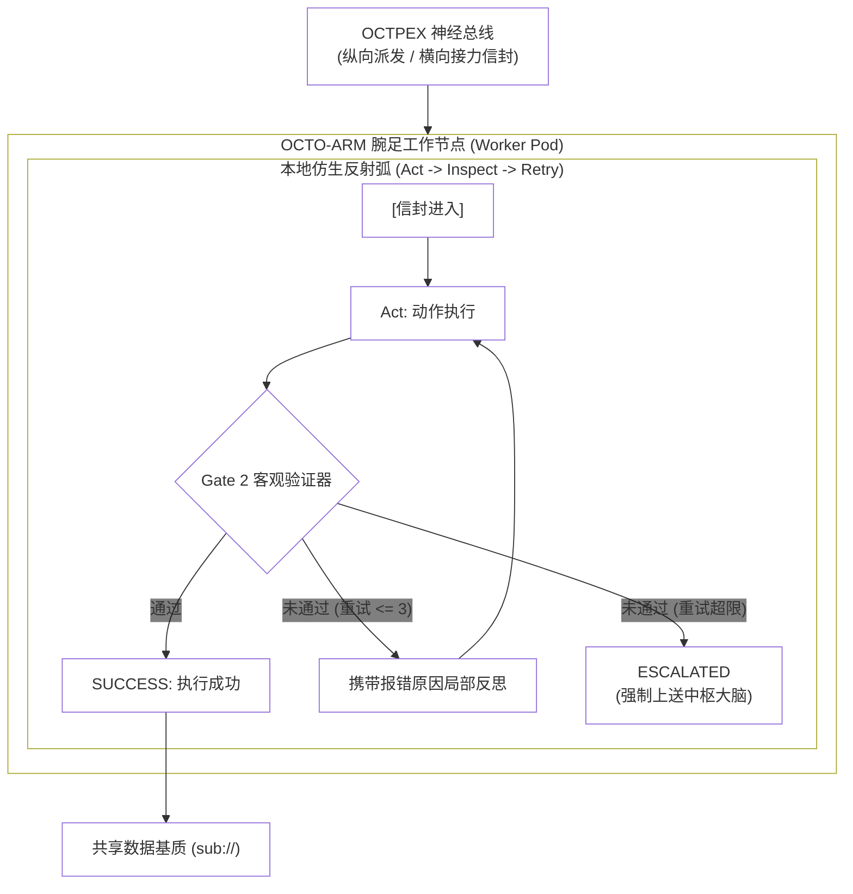
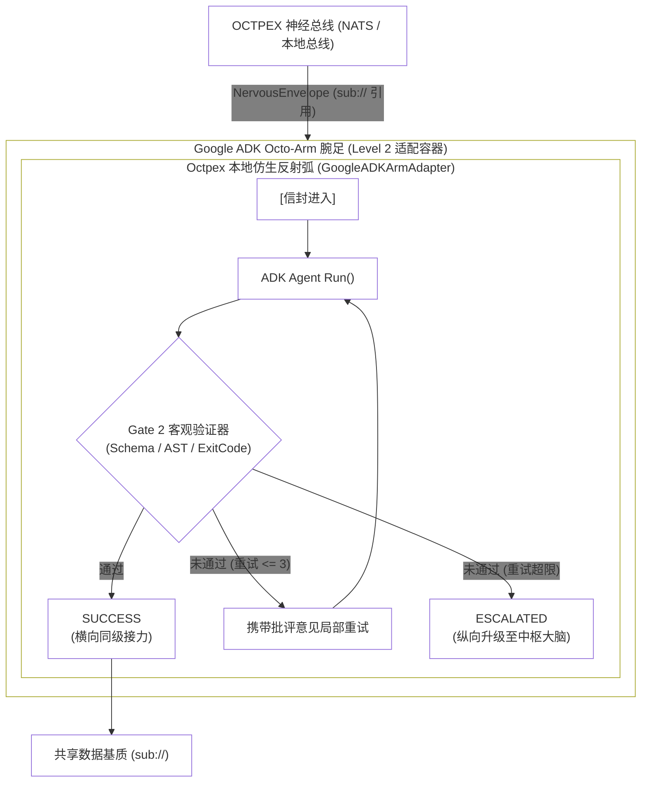

# Octpex 开发者与生态集成综合指南

本文档为二次开发者、社区贡献者与框架集成商提供在 Octpex 仿生智能体分布式基质上构建、封装与扩展 Agent 的全景指导。

---

## 1. 核心架构认知

在 Octpex 中，**Octo-Arm（腕足）** 本质是一个具备统一通信契约的分布式执行单元（Pod）。腕足内部的智能等级完全解耦，支持四级自适应阶梯：
- **Level 0（零智能吸盘）**：纯 Go 原生确定性状态机（< 5ms，0 Token 消耗）。
- **Level 1（边缘 SLM 反射）**：本地轻量小模型（0.5B-3B via Ollama），运行就地自愈微循环。
- **Level 2（包装单兵 Agent）**：通过 Python SDK 包装 Google ADK 或 LangGraph 智能体。
- **Level 3（封装多 Agent 团队）**：将 AutoGen 辩论组或 CrewAI 团队封装为单一高内聚专家节点。



---

## 2. 编写 Go 原生腕足 (Level 0 / 高性能状态机)

在 Go 中实现一个超低延迟、零 Token 消耗的确定性吸盘：

```go
package main

import (
    "context"
    "octpex/pkg/adapter"
    "octpex/pkg/protocol"
    "octpex/pkg/substrate"
    "time"
)

func RegisterMetricsArm(bus bus.NervousBus, sub substrate.DataSubstrateSPI) {
    fsm := adapter.NewNativeFSMAdapter(sub)
    fsm.RegisterHandler("metrics_filter", func(ctx context.Context, env *protocol.NervousEnvelope, sub substrate.DataSubstrateSPI) (*protocol.StepResult, error) {
        // 纯 Go 原生执行 - 0 Token 消耗，< 2ms 延迟
        uri := "sub://" + env.SessionID + "/filtered.json"
        _, err := sub.PutArtifact(ctx, uri, 0, []byte(`{"status":"clean"}`), 10*time.Minute)
        return &protocol.StepResult{
            Status:        "SUCCESS",
            OutputMessage: "Cleaned metrics stored",
            SubstrateRefs: []protocol.SubstrateRef{{URI: uri, Version: 1}},
        }, err
    })
    bus.Subscribe("metrics_filter", fsm.ExecuteStep)
}
```

---

## 3. Python SDK 与异构框架集成 (`bridge/python/octpex`)

Python SDK (`octpex-sdk`) 为各主流智能体框架提供仿生自愈循环与基质指针读写支持。

### 3.1 本地安装

```bash
pip install -e bridge/python
```

### 3.2 LangGraph 集成

```python
from octpex import ArmConfig, NervousEnvelope
from octpex.adapters import LangGraphArmAdapter

def run_langgraph(state: dict) -> dict:
    critique = state.get("critique")
    # LangGraph 计算图逻辑...
    return {"status": "ok", "patch": "applied"}

config = ArmConfig(arm_id="arm-langgraph-01", capability="code_patcher")
adapter = LangGraphArmAdapter(config, run_langgraph)
result = adapter.execute_envelope(incoming_envelope)
```

### 3.3 CrewAI 集成

```python
from octpex import ArmConfig
from octpex.adapters import CrewAIArmAdapter

def run_crew(inputs: dict) -> str:
    # crew.kickoff(inputs=inputs)
    return "Crew analysis completed"

config = ArmConfig(arm_id="arm-crew-01", capability="deep_analysis")
adapter = CrewAIArmAdapter(config, run_crew)
result = adapter.execute_envelope(incoming_envelope)
```

### 3.4 Google ADK 集成

在 Octpex 仿生分布式架构中，Google Agent Development Kit (ADK) 被定义为 **Level 2：单 Agent 封装运行时（Wrapped Single Agent）**。Octpex 并不替代 Google ADK，而是作为其分布式神经调度宿主与仿生协调底座，为其赋予数据基质零拷贝、硬性客观门禁、本地自愈反射弧以及侧向同级移交能力。

#### 3.4.1 架构职责与工作流程



1. **上下文映射与解耦**：将传入的 `NervousEnvelope.parameters` 与 `session_id` 自动映射为 ADK 的上下文输入字典。大体积数据通过 `sub://` 引用指针解析，避免长上下文污染与 Token 浪费。
2. **本地自愈反射弧**：当输出未通过验证时，`GoogleADKArmAdapter` 将门禁反馈（`critique`）注入为 `revision_instructions` 要求 ADK Agent 定向修复，无需全链路惊动中心大脑。
3. **外部客观硬门禁（Gate 2）**：摒弃不可靠的 LLM 自评机制，宿主强制执行确定性的 JSON Schema 解析、AST 编译或 Shell 退出码校验，阻断幻觉瞒报。
4. **侧向同级移交（Lateral Handoff）**：校验通过后，ADK 腕足将结果写入 `sub://`，并沿侧向总线直接将任务指针移交给下一个下游腕足（例如 Go 编写的 Level 0 极速验签腕足）。
5. **权限与跳数衰减**：安全凭证、写权限以及 `max_allowed_hops` 随侧向跳数单调递减，杜绝死循环与权限溢出。

#### 3.4.2 生产级接入代码示例

```python
import json
from octpex import (
    ArmConfig,
    NervousEnvelope,
    InMemorySubstrateClient,
    SubstrateRef,
)
from octpex.adapters import GoogleADKArmAdapter

# 1. 初始化 Google ADK Agent 执行函数
def build_adk_runner():
    # 模拟 Google ADK 标准 Agent 执行体
    def adk_runner(context: dict) -> dict:
        inputs = context.get("inputs", {})
        instructions = context.get("revision_instructions")

        # 接收到门禁批评指导时，Agent 执行定向修复
        if instructions:
            return {
                "status": "ok",
                "resolved": True,
                "patch": "if (conn != null) { conn.close(); }",
                "notes": f"Applied fix per critique: {instructions}",
            }

        # 首次执行可能产生的格式不全粗略结果
        return {
            "status": "pending_check",
            "patch": "conn.close();",
        }

    return adk_runner

# 2. 初始化数据基质客户端与腕足配置
substrate = InMemorySubstrateClient()
substrate.put_artifact(
    "sub://sess-001/raw_error.log",
    0,
    b"CRITICAL: NullPointerException at Service.java:102",
)

config = ArmConfig(
    arm_id="arm-adk-patcher-01",
    capability="code_patch_generator",
    max_reflex_retries=3,
    timeout_seconds=15.0,
)

# 3. 构造 GoogleADKArmAdapter
adapter = GoogleADKArmAdapter(
    config=config,
    adk_run_fn=build_adk_runner(),
    substrate=substrate,
)

# 4. 配置宿主级 Gate 2 客观验证器（强校验，拦截幻觉）
def gate2_verifier(output_str: str) -> str | None:
    try:
        data = json.loads(output_str)
        if data.get("status") != "ok":
            return "Output validation failed: 'status' must be 'ok'"
        if not data.get("patch"):
            return "Output validation failed: 'patch' cannot be empty"
        return None  # 验证通过
    except Exception as e:
        return f"JSON Parse error: {str(e)}"

adapter.set_gate2_verifier(gate2_verifier)

# 5. 模拟接收神经总线发来的仿生信封并执行
incoming_envelope = NervousEnvelope(
    envelope_id="env-adk-001",
    trace_id="trace-cluster-001",
    session_id="sess-001",
    plane="VERTICAL",
    message_type="TASK_DISPATCH",
    source_node="octo-brain",
    substrate_refs=[SubstrateRef(uri="sub://sess-001/raw_error.log", version=1)],
    parameters={"target_file": "Service.java"},
)

step_result = adapter.execute_envelope(incoming_envelope)
print(f"执行状态 : {step_result.status}")
print(f"局部重试 : {step_result.metadata.get('retries')}")
print(f"输出内容 : {step_result.output_message}")
```

#### 3.4.3 核心收益对比：原生 ADK 独立运行 vs. Octpex ADK 腕足

| 维度 | 原生独立 Google ADK | 接入 Octpex 神经底座后的 Google ADK |
| :--- | :--- | :--- |
| **Token 消耗** | 原始日志全量注入 Prompt，多轮重试耗费昂贵云端 Token。 | 边缘零拷贝（`sub://` 指针），高频任务本地闭环，节省 70%~85% 费用。 |
| **端到端延迟** | 每一步均往返云端模型 API，单任务耗时 5~15 秒。 | 腕内毫秒级反射自愈循环（<800ms），侧向同级移交（<15ms）。 |
| **验证可靠性** | 依赖大模型自评（易出现虚假信心与幻觉瞒报）。 | 宿主级 Gate 2 客观硬门禁校验（Schema、AST、单元测试退出码）。 |
| **跨框架协同** | 局限于 Python 生态，难以与 Go 原生高性能 FSM 联动。 | 统一通过仿生神经信封 `NervousEnvelope` 实现 Go、LangGraph、ADK 异构混部。 |
| **安全沙箱治理** | 缺乏递归防线，容易出现无限工具调用风暴。 | 权限随跳数单调衰减，物理沙箱施加硬配额与跳数上限（`max_allowed_hops`）。 |

### 3.5 Microsoft AutoGen 集成

在 Octpex 中，Microsoft AutoGen 多角色审议小组（如 Coder、Critic、Tester）被定义为 **Level 3：多智能体协作组（Multi-Agent Crew）**，通过 `AutoGenArmAdapter` 进行封装：

```python
from octpex import ArmConfig, NervousEnvelope
from octpex.adapters import AutoGenArmAdapter

def run_autogen_group_chat(context: dict) -> dict:
    # 模拟 AutoGen GroupChat 多角色审议达成共识
    max_rounds = context.get("max_rounds", 3)
    return {
        "consensus": "安全补丁通过 Critic 审查",
        "patch": "validateInput(data)",
        "rounds_used": 2,
    }

config = ArmConfig(arm_id="arm-autogen-01", capability="security_debate", max_reflex_retries=2)
adapter = AutoGenArmAdapter(config, run_autogen_group_chat, max_debate_rounds=3)
result = adapter.execute_envelope(incoming_envelope)
```

### 3.6 OctoArmDaemon 腕足运行时常驻守护器 (`octpex.worker`)

`OctoArmDaemon` 提供了将 Python 腕足作为常驻进程运行的标准守护器，支持与 Go 内核 HTTP REST 接口交互：

```python
from octpex import OctoArmDaemon
from octpex.adapters import GoogleADKArmAdapter

daemon = OctoArmDaemon(
    worker=adapter,
    server_url="http://localhost:8080",
    poll_interval=1.0,
)

# 本地执行信封
step_result = daemon.handle_envelope(envelope)

# 向 Go 内核分派或回传
response = daemon.dispatch_to_kernel(envelope)
```

---

## 4. 模型上下文协议 (MCP) 与算力挂载

- **边缘本地 SLM (Ollama)**：`pkg/adapter/ollama.go` 直连 `localhost:11434`，强制 JSON Mode 输出与 Token 遥测。
- **中心前沿 LLM**：`pkg/brain/frontier.go` 对接云端 Claude / GPT / Gemini / Qwen（千问）/ DeepSeek 等商用与开源大模型 API。
- **标准 MCP 客户端 (`pkg/mcp`)**：通过 `stdio` 管道拉起外部子进程或通过流式 HTTP 连接。
- **动态 MCP 盒子 (`pkg/tool`)**：外部 MCP Server 工具经 AbloEx 静态 AST 扫描后直接注册入神经环基底 `DynamicMCPBox`。

---

## 5. Web 可视化实时看板与 REST API (`pkg/server`)

Octpex 内嵌异步轻量级 HTTP 服务，提供集群运行状态拓扑的可视化看板与开放式接口。

### 5.1 核心路由端点
- `GET /`：交互式单页应用看板，动态渲染集群拓扑、活跃 Octo-Arm 节点状态与 FinOps 实时降本指标。
- `GET /api/v1/topology`：返回基底神经环上健康注册的 Arm 清单、角色与其能力标签。
- `GET /api/v1/finops`：返回 FinOps 财务与能效审计指标（边缘解耦率、Token 节约量、节约成本等）。
- `POST /api/v1/dispatch`：支持外部系统通过 HTTP POST 提交 JSON 格式的神经信封，直接派发至神经总线执行。

### 5.2 Go 语言中调用示例
```go
import "octpex/pkg/server"

srv := server.NewHTTPServer(
    server.ServerConfig{Port: 8080},
    nervousBus,
    capabilityRegistry,
    sharedSubstrate,
    finOpsCollector,
)
_ = srv.Start()
defer srv.Shutdown(ctx)
```

---

## 6. 物理网络驱动连接工厂 (`pkg/driver`)

`pkg/driver` 为生产分布式集群环境提供底层网络连接与健康探测：
- `DialClusterSubsystems(ctx, cfg)`：根据配置并发建立 Redis、NATS JetStream 与 etcd 的网络连接。
- `DialRedisCommander(endpoint)`：物理探测 Redis 端点连通性，自动容灾并具备零崩溃自愈机制。
- `DialNATSClient(url)`：连接至 NATS JetStream 消息中枢。
- `DialETCDClient(endpoints)`：连接至 etcd 分布式注册集群，维系租约心跳。
- `LiveTCPProber`：通用的毫秒级 TCP 端口连通性探测器。

---

## 7. 贡献检验标准

所有提交的代码必须保证测试全绿：
```bash
# Go 核心全量测试
go test -v ./...

# 内核吞吐与微秒级延迟基准压测
bin/octpex.exe bench

# 自动化 Go Benchmark 测试套件
go test -v -bench "Benchmark" octpex/test

# Python SDK 测试
python -m unittest discover -s bridge/python/tests

# 二进制可执行文件编译
go build -o bin/octpex.exe cmd/octpex/main.go
```
