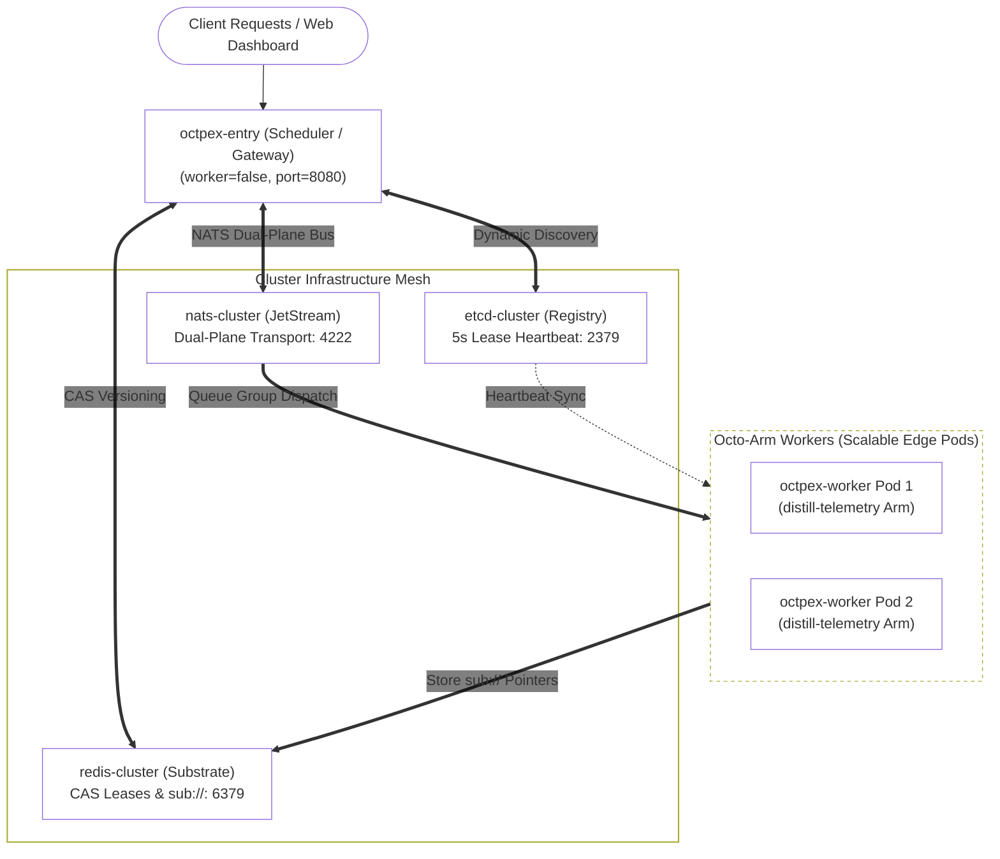
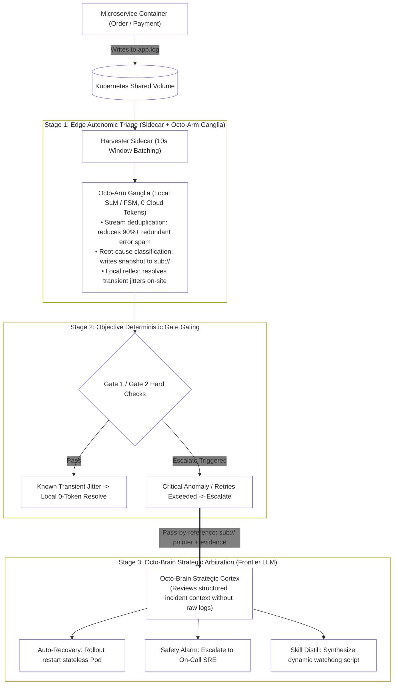
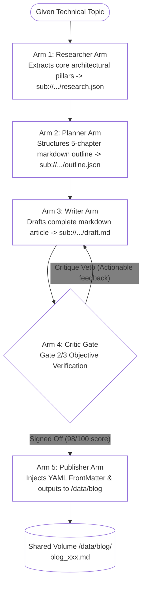
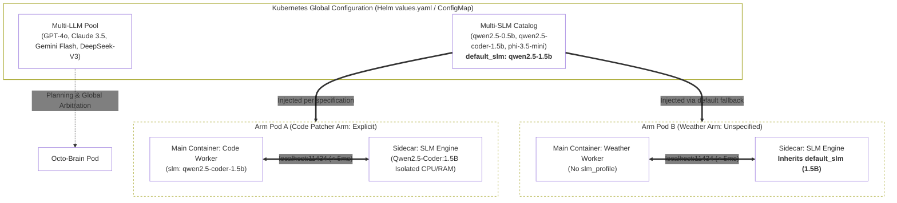

# Step-by-Step Guide: Deploying and Verifying Octpex Multi-Agent Cluster on Kubernetes

This guide assumes you already have an accessible Kubernetes environment ready (such as Docker Desktop built-in K8s, Minikube, Kind, K3s, or any standard cloud-managed cluster). This walkthrough will guide you through deploying a complete **Octpex Biomimetic Multi-Agent Distributed System** from scratch, validating end-to-end cross-node scheduling, Shared Data Substrate persistence, fault self-healing, and real-time dashboard observability.

---

## 1. Architecture & Multi-Agent Roles

In this deployment, Kubernetes orchestrates five services inside the `octpex-system` namespace:



1. **Infrastructure Tier**:
   - `nats-cluster:4222`: NATS JetStream dual-plane bus handling task dispatch and lateral handoffs.
   - `etcd-cluster:2379`: Basal Nerve Ring registry enforcing 5-second lease heartbeats.
   - `redis-cluster:6379`: Shared Data Substrate managing `sub://` references and atomic Lua CAS version leases.
2. **Multi-Agent Runtimes**:
   - **Central Dispatch Agent (`octpex-entry`)**: Central brain and API gateway (`-worker=false`) exposing REST APIs and Web UI.
   - **Edge Ganglion Agents (`octpex-worker`, 2 replicas)**: Specialized execution arms registered with capability `distill-telemetry`.

---

## 2. Prerequisites & Image Build

### 2.1 Verify Kubernetes Cluster Readiness
Ensure your terminal is connected to an active Kubernetes cluster using your preferred environment (Docker Desktop, Minikube, Kind, K3s, or cloud provider):

```bash
kubectl cluster-info
kubectl get nodes
```
Confirm node status reports `Ready` and your `kubectl` context has permission to create namespaces and workloads.

### 2.2 Build & Import Octpex Kernel Image (Local Registry Isolation Note)
Build the container image embedding the production cluster driver:

```bash
docker buildx build --load -t octpex/kernel:0.5.0 -f deploy/docker/Dockerfile .
```

> [!IMPORTANT]
> **Understanding Image Registry Isolation (Kind / containerd vs. Docker Engine)**:
> 1. Images built with `docker build` reside exclusively in the host Docker storage pool.
> 2. Modern local Kubernetes clusters (such as Kind nodes or Docker Desktop's containerd CRI runtime) run their own `containerd` daemon, looking strictly inside the `k8s.io` namespace.
> 3. If an image is not explicitly imported or pushed, Kubernetes will attempt to pull `octpex/kernel:0.5.0` from Docker Hub and fail with `ErrImagePull` or `ImagePullBackOff`.
>
> A top-level [Makefile](../Makefile) is provided to automate this entire build-load-deploy iteration:
> ```bash
> # One-command dev loop: build -> stream import into containerd -> rollout restart
> make dev
> 
> # Or step-by-step:
> make build   # Build kernel Docker image
> make load    # Stream image into containerd: ctr -n k8s.io images import -
> make deploy  # Rollout restart octpex-entry and octpex-worker
> ```
> *Note: For standard Kind clusters, you may also run `kind load docker-image octpex/kernel:0.5.0`. For remote/cloud clusters, tag and push to your private container registry (ECR, GCR, ACR).*

---

## 3. One-Click Cluster Deployment

Deploy the complete manifest [deploy/k8s/all-in-one.yaml](../deploy/k8s/all-in-one.yaml):

```bash
kubectl apply -f deploy/k8s/all-in-one.yaml
```

### Check Pod Status
Wait 10-30 seconds, then inspect all pods:

```bash
kubectl get pods -n octpex-system -o wide
```

All 6 pods should transition to `Running`:
```text
NAME                             READY   STATUS    RESTARTS   AGE
etcd-cluster-xxxxxxxxx-xxxxx     1/1     Running   0          25s
nats-cluster-xxxxxxxxx-xxxxx     1/1     Running   0          25s
redis-cluster-xxxxxxxxx-xxxxx    1/1     Running   0          25s
octpex-entry-xxxxxxxxx-xxxxx     1/1     Running   0          25s
octpex-worker-xxxxxxxxx-xxxxx1   1/1     Running   0          25s
octpex-worker-xxxxxxxxx-xxxxx2   1/1     Running   0          25s
```

---

## 4. End-to-End Multi-Agent Verification

### Step 1: Forward Entry Port
Expose the HTTP API:

```bash
kubectl port-forward -n octpex-system svc/octpex-service 8080:8080
```

---

### Step 2: Verify Dynamic Arm Discovery
Query the topology endpoint:

```bash
curl -s http://localhost:8080/api/v1/topology | jq .
```

Verify that `arm_count` equals `2`, confirming both worker pods registered successfully with etcd.

---

### Step 3: Dispatch Cross-Node Task
Send a telemetry deduplication workload to `octpex-entry`:

```bash
curl -s -X POST http://localhost:8080/api/v1/dispatch \
  -H "Content-Type: application/json" \
  -d '{
    "target_capability": "distill-telemetry",
    "envelope_id": "env-k8s-001",
    "session_id": "k8s-session-101",
    "trace_id": "trace-k8s-101",
    "parameters": {
      "log": "2026-11-19 WARN Connection timeout\n2026-11-19 WARN Connection timeout\n2026-11-19 INFO Reconnected successfully"
    }
  }' | jq .
```

**Verification checks:**
1. `metadata.worker_id` points to one of the `octpex-worker` pods, proving cross-node NATS dispatch;
2. `substrate_refs` contains `sub://k8s-session-101/distilled/env-k8s-001` with version `1`.

> [!NOTE]
> ### Deep Dive: How Do Octo-Arms Perceive & Execute Tasks?
> 
> When testing the `distill-telemetry` workload above, three common architectural questions arise:
> 
> #### 1. Is this deduplication performed by an SLM or standard code?
> **Answer: Go-native FSM streaming hash deduplication (0 Token cost, < 1ms latency), not an LLM.**
> This embodies Octpex's biomimetic reflex tiering—never using LLMs where deterministic code excels:
> - **Tier 1: Reflex Arc (Current Distiller Arm)**: Pure Go/regex code for high-throughput, low-latency log filtering at 0 token cost;
> - **Tier 2: Ganglion SLM (Edge Models)**: 0.5B-7B local models (Ollama/vLLM) for semantic clustering on unstructured, fuzzy text;
> - **Tier 3: Cortex Brain (Frontier LLM)**: Cloud LLMs arbitrate only when Gate 1/2 triggers on critical deadlocks or high-risk mutations.
> 
> #### 2. How does an arm know its task (dedup vs. writing) and regex rules?
> - **Capability Routing (`target_capability`)**: The envelope declares the required capability (e.g., `distill-telemetry` or `blog-writer`), routed by NATS to subscribing workers;
> - **Dynamic Parameters (`parameters`)**: Callers pass custom regex via `envelope.parameters["pattern_regex"]`, falling back to built-in deterministic defaults if omitted;
> - **Zero-Copy Pass-by-Reference (`substrate_refs`)**: Large payloads are never packed into envelopes; they are stored in the Redis substrate under `sub://` URIs.
> 
> #### 3. Do users need to write and configure arms, or just instruct the brain?
> - **Routine Workflows (Automated)**: Users give natural-language goals to Octo-Brain; the brain plans the DAG and routes tasks to existing arms;
> - **Unknown Formats (Self-Evolving)**: Arms escalate on unhandled formats, prompting Octo-Brain to synthesize new MCP tools on-the-fly and hot-load them into the edge box for future 0-token execution;
> - **Proprietary Systems (Custom Workers)**: Developers only write lightweight scripts (Go/Python SDK) when integrating internal enterprise databases or legacy APIs.

---

### Step 4: Verify Redis CAS Shared Substrate Readback
Inspect raw Redis storage inside the Redis pod:

```bash
kubectl exec -n octpex-system deploy/redis-cluster -- redis-cli HGETALL "octpex:sub:sub://k8s-session-101/distilled/env-k8s-001"
```

Confirms persistent Pass-by-Reference storage with monotonic versioning.

---

### Step 5: Verify FinOps Audit Metrics
Check cost and token metrics:

```bash
curl -s http://localhost:8080/api/v1/finops | jq .
```

Confirms tasks are attributed to edge workers with zero cloud token consumption.

---

### Step 6: Test Pod Failure Recovery
Simulate pod death:

```bash
kubectl delete pod -n octpex-system -l app=octpex-worker --force --grace-period=0
```

Monitor topology:
```bash
curl -s http://localhost:8080/api/v1/topology | jq .arm_count
```
The dead arm lease expires in `< 5s` and Kubernetes brings up a replacement that auto-registers.

---

### Step 7: Open Web UI Dashboard
Open your browser to:
```text
http://localhost:8080
```
View the live bionic topology diagram, Server-Sent Events stream, and FinOps cost curves.

---

## 5. Advanced Scenario A: Business App Log Harvesting & Three-Stage Closed Loop (AIOps Edge Autonomy)

In microservice clusters, downstream dependency fluctuations can trigger thousands of identical error stack traces within seconds. Forwarding all raw logs to cloud LLMs exhausts token budgets and introduces unacceptable operational latency.

Octpex addresses this through a biomimetic **"Edge Autonomic Triage + Cloud Strategic Cortex"** three-stage closed loop:



### Option 1: Run Three-Stage Simulation Locally (Direct Output)

Run the simulation script [examples/aiops_log_drain/main.py](../examples/aiops_log_drain/main.py) to inspect the two core scenarios:

```bash
python examples/aiops_log_drain/main.py
```

**Console Output Highlights:**
- **Case 1 (Transient Jitter)**: Connection timeout burst -> Arm deduplicates 33% -> Stores to `sub://.../incident-01.json` -> Gate 1 passes -> Executes `refresh_db_pool()` (**12ms, 0 Cloud Tokens**).
- **Case 2 (Fatal Deadlock)**: Deadlock detected -> Arm packages incident -> Gate 1 escalates -> Octo-Brain orders `rollout restart deploy/payment-gateway`, alerts SRE, and synthesizes `deadlock_preempt.sh`.

### Option 2: Deploy Shared-Volume Log Governance on Kubernetes

Apply the manifest [examples/aiops_log_drain/k8s-deployment.yaml](../examples/aiops_log_drain/k8s-deployment.yaml):

```bash
kubectl apply -f examples/aiops_log_drain/k8s-deployment.yaml
```

The pod mounts a shared volume `/var/log/mock-app` between two containers:
- `log-producer`: Simulates high-frequency application traffic with duplicate ERROR stack traces.
- `octpex-log-sidecar`: Batches logs, encapsulates them into Octpex nervous envelopes, and dispatches to edge workers for deduplication.

**Inspect raw logs and sidecar dispatch:**
```bash
# View raw logs from the mock application
kubectl logs -n octpex-system deploy/mock-app-log-generator -c log-producer --tail=10

# View sidecar dispatch events to octpex-service
kubectl logs -n octpex-system deploy/mock-app-log-generator -c octpex-log-sidecar --tail=10
```

**Verify distilled incident records in Redis CAS:**
```bash
# Check auto-generated substrate records in Redis
kubectl exec -n octpex-system deploy/redis-cluster -- redis-cli KEYS "octpex:sub:sub://sess-k8s-autolog/*"

# Read deduplicated output (duplicate errors are reduced to canonical entries)
kubectl exec -n octpex-system deploy/redis-cluster -- redis-cli HGETALL "octpex:sub:sub://sess-k8s-autolog/distilled/env-trace-auto-xxx"
```
Refresh `http://localhost:8080` to view the live SSE pulse stream and FinOps 0-token savings metrics.

---

## 6. Advanced Scenario B: 5-Agent Collaborative Blog Publishing Mesh (Multi-Round Review Loop & Shared Volume)

This scenario demonstrates an end-to-end multi-agent content generation pipeline. Given a technical topic (e.g., `"Kubernetes Biomimetic Multi-Agent Fabric on Octpex"`), 5 specialized agent arms collaborate over the Octpex distributed fabric:



### Option 1: Run Inside Kubernetes via Batch Job with Shared Volume
Deploy the Job manifest [examples/blog_publish_mesh/k8s-job.yaml](../examples/blog_publish_mesh/k8s-job.yaml):

```bash
kubectl apply -f examples/blog_publish_mesh/k8s-job.yaml
```

Follow the multi-agent deliberation and critique revision loop in real time:
```bash
kubectl logs -n octpex-system job/octpex-blog-publishing-job -f
```

**Key Execution Highlights:**
1. **Round 1**: Writer creates the initial draft. Critic runs Gate 2 validation, notes missing depth on Redis CAS update semantics, assigns 78/100, and vetoes the draft with actionable feedback.
2. **Round 2**: Writer incorporates critique, adding deep-dive sections on Redis CAS atomic leases and NATS JetStream dual-plane buses. Critic re-evaluates and awards 98/100 approval.
3. **Publisher**: Publisher Arm injects YAML FrontMatter (metadata, tags, review score) and saves the completed article into the shared volume `/data/blog/`.

### Option 2: Run via Local Python SDK Directly into Host Directory
To test directly on your local developer machine with file output into a host directory, run [examples/blog_publish_mesh/main.py](../examples/blog_publish_mesh/main.py):

```bash
python examples/blog_publish_mesh/main.py \
  --topic "Kubernetes Biomimetic Multi-Agent Fabric on Octpex" \
  --output "./output/blog" \
  --rounds 3
```

Check the published markdown post in `output/blog/`:
```bash
cat output/blog/blog_*.md
```

---

## 7. Production Multi-LLM/SLM Resource Pool & Sidecar Injection Architecture

In enterprise Kubernetes deployments, Octpex applies a **Global Multi-LLM/SLM Catalog + Arm Pod Sidecar Injection** pattern to solve latency, resource isolation, and specialized capability matching.



### Key Architectural Benefits
1. **Eliminate Noisy Neighbors**: Centralized shared SLMs suffer from queue starvation when high-frequency log workers burst. The sidecar pattern guarantees dedicated CPU/GPU quotas (`requests/limits`) per Pod.
2. **Zero-Hop Localhost Latency (< 5ms)**: Worker logic calls `http://127.0.0.1:11434` over local loopback, removing ingress/DNS hops.
3. **Explicit Assignment with Default Fallback**:
   * Specialized workers (e.g. code repair) declare `slm_profile: "qwen2.5-coder-1.5b"`;
   * General workers omit `slm_profile` and automatically inherit the platform's `default_slm` (e.g. `qwen2.5-1.5b`);
   * Deterministic Level 0 workers set `slm_profile: "none"` to deploy with 0 token/CPU overhead.

### Deployment Example

Apply the sidecar demo manifest:
```bash
kubectl apply -f deploy/k8s/arm-sidecar-demo.yaml
```

Verify the dual-container (`2/2 READY`) Pod status:
```bash
kubectl get pods -n octpex-system -l octpex.io/arm-id
```

---

## 8. Teardown

Clean up all core and scenario resources:

```bash
kubectl delete -f deploy/k8s/arm-sidecar-demo.yaml --ignore-not-found
kubectl delete -f examples/aiops_log_drain/k8s-deployment.yaml --ignore-not-found
kubectl delete -f examples/blog_publish_mesh/k8s-job.yaml --ignore-not-found
kubectl delete -f deploy/k8s/all-in-one.yaml
```
Deletes the `octpex-system` namespace and all attached resources cleanly.
