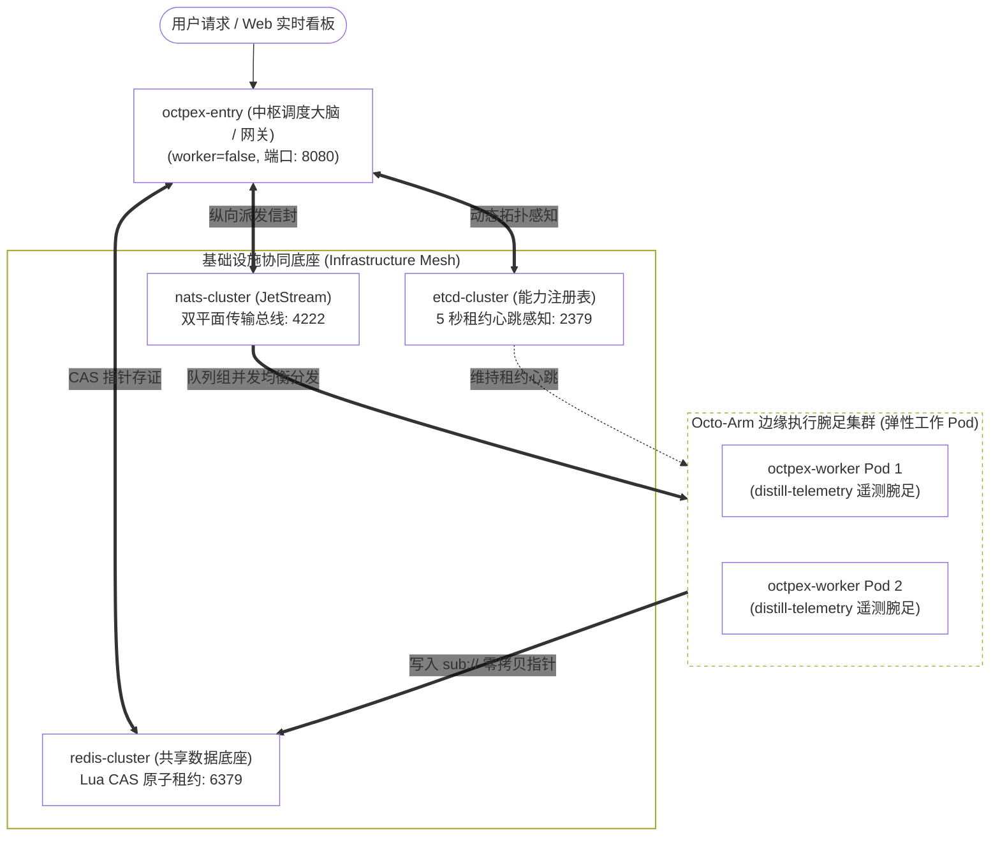
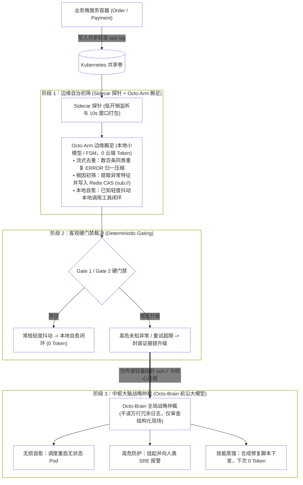
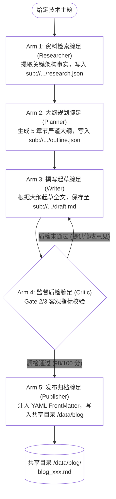

# 基于 Kubernetes 从零搭建与验证 Octpex 多智能体分布式集群指引

本指引假设您已准备好一个可用的 Kubernetes 环境（无论使用 Docker Desktop 内置 K8s、Minikube、Kind、K3s 还是标准云托管集群均可）。本指南将带您在此环境中从零开始完整部署一套 **Octpex 仿生多 Agent 分布式系统**，并完成端到端跨节点调度、数据基质存证、故障自愈与可视化看板的实测验收。

---

## 一、集群拓扑与多 Agent 角色分工

在本次部署中，Kubernetes 将在 `octpex-system` 命名空间中编排以下 5 类服务：



1. **基础设施三件套**：
   - `nats-cluster:4222`：NATS JetStream 消息总线，承载纵向派发与横向总线；
   - `etcd-cluster:2379`：基底神经环能力注册表，管理 5 秒租约与健康心跳；
   - `redis-cluster:6379`：共享数据底座（Shared Data Substrate），管理 `sub://` 零拷贝引用与原子 CAS 版本租约。
2. **多 Agent 节点**：
   - **中枢调度 Agent (`octpex-entry`)**：作为顶层大脑与 API 网关（`-worker=false`），负责任务接收、全局编排、拓扑维护与 Web 仪表盘暴露；
   - **边缘工作 Agent (`octpex-worker`，2 副本)**：作为专业执行腕足（搭载 `distill-telemetry` 遥测去噪能力），自注册至 etcd，并发监听 NATS 消费组，执行完毕将轻量指针写入 Redis。

---

## 二、前置准备与镜像构建

### 1. 确认 Kubernetes 集群环境就绪
请确保您的终端已连接至一个可用的 Kubernetes 集群（可按您熟悉的偏好自行准备，如 Docker Desktop 内置 K8s、Minikube、Kind、K3s 或云托管集群等），在终端执行基础连通性检查：

```bash
kubectl cluster-info
kubectl get nodes
```
确认节点状态输出为 `Ready`，且当前 `kubectl` 具备目标集群的资源创建与操作权限。

### 2. 构建 Octpex 集群节点镜像
在项目根目录下构建包含真实生产驱动（`cluster/` 模块）的容器镜像：

```bash
docker build -t octpex/kernel:0.5.0 -f deploy/docker/Dockerfile .
```

*注：若使用 Docker Desktop / Minikube 等本地集群，节点原生共享本机的 Docker 镜像，无需 push 到外部镜像仓库；若使用远程或云端集群，可将镜像 tag 后推送至私有镜像仓库。*

---

## 三、一键部署全套多 Agent 环境

项目中已为您准备好开箱即用的全要素资源编排清单 [deploy/k8s/all-in-one.yaml](../deploy/k8s/all-in-one.yaml)：

```bash
kubectl apply -f deploy/k8s/all-in-one.yaml
```

### 检查 Pod 部署状态
等待约 10-30 秒，拉起全部组件：

```bash
kubectl get pods -n octpex-system -o wide
```

预期看到以下全部处于 `Running` 状态的 Pod：
```text
NAME                             READY   STATUS    RESTARTS   AGE
etcd-cluster-xxxxxxxxx-xxxxx     1/1     Running   0          25s
nats-cluster-xxxxxxxxx-xxxxx     1/1     Running   0          25s
redis-cluster-xxxxxxxxx-xxxxx    1/1     Running   0          25s
octpex-entry-xxxxxxxxx-xxxxx     1/1     Running   0          25s
octpex-worker-xxxxxxxxx-xxxxx1   1/1     Running   0          25s
octpex-worker-xxxxxxxxx-xxxxx2   1/1     Running   0          25s
```

---

## 四、端到端跨节点多 Agent 协同验证

### 步骤 1：暴露中枢服务端口
在本地开启端口转发，映射中枢 Agent 的 HTTP 服务：

```bash
kubectl port-forward -n octpex-system svc/octpex-service 8080:8080
```

*(保持此终端窗口运行，在另一个新终端中执行以下验证指令)*

---

### 步骤 2：验证多 Agent 自动发现与拓扑感知
通过 REST API 查询当前集群中的活跃智能体：

```bash
curl -s http://localhost:8080/api/v1/topology | jq .
```

**预期输出：**
```json
{
  "active_arms": [
    {
      "arm_id": "arm-telemetry-01-octpex-worker-xxx-xxx",
      "capability_tags": [
        "distill-telemetry"
      ],
      "role_name": "telemetry-distiller",
      "runtime_adapter": "go-native-fsm",
      "telemetry": {
        "status": "HEALTHY"
      }
    },
    {
      "arm_id": "arm-telemetry-01-octpex-worker-yyy-yyy",
      "capability_tags": [
        "distill-telemetry"
      ],
      "role_name": "telemetry-distiller",
      "runtime_adapter": "go-native-fsm",
      "telemetry": {
        "status": "HEALTHY"
      }
    }
  ],
  "arm_count": 2
}
```
**判定标准**：`arm_count` 为 `2`，表示两个 Worker Pod 已通过 etcd 成功注册并建立了心跳。

---

### 步骤 3：跨节点任务分发与去噪闭环
向 `octpex-entry` 派发一个包含重复日志的复杂任务，观察中枢如何将任务通过 NATS 跨节点分发至 Worker Pod：

```bash
curl -s -X POST http://localhost:8080/api/v1/dispatch \
  -H "Content-Type: application/json" \
  -d '{
    "target_capability": "distill-telemetry",
    "envelope_id": "env-k8s-001",
    "session_id": "k8s-session-101",
    "trace_id": "trace-k8s-101",
    "parameters": {
      "log": "2026-11-19 WARN Connection timeout\n2026-11-19 WARN Connection timeout\n2026-11-19 INFO Reconnected successfully"
    }
  }' | jq .
```

**预期输出：**
```json
{
  "status": "SUCCESS",
  "output_message": "2026-11-19 WARN Connection timeout\n2026-11-19 INFO Reconnected successfully",
  "substrate_refs": [
    {
      "uri": "sub://k8s-session-101/distilled/env-k8s-001",
      "version": 1,
      "content_type": "text/plain",
      "byte_size": 75
    }
  ],
  "metadata": {
    "trace_id": "trace-k8s-101",
    "unique_lines": 2,
    "worker_id": "arm-telemetry-01-octpex-worker-xxx-xxx"
  }
}
```
**判定标准**：
1. `worker_id` 显示任务是由后台的某个 `octpex-worker` Pod 执行的，而非入口 `entry` 执行；
2. 重复的日志被就地去噪压缩；
3. 生成了指向共享底座的轻量 URI：`sub://k8s-session-101/distilled/env-k8s-001`（版本为 1）。

---

### 步骤 4：验证共享数据底座（Redis CAS）真实存证
直接进入 Redis Pod，验证 Worker 写入的数据是否真实持久化：

```bash
kubectl exec -n octpex-system deploy/redis-cluster -- redis-cli KEYS "octpex:sub:*"
```

查看去噪产物内容与单调递增版本号：
```bash
kubectl exec -n octpex-system deploy/redis-cluster -- redis-cli HGETALL "octpex:sub:sub://k8s-session-101/distilled/env-k8s-001"
```
**预期输出：**
```text
1) "data"
2) "2026-11-19 WARN Connection timeout\n2026-11-19 INFO Reconnected successfully"
3) "version"
4) "1"
```
证明零拷贝指针（Pass-by-Reference）已在分布式共享底座中可靠存证。

---

### 步骤 5：验证 FinOps 独立财务核算
检查 Entry 节点与 Worker 节点的 Token 与成本统计：

```bash
curl -s http://localhost:8080/api/v1/finops | jq .
```

**判定标准**：由于 `octpex-entry` 只做调度，执行任务发生在 Worker 上，系统将精确区分中枢协调成本与边缘执行成本。

---

### 步骤 6：故障注入与高可用自愈验证（模拟 Agent 崩溃）
测试当其中一个 Agent 发生 Pod 异常崩溃时，系统是否能在 5 秒内自动剔除并由 K8s 重启恢复：

1. **强行杀死其中一个 Worker Pod**：
   ```bash
   kubectl delete pod -n octpex-system -l app=octpex-worker --force --grace-period=0
   ```
2. **立即观察拓扑变化**：
   ```bash
   curl -s http://localhost:8080/api/v1/topology | jq .arm_count
   ```
   *由于 etcd 租约机制，坏死节点的租约在 5 秒内失效，存活腕足数从 2 短暂变为 1 或重新拉起恢复为 2。*
3. **K8s 重新拉起新 Pod 并自动注册**：
   ```bash
   kubectl get pods -n octpex-system -l app=octpex-worker
   ```
   新 Pod 启动后自动建立新的 etcd 租约，`arm_count` 自动恢复为 `2`，整个过程对调用端无感。

---

### 步骤 7：在浏览器查看实时可视化看板

在浏览器中直接打开：
```text
http://localhost:8080
```

看板将直观呈现：
- **实时拓扑结构图**：`Octo-Brain (中枢)` 与下属多个 `Octo-Arms (腕足)` 的实时心跳与健康状态；
- **Server-Sent Events (SSE) 事件脉冲流**：观察每一次任务分发（`ENVELOPE_DISPATCH`）与节点响应；
- **FinOps 降本看板**：查看 0-Token 闭环率、节省的总 Token 数量与折算美元 ROI。

---

## 五、实战进阶场景 A：业务容器日志自动监听与三段式自治闭环（AIOps 边缘自愈）

在微服务集群中，业务容器（如订单网关、支付中台）遇到下游波动时，数秒内可能刷出成千上万条完全相同的连接超时或死锁堆栈。如果将这些原始日志一股脑直接喂给云端大模型，不仅会打爆 Token 预算，还会由于大模型的高时延导致运维处置滞后。

Octpex 采用**“腕足边缘自治初筛，大脑中枢战略裁决”**的三段式闭环机制解决该问题：



### 方式 1：本地运行三段闭环仿真演示（直观输出）

在本地终端运行预置的演示脚本 [examples/aiops_log_drain/main.py](../examples/aiops_log_drain/main.py)，可直观查阅两类典型案例的分级处理全过程：

```bash
python examples/aiops_log_drain/main.py
```

**控制台直观呈现：**
- **案例 1（常规高频抖动）**：连接池满刷屏 -> 腕足流式去重压缩 33% -> 存入 `sub://.../incident-01.json` -> Gate 1 放行 -> 本地执行 `refresh_db_pool()` 自愈成功（**耗时 12ms，消耗云端 Token: 0**）。
- **案例 2（严重不可自愈死锁）**：交易死锁且堆积超限 -> 腕足打包存证现场 -> Gate 1 判定高危并拦截升级 -> Octo-Brain 大模型评估判断为无状态死锁，下发 `kubectl rollout restart` 重启指令，并同时向 SRE 推送告警并蒸馏出巡检脚本。

### 方式 2：在 Kubernetes 集群内实测业务共享日志治理

运行示例独立目录下的编排清单 [examples/aiops_log_drain/k8s-deployment.yaml](../examples/aiops_log_drain/k8s-deployment.yaml)：

```bash
kubectl apply -f examples/aiops_log_drain/k8s-deployment.yaml
```

该 Pod 内包含两个容器共享挂载 `/var/log/mock-app` 卷：
- `log-producer`：模拟业务服务，每隔 5 秒生成包含高频重复 ERROR 堆栈的日志；
- `octpex-log-sidecar`：自治轻量代理，批量捕获新增日志并封装为 Octpex 任务信封，调用 `octpex-service` 分发给 Worker 腕足。

**观察业务日志输出与 Sidecar 派发流程：**
```bash
# 查看业务模拟容器生成的原始日志
kubectl logs -n octpex-system deploy/mock-app-log-generator -c log-producer --tail=10

# 查看 Sidecar 自动向 Octpex 神经中枢提交治理信封的日志
kubectl logs -n octpex-system deploy/mock-app-log-generator -c octpex-log-sidecar --tail=10
```

**验证去噪结果已自动持久化在 Redis 共享底座：**
```bash
# 查看自动生成的去噪存证记录
kubectl exec -n octpex-system deploy/redis-cluster -- redis-cli KEYS "octpex:sub:sub://sess-k8s-autolog/*"

# 读取其中一条去噪记录（重复的 Connection timeout 已被边缘腕足合并归一）
kubectl exec -n octpex-system deploy/redis-cluster -- redis-cli HGETALL "octpex:sub:sub://sess-k8s-autolog/distilled/env-trace-auto-xxx"
```
同时刷新 `http://localhost:8080` 看板，可在 SSE 事件流中看到实时的边缘治理脉冲与 0-Token 财务收益。

---

## 六、实战进阶场景 B：多 Agent 协同博客全自动调研、起草、多轮评审与共享卷发布（Blog Publishing Mesh）

本场景展示一个完整的端到端内容工业化多智能体流水线。针对给定的技术主题（如 `"Kubernetes Biomimetic Multi-Agent Fabric on Octpex"`），5 个专职腕足智能体在 Octpex 分布式底座上协同运转：



### 方式 1：在 Kubernetes 集群内以任务（Job）运行并持久化落地

执行示例独立目录下的任务清单 [examples/blog_publish_mesh/k8s-job.yaml](../examples/blog_publish_mesh/k8s-job.yaml)：

```bash
kubectl apply -f examples/blog_publish_mesh/k8s-job.yaml
```

实时追踪多智能体协作与质检打回重修的日志流：
```bash
kubectl logs -n octpex-system job/octpex-blog-publishing-job -f
```

**预期输出日志流亮点：**
1. **第 1 轮**：Writer 起草初稿后，Critic 质检腕足执行 Gate 2 审查，检测到未充分阐述 Redis CAS 原理性，打出 78 分并打回重修，提供改进反馈；
2. **第 2 轮**：Writer 吸收批评意见，自动补充 CAS 原子性与 NATS 双平面总线章节，Critic 重新复审打出 98 分并签发批准；
3. **发布腕足**：Publisher 智能体将 FrontMatter 元数据（作者、标签、质检分数、修订轮次）注入 Markdown 并写入共享卷 `/data/blog/`。

### 方式 2：使用本地 Python SDK 协同并在宿主机目录直接查看产物

如果您希望直接在本地开发环境调试或让文件直接生成在宿主机目录中，可以直接运行已封装的脚本 [examples/blog_publish_mesh/main.py](../examples/blog_publish_mesh/main.py)：

```bash
python examples/blog_publish_mesh/main.py \
  --topic "Kubernetes Biomimetic Multi-Agent Fabric on Octpex" \
  --output "./output/blog" \
  --rounds 3
```

执行完毕后，在本地的 `output/blog/` 目录下将直接生成规范的 Markdown 博客产物，如 `output/blog/blog_blog-xxx.md`。您可直接用 Markdown 编辑器打开查看全文。

---

## 七、环境清理

验证完成后，一键清理所有 Kubernetes 部署与进阶场景资源：

```bash
kubectl delete -f examples/aiops_log_drain/k8s-deployment.yaml --ignore-not-found
kubectl delete -f examples/blog_publish_mesh/k8s-job.yaml --ignore-not-found
kubectl delete -f deploy/k8s/all-in-one.yaml
```
该操作会干净移除 `octpex-system` 命名空间及其中所有 Pod、Service、Job 和配置。
