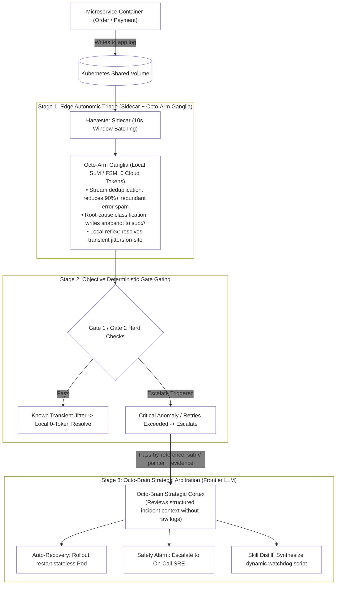

# AIOps Log Drain: Three-Stage Autonomous Closed Loop

[Chinese Version](README_CN.md)

This example demonstrates the complete biomimetic self-healing pipeline for high-frequency microservice logs:



## Running the Three-Stage Closed Loop Demo Locally

Run the complete end-to-end simulation showing Case 1 (0-Token Edge Resolve) and Case 2 (Gate Escalation to Cloud Brain):

```bash
python examples/aiops_log_drain/main.py
```

## Running on Kubernetes Cluster

> **Prerequisite:** Ensure the Octpex multi-agent cluster is deployed and running by following the [Kubernetes Deployment Guide](../../docs/k8s_multi_agent_guide.md) (e.g. `kubectl apply -f deploy/k8s/all-in-one.yaml`).

Deploy the shared-volume pod into the `octpex-system` namespace:

```bash
kubectl apply -f examples/aiops_log_drain/k8s-deployment.yaml
```

View sidecar logs capturing and dispatching to Octpex:

```bash
kubectl logs -n octpex-system deploy/mock-app-log-generator -c octpex-log-sidecar --tail=10
```

Check deduplicated results in Redis CAS:

```bash
kubectl exec -n octpex-system deploy/redis-cluster -- redis-cli KEYS "octpex:sub:sub://sess-k8s-autolog/*"
```

Clean up:

```bash
kubectl delete -f examples/aiops_log_drain/k8s-deployment.yaml
```
