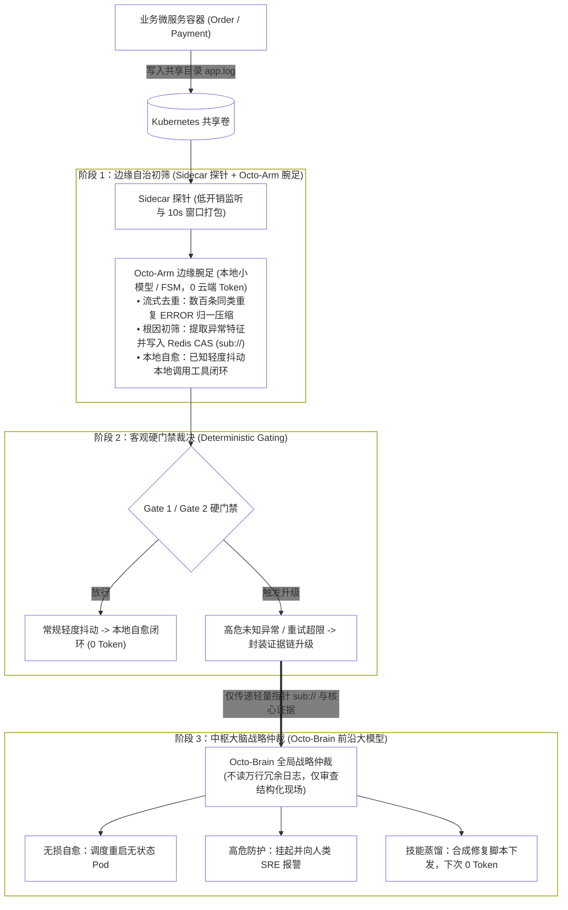

# AIOps 业务日志治理与三段式自治自愈闭环示例

[English](README.md)

本示例完整演示针对微服务高频日志的仿生分布式自愈闭环流程：



## 1. 本地极速运行三段闭环仿真演示

无需搭建 Kubernetes 集群，直接在本地终端运行完整的端到端仿真脚本，直观查看“低危抖动 0-Token 本地自愈”与“高危死锁升级中枢决策”两类典型场景：

```bash
python examples/aiops_log_drain/main.py
```

## 2. 在 Kubernetes 集群中部署运行

> **前置条件：** 请先参考 [Kubernetes 多 Agent 部署指引](../../docs/k8s_multi_agent_guide_cn.md) 部署好多智能体集群（如执行 `kubectl apply -f deploy/k8s/all-in-one.yaml` 并确认 Pod 正常运行）。

将包含共享存储卷的采集 Pod 部署到 `octpex-system` 命名空间：

```bash
kubectl apply -f examples/aiops_log_drain/k8s-deployment.yaml
```

查看 Sidecar 捕获日志并自动向 Octpex 神经总线派发信封的实时输出：

```bash
kubectl logs -n octpex-system deploy/mock-app-log-generator -c octpex-log-sidecar --tail=10
```

进入 Redis 验证自动完成流式去重与版本存证的数据：

```bash
kubectl exec -n octpex-system deploy/redis-cluster -- redis-cli KEYS "octpex:sub:sub://sess-k8s-autolog/*"
```

清理实验资源：

```bash
kubectl delete -f examples/aiops_log_drain/k8s-deployment.yaml
```
