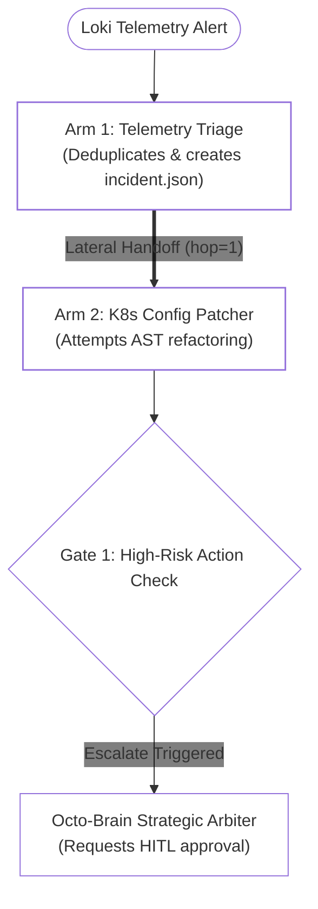

# AIOps Triage Mesh Example

[Chinese Version](README_CN.md)

This example demonstrates peer-to-peer lateral coordination across heterogeneous Octo-Arms:
- **Arm 1 (Telemetry Triage)**: Triages Loki alerts, stores incidents to `sub://{session}/incident.json`, and triggers a lateral handoff.
- **Arm 2 (Config Patcher)**: Reads incident snapshot via CAS reference, attempts an AST patch, detects a high-risk mutation, and escalates to the Octo-Brain.
- **Octo-Brain**: Arbitrates the task, evaluates risks, and requests Human-in-the-Loop (HITL) approval.



## Running the Example

```bash
go run examples/aiops_triage_mesh/main.go
```
