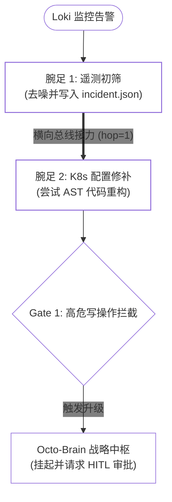

# AIOps 智能运维分级接力协同示例

[English](README.md)

本示例展示异构 Octo-Arm 腕足节点之间的横向点对点（P2P）接力流转与分级协同：
- **腕足 1（Loki 遥测初筛腕足）**：分析告警日志，将现场写入 `sub://{session}/incident.json`，并触发横向接力；
- **腕足 2（K8s 配置补丁腕足）**：通过指针读取现场，尝试 AST 代码修补，检测到写库高危操作后触发门禁升级；
- **Octo-Brain 中枢中枢**：战略仲裁任务，挂起高危动作并向人类工程师发起 HITL 审批。



## 运行示例

```bash
go run examples/aiops_triage_mesh/main.go
```
