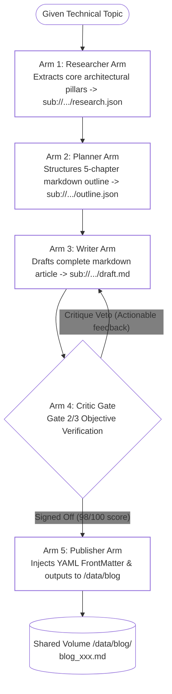

# Blog Publishing Multi-Agent Mesh Example

[Chinese Version](README_CN.md)

This example demonstrates a 5-arm collaborative workflow orchestrated across the Octpex biomimetic fabric:



1. **Researcher Arm**: Queries background facts and technical pillars (`sub://{session}/research.json`).
2. **Planner Arm**: Organizes findings into a 5-chapter structured outline (`sub://{session}/outline.json`).
3. **Writer Arm**: Generates markdown drafts based on the outline and incorporates feedback (`sub://{session}/draft.md`).
4. **Critic Gate Arm**: Enforces objective Gate 2 verification (depth, checklist, keywords). In round 1, vetoes the draft to trigger an iterative revision loop; approves in round 2.
5. **Publisher Arm**: Injects YAML FrontMatter and outputs the finalized article to a shared directory or volume (`/data/blog/`).

## Running Locally

```bash
python examples/blog_publish_mesh/main.py --topic "Kubernetes Biomimetic Multi-Agent Fabric on Octpex" --output "./output/blog"
```

The resulting article will be written to `output/blog/blog_*.md`.

## Running in Kubernetes

> **Prerequisite:** Ensure the Octpex multi-agent cluster is deployed and running by following the [Kubernetes Deployment Guide](../../docs/k8s_multi_agent_guide.md) (e.g. `kubectl apply -f deploy/k8s/all-in-one.yaml`).

Apply the Job manifest to your cluster:

```bash
kubectl apply -f examples/blog_publish_mesh/k8s-job.yaml
```

Follow the logs:

```bash
kubectl logs -n octpex-system job/octpex-blog-publishing-job -f
```

Clean up:

```bash
kubectl delete -f examples/blog_publish_mesh/k8s-job.yaml
```
