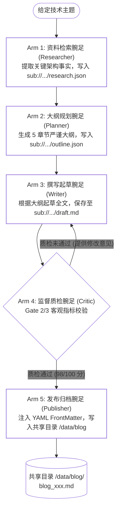

# 多 Agent 协同博客调研、起草、多轮评审与共享卷发布示例

[English](README.md)

本示例展示一个基于 Octpex 分布式智能体底座的 5 腕足内容工业化生产协同流水线：



### 5 腕足协同分工

1. **资料检索腕足 (Researcher)**：围绕给定技术主题检索核心事实与架构要点，写入 `sub://{session}/research.json`；
2. **大纲规划腕足 (Planner)**：将调研结果梳理为严密的 5 章节大纲，写入 `sub://{session}/outline.json`；
3. **撰写起草腕足 (Writer)**：根据大纲与历次质检反馈起草 Markdown 全文，保存至 `sub://{session}/draft.md`；
4. **监督质检腕足 (Critic)**：执行 Gate 2/3 客观指标校验（字数、技术深度与必选关键词）。第 1 轮打回重修并提供具体改进建议；第 2 轮打出 98 分验收通过；
5. **发布归档腕足 (Publisher)**：注入标准 YAML FrontMatter 元数据，直接写入共享目录或存储卷 `/data/blog/`。

---

## 1. 本地直接运行

在本地运行 Python 协同脚本：

```bash
python examples/blog_publish_mesh/main.py \
  --topic "Kubernetes Biomimetic Multi-Agent Fabric on Octpex" \
  --output "./output/blog"
```

生成的博客文章将直接保存在本地目录 `output/blog/blog_*.md` 中。

---

## 2. 在 Kubernetes 集群中以任务运行

> **前置条件：** 请先参考 [Kubernetes 多 Agent 部署指引](../../docs/k8s_multi_agent_guide_cn.md) 部署好多智能体集群（如执行 `kubectl apply -f deploy/k8s/all-in-one.yaml` 并确认 Pod 正常运行）。

将 Job 编排清单提交到 Kubernetes：

```bash
kubectl apply -f examples/blog_publish_mesh/k8s-job.yaml
```

追踪 5 智能体协作与多轮修订的实时日志：

```bash
kubectl logs -n octpex-system job/octpex-blog-publishing-job -f
```

清理实验任务：

```bash
kubectl delete -f examples/blog_publish_mesh/k8s-job.yaml
```
