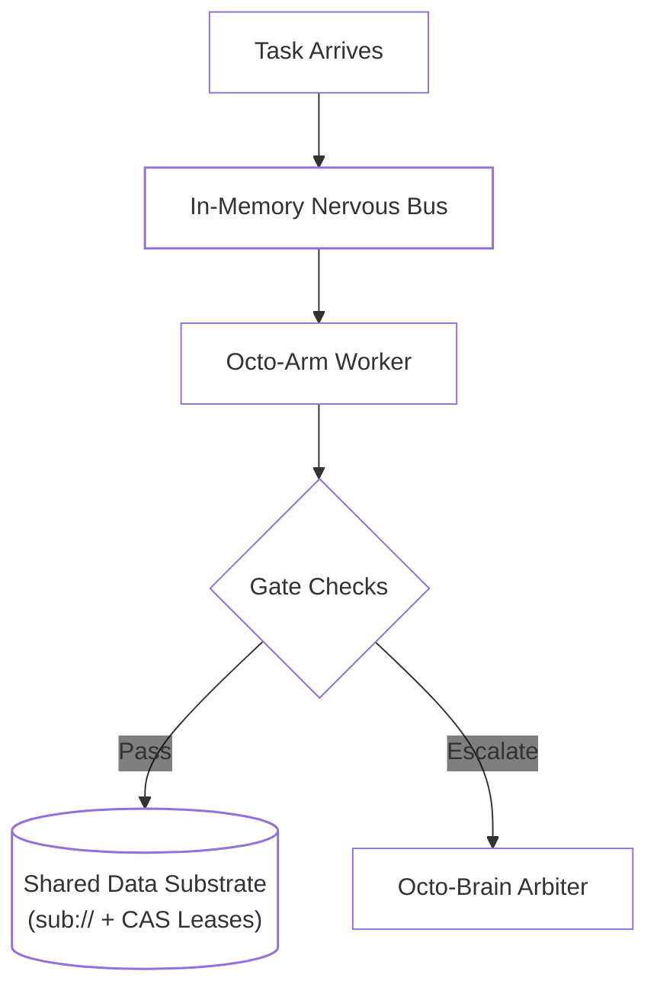

# Local Quickstart Example

[Chinese Version](README_CN.md)

This example demonstrates the zero-dependency, single-node in-memory kernel of Octpex:
- Dual-plane in-memory bus (`Vertical Dispatch` and `Lateral Handoff`)
- Compare-And-Swap (CAS) state synchronization over `sub://` references
- Objective escalation funnel with Gate 1, Gate 2, and Gate 3 checks
- FinOps token savings and cost telemetry



## Running the Example

```bash
go run examples/local_quickstart/main.go
```
