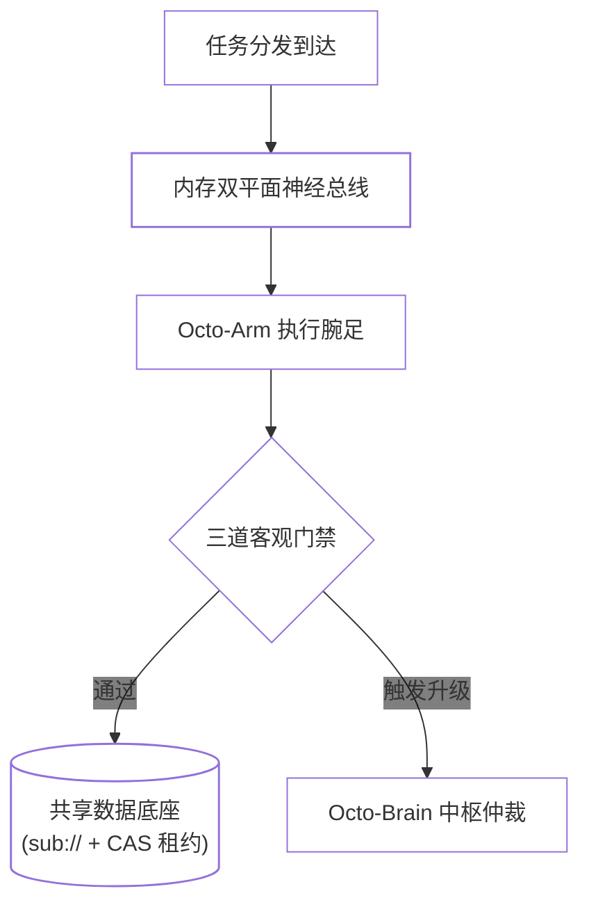

# 单机极速体验快速入门示例

[English](README.md)

本示例展示 Octpex 零外部依赖的单机内存核心运行机制：
- 双平面内存总线（纵向派发信封与横向同级接力）
- 基于 `sub://` 零拷贝指针的 Compare-And-Swap（CAS）原子版本基质
- 三道客观确定性硬门禁（Gate 1 前置策略、Gate 2 格式/AST 校验、Gate 3 数学质检）
- FinOps Token 降本与财务收益实时审计



## 运行示例

```bash
go run examples/local_quickstart/main.go
```
