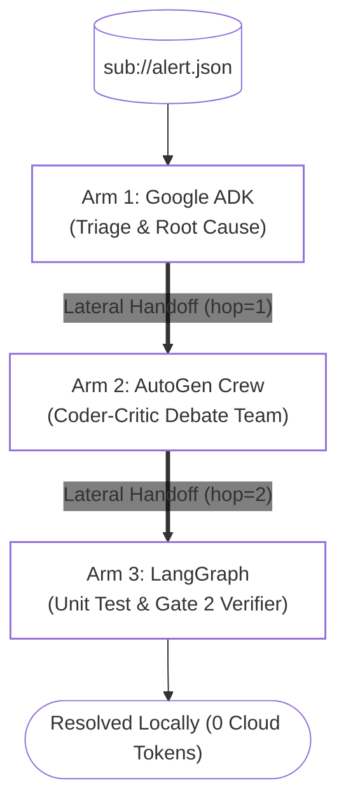

# Python Heterogeneous Multi-Agent Mesh Example

[Chinese Version](README_CN.md)

This example demonstrates seamless biomimetic lateral coordination across heterogeneous agent frameworks using the Octpex Python SDK:
- **Arm 1 (Google ADK)**: Wrapped single agent diagnosing raw incident telemetry.
- **Arm 2 (Microsoft AutoGen)**: Coder-critic multi-agent debate crew synthesizing code patches.
- **Arm 3 (LangGraph)**: Stateful cyclic workflow agent executing unit tests and Gate 2 verification.
All exchanging zero-copy pointers over the Shared Data Substrate (`sub://`).



## Running the Example

```bash
python examples/python_heterogeneous_mesh/main.py
```
