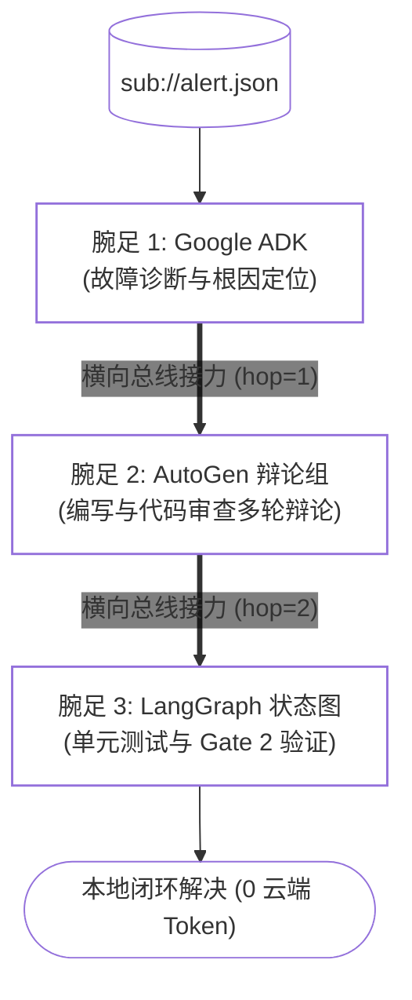

# Python 异构多框架多智能体协同示例

[English](README.md)

本示例展示使用 Octpex Python SDK 将不同技术栈的 Agent 框架封装为标准化腕足，并通过横向总线与共享数据底座实现点对点协同：
- **腕足 1（Google ADK）**：单智能体封装，负责原始告警初筛与根因定位；
- **腕足 2（Microsoft AutoGen）**：多智能体辩论组，由 Coder 与 Critic 进行多轮代码生成辩论；
- **腕足 3（LangGraph）**：循环图工作流智能体，执行单元测试与 Gate 2 确定性校验。
所有智能体之间通过 `sub://` 零拷贝指针引用共享数据底座，避免多进程大报文反复拷贝。



## 运行示例

```bash
python examples/python_heterogeneous_mesh/main.py
```
