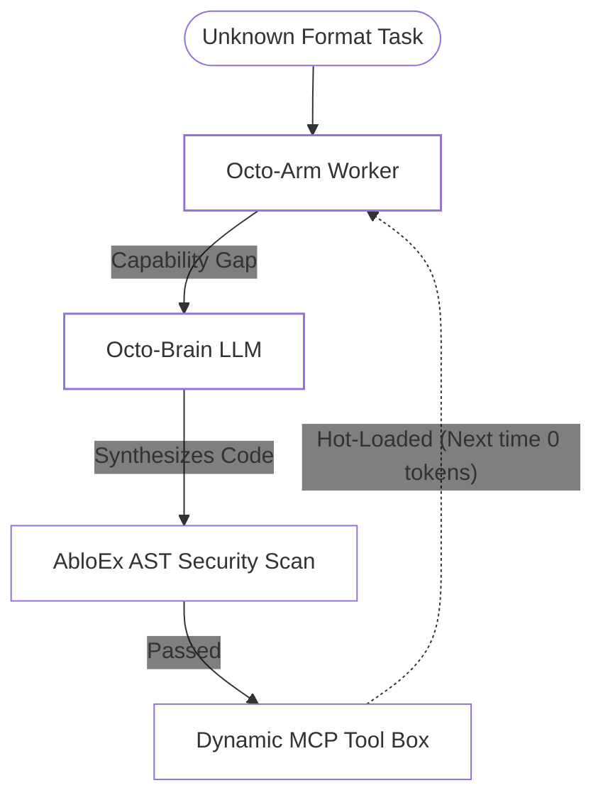

# Self-Evolving Dynamic Tool Synthesis Example

[Chinese Version](README_CN.md)

This example demonstrates the complete "Brain-teaches-Arm" capability distillation closed loop:
1. **Octo-Arm** encounters an unknown unstructured log format and exhausts local retries.
2. The task escalates to the **Octo-Brain**, which writes a dedicated parser script.
3. The script passes pre-admission AST security scanning (AbloEx sandbox).
4. The synthesized tool is compiled and hot-deployed into the **Dynamic MCP Box**.
5. Subsequent tasks are resolved by edge arms locally with **zero cloud tokens**!



## Running the Example

```bash
go run examples/self_evolving_parser/main.go
```
