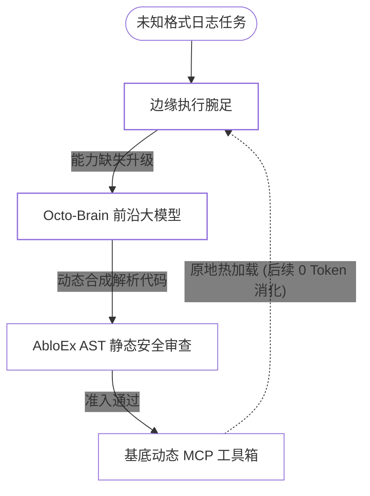

# 跨层自进化与动态 MCP 工具合成示例

[English](README.md)

本示例完整演示“大脑教腕足”能力蒸馏自进化闭环：
1. **边缘腕足**遇到未知的非结构化日志，本地反射重试耗尽；
2. 任务升级至 **Octo-Brain 中枢大模型**，中枢大模型动态编写出一段专用的解析器脚本；
3. 动态脚本通过 AbloEx 安全沙盒的准入静态 AST 语法树扫描（拦截恶意系统调用）；
4. 合成工具编译并热加载至**基底动态 MCP 工具箱**；
5. 后续同类格式任务由边缘腕足直接就地调用该工具消化，**实现 0 云端 Token 闭环**！



## 运行示例

```bash
go run examples/self_evolving_parser/main.go
```
