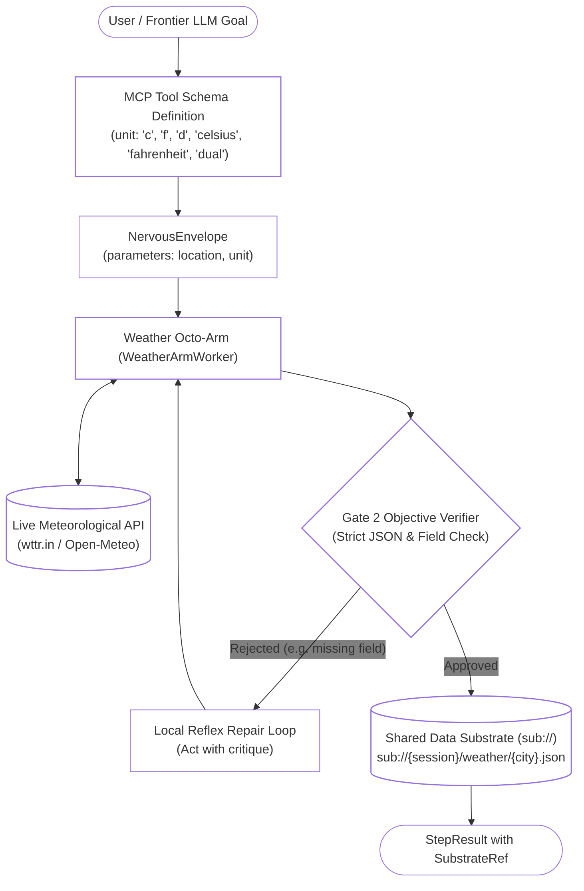

# Weather Tool & Octo-Arm MCP Integration Example

[Chinese Version](README_CN.md)

This example demonstrates how a standard Function Calling / MCP (Model Context Protocol) tool schema is converted into a production-grade, distributed Octpex Octo-Arm, querying **real-time live meteorological APIs**:



---

## Key Architectural Concepts

1. **Flexible Unit System (Shorthands 'c', 'f', 'd' & Full Names)**:
   - **`c` / `celsius`**: Celsius (e.g., Beijing returning `7.0°C`).
   - **`d` / `dual`**: Dual mode returning both Fahrenheit and Celsius (e.g., Los Angeles returning `59.0°F (15.0°C)`).
   - **`f` / `fahrenheit`**: Fahrenheit (e.g., London returning `41.0°F`).
2. **Live Meteorological API Integration (Zero Fake Data)**:
   Directly queries global live weather services (`wttr.in`) returning actual live observations.
3. **JSON Schema Tool Contract**:
   Standard tool definition declaring parameter types, required keys, and descriptions for LLM discovery and function calling.
4. **Biomimetic Octo-Arm Wrapping (`OctoArmWorker`)**:
   Encapsulates the tool inside the local reflex loop: `Act -> Inspect (Gate 2) -> Self-Repair`.
5. **Objective Gate 2 Verification**:
   Enforces that live API output strictly satisfies mandatory schema contracts (e.g. `location`, `temperature`, `display`, `condition`) before passing downstream.
6. **Pass-by-Reference Substrate Persistence (`sub://`)**:
   Structured reports are written to the atomic Redis CAS substrate, returning lightweight `sub://` references to prevent payload bloat.

---

## Running the Demo

### 1. Full Arm Reflex Loop & Objective Gate 2 Verification (Python)

```bash
python examples/weather_mcp_arm/main.py
```

- **Scenario A**: Beijing query with shorthand `unit="c"` -> outputs live Celsius `7.0°C` and persists to `sub://.../weather/beijing.json`.
- **Scenario B**: Los Angeles query with shorthand `unit="d"` -> outputs live `59.0°F (15.0°C)` and persists to `sub://.../weather/los_angeles.json`.
- **Scenario C**: London query with shorthand `unit="f"` -> triggers Gate 2 missing field interception, executes local SLM reflex self-repair, and completes without escalating to central Octo-Brain.

---

### 2. Standalone Arm Worker HTTP Service & Invocation via curl

Start the standalone Weather Arm Worker HTTP daemon (listening on port 8081):

```bash
python examples/weather_mcp_arm/server.py 8081
```

Invoke using `curl`:

#### Method A: Inspect the Arm Registration Card (`GET /manifest`)
```bash
curl http://localhost:8081/manifest
```

#### Method B: Vertical Envelope Dispatch (`POST /api/v1/dispatch`)
```bash
curl -X POST http://localhost:8081/api/v1/dispatch \
  -H "Content-Type: application/json" \
  -d '{
    "target_capability": "get_current_temperature",
    "parameters": {
      "location": "Paris",
      "unit": "c"
    }
  }'
```

#### Method C: Direct Query (`GET /weather`)
```bash
curl "http://localhost:8081/weather?location=Sydney&unit=dual"
```

---

### 3. Orchestrating the Arm from Central Octpex Daemon (CLI / curl)

In a real deployment, Octpex has one central Brain (`octpex run`, listening on port 8080).
Dispatch tasks to the central gateway:

```bash
curl -X POST http://localhost:8080/api/v1/dispatch \
  -H "Content-Type: application/json" \
  -d '{
    "target_capability": "get_current_temperature",
    "parameters": {
      "location": "Paris",
      "unit": "c"
    }
  }'
```

---

### 4. Interactive Dialogue & Auto-Registration on 8080 Dashboard

When running `make run`, opening **`http://localhost:8080`** displays the full-featured Biomimetic Nervous System Dashboard and Interactive Dialogue Console.

#### 4.1 Arm Auto-Registration & Heartbeat Mechanism
* **Why the Arm Was Previously Not Listed**: Previously, Octpex only rendered arms registered statically inside memory (such as built-in Telemetry arms). External Python/Node arms running on independent ports (e.g. 8081) lacked an HTTP registration gateway and an automatic bootstrap handshake.
* **Current End-to-End Registration Loop**:
  1. **Central Brain HTTP Gateway**: The central kernel exposes `POST /api/v1/register` and `POST /api/v1/heartbeat`. Upon registration, it dynamically binds a reverse HTTP proxy forwarder on the nervous bus for that capability.
  2. **Python Arm Auto-Registration Daemon**: When `server.py` starts, `start_auto_registration` spawns a background thread that POSTs `arm.yaml` metadata (`arm_id: arm-weather-mcp`, capability `get_current_temperature`, endpoint `http://127.0.0.1:8081`) to the central Brain, followed by heartbeats every 5 seconds.
  3. **Live Topology Visualization**: The 8080 dashboard polls topology and dynamically renders the arm under **3. OCTO-ARMS MESH** with a green status indicator, endpoint badge, and capability tags.

#### 4.2 Interactive Biomimetic Dialogue Panel
The top section of the 8080 dashboard provides a natural language chat interface:
* **Preset Prompt Chips**: Click on chips like `Beijing Temperature` (Beijing temp), `Tokyo Weather (Dual)` (Tokyo dual unit), `Paris Weather` (Paris weather), or `Telemetry Analysis` (distill-telemetry) to send immediately.
* **Natural Language Dispatch**: Entering a query like "What is the current weather in Paris?" invokes `/api/v1/chat`. The brain constructs a vertical nervous envelope, routes it to the registered weather arm over the bus, and prints the formatted meteorological report.
* **Live SSE Stream**: The Server-Sent Events window below displays real-time `ARM_REGISTERED` and `ENVELOPE_DISPATCH` pulses.

#### 4.3 Arm Lifecycle Management: Self-Registration vs Managed Config
Octpex supports two arm lifecycle strategies to decouple central brain from heterogeneous edge nodes:
1. **Autonomous Edge Self-Registration (Default for Weather Arm)**:
   * The arm runs as an independent microservice (e.g., `python server.py 8081`), reads its local `arm.yaml`, and registers itself to the central brain at boot. It allows seamless hot-plugging across different languages and machines.
2. **Managed / Config-Driven Mode**:
   * For production daemon deployments, arms can be declared in central config files (e.g., `configs/local.yaml` or `configs/cluster.yaml`) under `daemon.managed_arms`. The `octpex daemon` initializes and supervises them centrally.
3. **Cloud-Native Kubernetes Mode**:
   * Arms are deployed as K8s Pods with `OCTPEX_BRAIN_URL=http://octpex-brain:8080` injected as an environment variable. K8s handles scaling and health checks while the arm auto-registers to the central service.

---

### 5. Model-Driven Semantic Disambiguation & Zero-Fake Data Policy

#### 5.1 Model-Driven MCP Parameter Resolution (Rejecting Rigid Hardcoded Tables)
* **No Rigid Hardcoded Tables**: Agentic architectures reject static lookup tables (such as a hardcoded static dictionary). Entity disambiguation and administrative hierarchy mapping are dynamically performed by the Frontier LLM (Brain) or local Ganglion SLM.
* **Driven by MCP Tool Schemas & Skill Definitions**:
  * Arms declare parameter contracts and expectations in their MCP tool schemas (`WEATHER_TOOL_DEFINITION`);
  * Models inspect the schema and automatically transform natural language into canonical tool arguments (e.g. converting "Washington" into `Washington, D.C.`);
* **Common-Sense Defaults & Interactive Clarification**:
  * **Common-Sense Defaults**: When natural language lacks qualification, the model applies prevailing common-sense defaults (e.g. 'Chaoyang' defaults to Beijing Chaoyang District; 'Washington' defaults to Washington, D.C.);
  * **Honoring Qualifications**: If the user provides explicit context (e.g. 'Chaoyang, Liaoning' or 'Washington State'), the model resolves to Chaoyang, Liaoning or the State of Washington;
  * **Interactive Clarification**: If natural language is completely ambiguous or lacks location entirely, the agent politely prompts the user for clarification rather than making assumptions.

#### 5.2 Zero-Trust & No Silent Fallback Policy
The system strictly prohibits silent fake data fallbacks:
1. **No Assumed Cities**: When a user asks for weather without specifying a location, the system prompts for clarification instead of defaulting to Beijing;
2. **True Network Error Reporting**: If public meteorological APIs are unreachable, the system raises `ConnectionError: External meteorological API unreachable` rather than returning cached or synthetic dummy data;
3. **Explicit Simulation Mode**: Offline simulation requires explicit activation via `OCTPEX_ALLOW_OFFLINE_SIMULATION=1`, and results are visibly watermarked with `[Offline Simulation - No External Connectivity]`.
