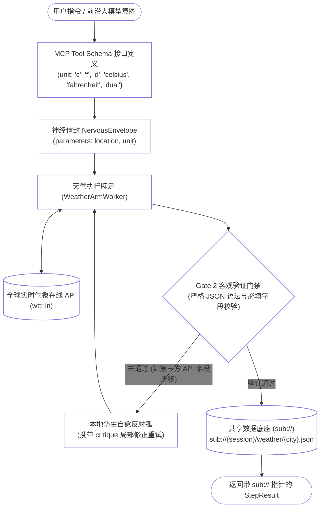

# 天气工具与 MCP 腕足接入示例 (真实在线 API)

[English](README.md)

本示例完整演示如何将一个对接**真实公开气象 API（拒绝模拟假数据）**的 Function Calling / MCP（模型上下文协议）JSON Schema 工具，封装为一个具备客观门禁与零拷贝存证特性的生产级 Octpex 腕足（Octo-Arm）：



---

## 核心设计要点

1. **灵活简写温标支持（简写 `c`、`f`、`d` 及全称）**：
   - **`c` / `celsius`**：摄氏度模式（如北京实时返回 `7.0°C`）；
   - **`d` / `dual`**：双显模式（如洛杉矶同时返回华氏度与摄氏度 `59.0°F (15.0°C)`）；
   - **`f` / `fahrenheit`**：华氏度模式（如伦敦返回 `41.0°F`）；
   - 字段中同时提供数值型 `temp_c`、`temp_f`、请求的 `unit` 与标准化的 `canonical_unit`，以及排版好的 `display`。
2. **真实在线气象数据（拒绝静态假数据）**：
   直接通过公开气象 API（`wttr.in`）动态实时抓取全球各大城市（北京、洛杉矶、伦敦等）的实时气温、湿度、风速和天气实况。
3. **标准 JSON Schema 契约**：
   定义与 OpenAI Function Calling / Anthropic MCP 完全兼容的工具声明（`name`、`description`、`parameters`、`required`），方便大模型意图匹配与参数提取。
4. **Gate 2 客观硬门禁（防 API 字段漂移与幻觉瞒报）**：
   在输出传递给下游前，强制执行字段完整性校验（必须包含 `location`、`temperature`、`display`、`condition` 等），若外部接口发生字段变更或丢失时立即拦截并指导重试。
5. **共享底座零拷贝存证（`sub://`）**：
   查询出的天气报告自动写入 Redis CAS 底座，下游或上级调度只接收极轻量的 `sub://` 指针引用。

---

## 运行演示

### 1. 完整腕足反射弧与客观门禁演示 (Python)

运行单体腕足工作流验证（加载 `arm.yaml`，执行真实 API 抓取、Gate 2 客观校验与本地小模型自愈）：

```bash
python examples/weather_mcp_arm/main.py
```

- **场景 A**：北京天气实时查询（简写 `unit="c"`），输出实时气温 `7.0°C`，通过 Gate 2 门禁并写入 `sub://.../weather/beijing.json`；
- **场景 B**：洛杉矶天气实时查询（简写 `unit="d"`），输出双显 `59.0°F (15.0°C)` 并存入共享底座；
- **场景 C**：伦敦天气实时查询（简写 `unit="f"`），模拟首轮输出缺失必填字段，Gate 2 客观门禁精准拦截并触发本地 SLM 反射自愈，1 轮重试后成功修复，避免向上惊动大脑。

---

### 2. 启动腕足服务并使用 curl 调用 (REST / HTTP)

启动独立的腕足 HTTP Worker 服务（监听 8081 端口）：

```bash
python examples/weather_mcp_arm/server.py 8081
```

在任意终端中通过 `curl` 即可调用：

#### 方式 A：查看腕足向大脑暴露的注册卡 (`GET /manifest`)
```bash
curl http://localhost:8081/manifest
```

#### 方式 B：自顶向下传递仿生信封参数 (`POST /api/v1/dispatch`)
```bash
curl -X POST http://localhost:8081/api/v1/dispatch \
  -H "Content-Type: application/json" \
  -d '{
    "target_capability": "get_current_temperature",
    "parameters": {
      "location": "Paris",
      "unit": "c"
    }
  }'
```

#### 方式 C：快速 GET 查询 (`GET /weather`)
```bash
curl "http://localhost:8081/weather?location=Sydney&unit=dual"
```

---

### 3. 在 Octpex 总大脑中调度该腕足 (CLI / curl)

在实际生产集群中，中央大脑只有一个（即 Go 内核 `octpex run`，监听 8080 端口）。
通过向 Octpex 总大脑发送纵向神经信封，内核将自动路由至天气腕足：

```bash
curl -X POST http://localhost:8080/api/v1/dispatch \
  -H "Content-Type: application/json" \
  -d '{
    "target_capability": "get_current_temperature",
    "parameters": {
      "location": "Paris",
      "unit": "c"
    }
  }'
```

---

### 4. 8080 控制台自然语言对话与腕足自动接入机制

启动 `make run` 后，在浏览器中打开 **`http://localhost:8080`**，即可体验全功能仿生看板与智能对话总控。

#### 4.1 腕足自动接入与心跳机制（为什么此前未列出天气腕足？）
* **此前未列出原因**：此前 Octpex 核心仅展示了内置常驻内存的内核腕足（如 Telemetry 腕足），而外部 Python/Node 腕足监听在独立端口（8081），缺乏向中央中枢上报元数据的通道与自举机制。
* **现已建立的接入闭环**：
  1. **Go 核心注册接口**：中枢内核提供了 `POST /api/v1/register` 和 `POST /api/v1/heartbeat` 接口，并在收到注册后自动在神经总线建立反向 HTTP 代理转发通道；
  2. **Python 腕足后台自注册**：`server.py` 启动时通过 `start_auto_registration` 守护线程自动将 `arm.yaml` 声明的元数据（`arm_id: arm-weather-mcp`、能力 `get_current_temperature`、端点 `http://127.0.0.1:8081`）提交至中枢，并每 5 秒自动维持一次心跳；
  3. **拓扑即时点亮**：8080 控制台实时轮询拓扑，在 **3. OCTO-ARMS MESH** 中点亮显示天气腕足卡片（显示 Arm ID、Role Name、Endpoint 及能力徽标）。

#### 4.2 控制台自然语言对话框 (Interactive Dialogue Panel)
8080 页面顶部的对话总控面板支持直接使用自然语言与仿生智能体交互：
* **快捷测试胶囊 (Chips)**：页面提供 `北京当前气温`、`东京天气 (双显)`、`巴黎天气`、`上海天气`、`遥测分析 (distill-telemetry)` 等胶囊，点击即可一键发送；
* **自然语言意图派发**：输入例如“查询北京今天气温”，中枢通过 `/api/v1/chat` 识别并构造垂直神经信封，通过神经母线垂直派发给天气腕足，实时获取气象数据并在对话窗口中格式化输出；
* **实时脉冲监听**：下方的 SSE 脉冲流窗口会同步滚出 `ARM_REGISTERED` 与 `ENVELOPE_DISPATCH` 事件。

#### 4.3 腕足生命周期管理：自注册 vs 集中配置
Octpex 支持两种腕足启动与管理模式，解耦中央大脑与异构边缘：
1. **边缘自治自注册模式（Autonomous Self-Registration / 本天气腕足默认）**：
   * 腕足作为一个独立微服务运行（例如 `python server.py 8081`），由自身读取本地 `arm.yaml`，启动时主动向大脑报到并维持心跳。支持跨语言（Python、Node、Rust）、跨网络边缘节点无缝热插拔。
2. **守护进程托管配置模式（Managed / Config-Driven 模式）**：
   * 在生产环境或 Docker 单机守护部署中，可以在系统配置文件（如 `configs/local.yaml` 或 `configs/cluster.yaml`）的 `daemon.managed_arms` 字段声明要自动启动的腕足，由 `octpex daemon` 统一编排并维持生命周期。
3. **云原生 K8s 编排模式**：
   * 在 Kubernetes 中通过 Pod 部署腕足，通过环境变量注入 `OCTPEX_BRAIN_URL=http://octpex-brain:8080`，由 K8s 管理副本扩缩与健康探针，腕足自举注册。

---

### 5. 模型自主感知参数消歧与零假数据原则

#### 5.1 模型自主语义消歧与参数转换机制（拒绝死配置）
* **拒绝硬编码死配置**：智能体系统严禁在代码中编写静态地名词典（如硬编码的 `CANONICAL_GEO_KNOWLEDGE_BASE`）。地名、层级与歧义应交由大模型（Octo-Brain）或小脑（Ganglion SLM）自主认知推理。
* **MCP Schema 与 Skill 驱动自动转参**：
  * 腕足在其 MCP 工具定义（`WEATHER_TOOL_DEFINITION`）中清楚声明参数规范与消歧期望；
  * 模型发现工具参数要求后，自动将用户的口语化自然语言提炼并标准化为权威查询参数（如将“华盛顿”转为 `Washington, D.C.`）；
* **常识缺省与主动反问确认机制**：
  * **常识缺省**：遇到未加限定的通用地名时，模型结合上下文与通用常识采用最合理的缺省（例如：“朝阳”缺省判定为北京市朝阳区，“华盛顿”缺省判定为美国首都华盛顿特区）；
  * **尊重指定**：若用户显式指定了区域（如“辽宁朝阳”或“华盛顿州”），模型精准推断为辽宁省朝阳市或 Washington State；
  * **主动反问澄清 (Clarification / HITL)**：当自然语言意图极度模糊且关键信息缺失（如用户仅输入“查天气”而未给出任何地点）时，智能体主动向用户发起澄清反问：“请问您想查询哪个城市或地区的天气？例如：华盛顿特区、北京朝阳、辽宁朝阳或巴黎。”，绝不自作主张。

#### 5.2 零假数据与透明降级原则 (No Silent Fallback)
系统杜绝“暗度陈仓”式的隐蔽假数据兜底：
1. **未指定城市不盲目兜底**：若用户未输入城市名称，系统绝不擅自假设为“北京”，而是主动提示用户补充具体城市；
2. **无外网连接真实报错**：若运行环境无网络连接或公共气象 API（`wttr.in`）不可达，系统直接抛出 `ConnectionError: 外部气象网络不可达`，如实反映网络状态；
3. **显式离线模拟必须明确标明**：仅当显式声明环境变量 `OCTPEX_ALLOW_OFFLINE_SIMULATION=1` 时，系统才允许输出基准模拟数据，且数据展示强制附加 `[离线模拟-无外网连接]` 显式水印，绝不隐瞒真实数据来源。
